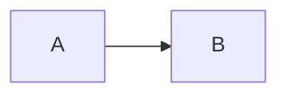
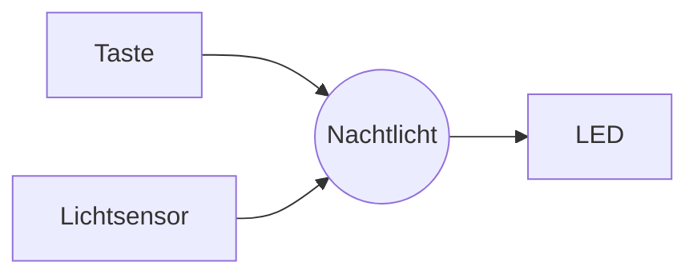
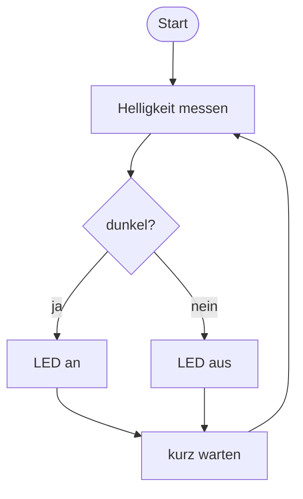
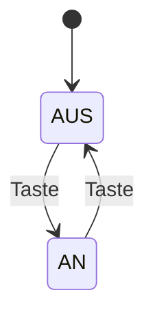
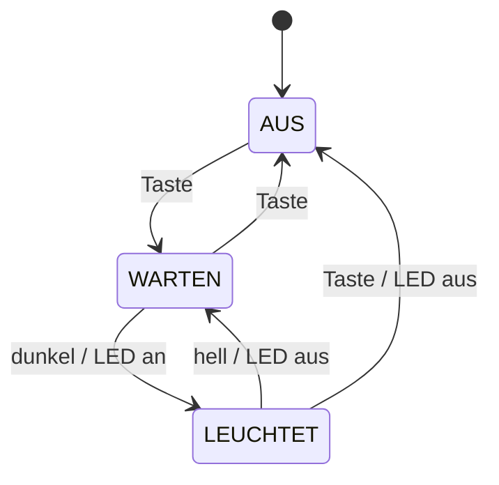

+++
title = "Diagramme mit Mermaid"
weight = 6
+++

**Mermaid** zeichnet Diagramme aus Text. Du beschreibst in ein paar Zeilen, welche Kästchen es gibt und welche Pfeile sie verbinden, und Mermaid macht daraus eine Grafik. Weil das Diagramm nur Text ist, steht es direkt in deiner Markdown-Datei, lässt sich mit Git versionieren und ist in Sekunden geändert. Kein Zeichenprogramm, kein Screenshot, der veraltet.

## So schreibst du einen Mermaid-Block

Ein Mermaid-Diagramm ist ein [Code-Block]({}) mit der Sprache `mermaid`:

````markdown

````

wird zu


Die **erste Zeile** im Block sagt, welche Art von Diagramm du willst. Für dieses Buch brauchst du zwei: `flowchart` und `stateDiagram-v2`.

{}
**GitHub** und **dieses Buch** zeigen den Block als Grafik. **Thonny** und viele Editoren zeigen nur den Text. Zum Ausprobieren nimm den Online-Editor [mermaid.live](https://mermaid.live): links tippen, rechts sofort das Bild sehen.
{}

## Flussdiagramm: `flowchart`

### Richtung

Gleich nach `flowchart` kommt die Richtung:

| Kürzel | Richtung |
|--------|----------|
| `LR` | von links nach rechts |
| `TD` | von oben nach unten |

### Knoten

Jeder Knoten hat eine **ID** (kurz, ohne Leerzeichen und Umlaute) und eine **Beschriftung**. Die Klammern um die Beschriftung bestimmen die Form:

| Du schreibst | Form | Wofür |
|--------------|------|-------|
| `A[Text]` | Rechteck | Schritt, Bauteil |
| `A([Text])` | abgerundet | Start, Ende |
| `A{Text}` | Raute | Entscheidung, Frage |
| `A((Text))` | Kreis | das Gerät selbst |

Hast du einen Knoten einmal beschriftet, reicht danach die ID.

### Pfeile

| Du schreibst | Bedeutung |
|--------------|-----------|
| `A --> B` | Pfeil |
| `A -->\|ja\| B` | Pfeil mit Beschriftung |
| `A --- B` | Linie ohne Spitze |

### Beispiel 1: Eingaben → Gadget → Ausgaben

So skizziert ihr in [Woche 2]({}) euer Gadget:



````markdown

````

### Beispiel 2: Ablaufplan mit Entscheidung

Mit einer **Raute** und beschrifteten Pfeilen zeichnest du ein `if`:


````markdown

````

Der Pfeil von `W` zurück zu `M` ist die `while True`-Schleife.

## Zustandsdiagramm: `stateDiagram-v2`

Ein Zustandsdiagramm zeigt, in welchen **Zuständen** ein Gerät sein kann und welches **Ereignis** es von einem Zustand in den nächsten bringt. Mehr dazu in [Woche 4]({}).

| Du schreibst | Bedeutung |
|--------------|-----------|
| `[*] --> AUS` | Startzustand ist AUS |
| `AUS --> AN: Taste` | Übergang von AUS nach AN beim Ereignis „Taste" |
| `AN --> AUS: Taste / LED aus` | Ereignis **/** was dabei passiert |
| `AUS --> [*]` | Endzustand (brauchst du selten) |

Zustände musst du nicht extra anlegen. Sobald ein Name in einem Pfeil vorkommt, gibt es ihn.

### Beispiel 3: Der Schalter



````markdown

````

### Beispiel 4: Das Nachtlicht



````markdown

````

## Wenn das Diagramm nicht erscheint

Mermaid ist streng: Ein einziger Tippfehler, und statt der Grafik kommt eine Fehlermeldung oder gar nichts. Prüfe der Reihe nach:

- Beginnt der Block mit ```` ```mermaid ```` (klein geschrieben) und endet er mit ```` ``` ````?
- Stimmt die erste Zeile genau: `flowchart LR`, `flowchart TD` oder `stateDiagram-v2`?
- Sind die **IDs** ohne Leerzeichen, Umlaute und Sonderzeichen? `LED_AN` geht, `LED an` nicht.
- Enthält eine Beschriftung Klammern oder Anführungszeichen? Dann setze sie in Anführungszeichen: `A["Taste (rot)"]`.
- Heißt ein Knoten im Flussdiagramm `end`? Das ist ein reserviertes Wort. Nimm `Ende` oder `E([Ende])`.
- Pfeil richtig geschrieben? Es sind **zwei** Striche: `-->`.

{}
Überleg dir das Diagramm zuerst mit Stift und Papier. Mermaid ist zum sauberen Abschreiben da, nicht zum Nachdenken. Wenn es in mermaid.live funktioniert, kopierst du den Block in deine `.md`-Datei.
{}

## Mehr

- [mermaid.live](https://mermaid.live): Online-Editor mit Sofort-Vorschau
- [Diagramme auf GitHub erstellen](https://docs.github.com/de/get-started/writing-on-github/working-with-advanced-formatting/creating-diagrams) (deutsch)
- [Mermaid-Dokumentation](https://mermaid.js.org/intro/) mit allen Diagrammarten (englisch)
