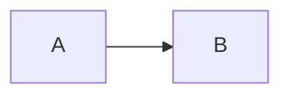
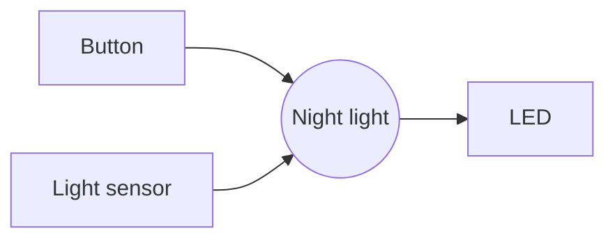
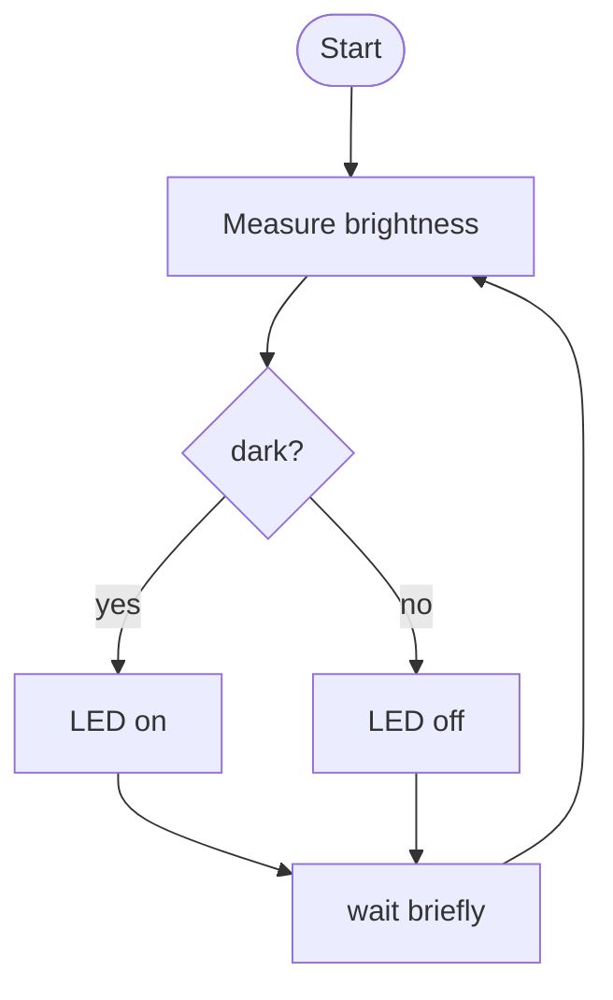
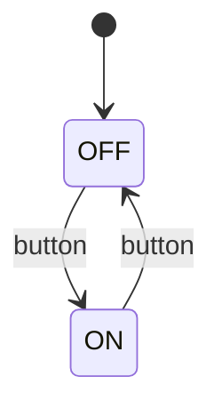
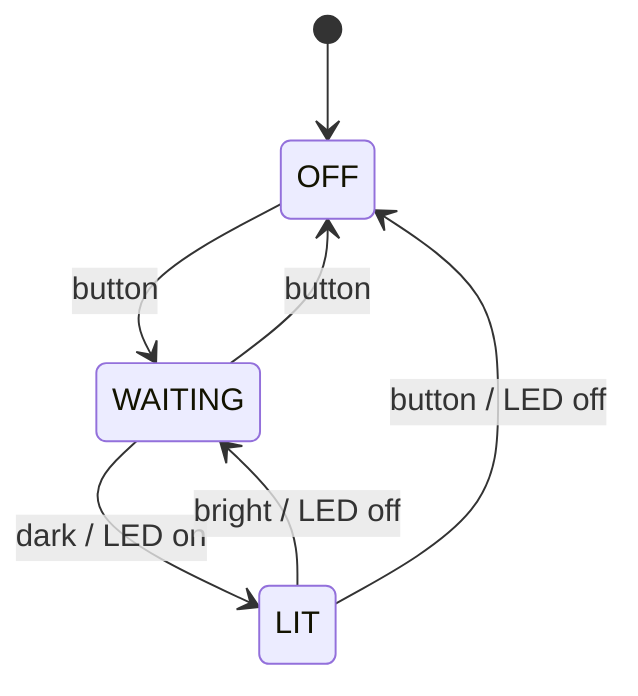

+++
title = "Diagrams with Mermaid"
weight = 6
+++

**Mermaid** draws diagrams from text. You describe in a few lines which boxes there are and which arrows connect them, and Mermaid turns that into a picture. Because the diagram is just text, it lives right inside your Markdown file, can be versioned with Git and is changed in seconds. No drawing program, no screenshot that goes out of date.

## How to write a Mermaid block

A Mermaid diagram is a [code block]({}) with the language `mermaid`:

````markdown

````

becomes


The **first line** in the block says which kind of diagram you want. For this book you need two: `flowchart` and `stateDiagram-v2`.

{}
**GitHub** and **this book** show the block as a picture. **Thonny** and many editors only show the text. To try things out, use the online editor [mermaid.live](https://mermaid.live): type on the left, see the picture on the right straight away.
{}

## Flowchart: `flowchart`

### Direction

Right after `flowchart` comes the direction:

| Code | Direction |
|------|-----------|
| `LR` | left to right |
| `TD` | top to bottom |

### Nodes

Every node has an **ID** (short, no spaces or special characters) and a **label**. The brackets around the label decide the shape:

| You write | Shape | Used for |
|-----------|-------|----------|
| `A[Text]` | rectangle | step, component |
| `A([Text])` | rounded | start, end |
| `A{Text}` | diamond | decision, question |
| `A((Text))` | circle | the device itself |

Once a node has a label, the ID alone is enough after that.

### Arrows

| You write | Meaning |
|-----------|---------|
| `A --> B` | arrow |
| `A -->\|yes\| B` | arrow with a label |
| `A --- B` | line without a tip |

### Example 1: inputs → gadget → outputs

This is how you sketch your gadget in [week 2]({}):



````markdown

````

### Example 2: flowchart with a decision

With a **diamond** and labelled arrows you draw an `if`:


````markdown

````

The arrow from `W` back to `M` is the `while True` loop.

## State diagram: `stateDiagram-v2`

A state diagram shows which **states** a device can be in and which **event** takes it from one state to the next. More on this in [week 4]({}).

| You write | Meaning |
|-----------|---------|
| `[*] --> OFF` | the start state is OFF |
| `OFF --> ON: button` | transition from OFF to ON on the event "button" |
| `ON --> OFF: button / LED off` | event **/** what happens along the way |
| `OFF --> [*]` | end state (rarely needed) |

You don't have to declare states separately. As soon as a name appears in an arrow, it exists.

### Example 3: the switch



````markdown

````

### Example 4: the night light



````markdown

````

## When the diagram doesn't appear

Mermaid is strict: a single typo, and instead of the picture you get an error message or nothing at all. Check in this order:

- Does the block start with ```` ```mermaid ```` (lower case) and end with ```` ``` ````?
- Is the first line exactly `flowchart LR`, `flowchart TD` or `stateDiagram-v2`?
- Are the **IDs** free of spaces and special characters? `LED_ON` works, `LED on` doesn't.
- Does a label contain brackets or quotes? Then put it in quotation marks: `A["Button (red)"]`.
- Is a flowchart node called `end`? That is a reserved word. Use `End` or `E([End])`.
- Is the arrow written correctly? It has **two** dashes: `-->`.

{}
Work out the diagram with pen and paper first. Mermaid is for writing it up neatly, not for thinking. Once it works in mermaid.live, copy the block into your `.md` file.
{}

## More

- [mermaid.live](https://mermaid.live): online editor with instant preview
- [Creating diagrams on GitHub](https://docs.github.com/en/get-started/writing-on-github/working-with-advanced-formatting/creating-diagrams)
- [Mermaid documentation](https://mermaid.js.org/intro/) with every diagram type
