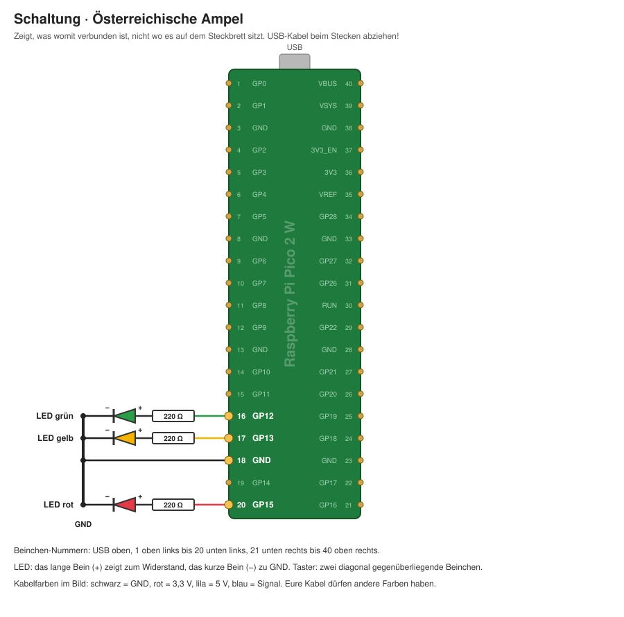
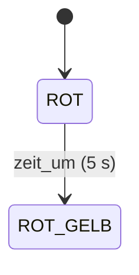
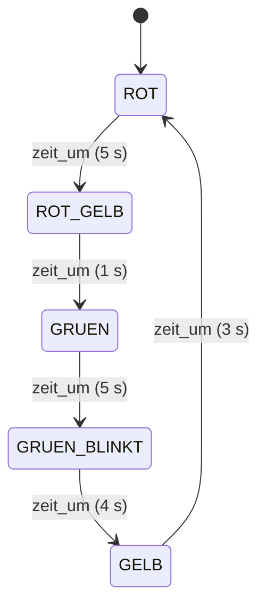

# Bauplan · Österreichische Ampel

**Team:** 265a-team-01 · **Board:** Raspberry Pi Pico 2 W · **Ziel:** alle Karten bis Ende Woche 6 fertig, Vorführung in Woche 7

## So arbeitet ihr mit diesem Bauplan

1. **Teil 1** enthält eure User Stories in überarbeiteter Form. Fangt mit Karte **K0** an.
2. **Teil 2** sind die Karten für euer Kanban-Board. **Ihr entscheidet**, wer welche Karte nimmt und wann. Eine Karte darf erst starten, wenn alle Karten unter „braucht vorher" fertig sind. Höchstens eine Karte pro Person in „In Arbeit".
3. **Teil 3** erklärt jede Karte Schritt für Schritt. Wo im Code `# TODO` steht, schreibt ihr selbst. Wenn ihr hängt, öffnet die Hilfe **der Reihe nach**: zuerst Tipp 1, dann Tipp 2, die Lösung nur, wenn es gar nicht geht. Notiert im Lernjournal, welche Stufe ihr gebraucht habt.

> ⚠️ Bauteile nur stecken, wenn das USB-Kabel **abgezogen** ist. LEDs immer mit Vorwiderstand.

---

## Teil 1 · Unsere User Stories (überarbeitet)

### US1 · Ampelphasen in der richtigen Reihenfolge (Muss)

Als Autofahrer:in möchte ich, dass die Ampel ihre Farben immer in derselben Reihenfolge wechselt, damit ich weiß, wann ich stehen bleiben muss und wann ich fahren darf.

- [ ] Die Ampel läuft ohne Eingriff im Kreis: Rot → Rot-Gelb → Grün → Grün blinkt → Gelb → Rot.
- [ ] Die Dauer stimmt (±0,5 s, mit der Handy-Stoppuhr gemessen): Rot 5 s, Rot-Gelb 1 s, Grün 5 s, Gelb 3 s.
- [ ] Bei Rot leuchtet nur Rot, bei Grün nur Grün, bei Gelb nur Gelb. Nie leuchten Rot und Grün gleichzeitig.

> **Was wir geändert haben:** Eure drei Stories (Straßenverwaltung, Autofahrer, Unternehmer) wollten alle dasselbe: „Die Ampel soll rot anzeigen". Drei Stories mit demselben Verhalten sind eine Story, deshalb gibt es jetzt **eine** mit allen Phasen. „Rot anzeigen" allein kann man nicht prüfen, deshalb stehen jetzt Reihenfolge und Dauer in Sekunden in den Kriterien.

### US2 · Grün blinkt vor dem Gelb (Muss)

Als Autofahrer:in in Österreich möchte ich, dass Grün vor dem Wechsel blinkt, damit ich rechtzeitig bremsen kann.

- [ ] Nach der Grünphase blinkt Grün **4-mal** (je 0,5 s an, 0,5 s aus), dann kommt Gelb.
- [ ] Während des Blinkens leuchten Rot und Gelb nicht.

> **Was wir geändert haben:** Neu dazugekommen. Das Grünblinken gibt es in Österreich wirklich (in Deutschland nicht). Es macht euren Automaten interessanter, weil eine Lampe **innerhalb** eines Zustands an und aus geht.

**Karte K0:** Kopiert Teil 1 in eure `ANFORDERUNGEN.md` (die alten Stories ersetzen) und committet mit der Nachricht `Stories überarbeitet`.

---

## Teil 2 · Karten für euer Kanban-Board

| Karte | Story | braucht vorher | fertig, wenn … |
|-------|-------|----------------|----------------|
| K0 Stories übernehmen | – | – | `ANFORDERUNGEN.md` enthält Teil 1, committet |
| K1 Drei LEDs anschließen | US1 | – | der Testcode lässt Rot, Gelb, Grün nacheinander leuchten |
| K2 Zustandsdiagramm zeichnen | US1, US2 | K0 | Mermaid-Diagramm mit allen 5 Zuständen in `README.md` |
| K3 `naechster_zustand` schreiben | US1 | K2 | Tests zu `naechster_zustand` in K5 sind grün |
| K4 `lampen` schreiben (mit Blinken) | US1, US2 | K2 | Tests zu `lampen` in K5 sind grün |
| K5 `test_logik.py` | US1, US2 | K3, K4 | alle Tests grün am PC |
| K6 `main.py` am Board | US1, US2 | K1, K5 | die Ampel läuft am Board im Kreis |
| K7 Testprotokoll `TESTS.md` | US1, US2 | K6 | jedes Akzeptanzkriterium hat eine Zeile mit ✅ oder ❌ |
| K8 `README.md` fertig | – | K6 | README nach der Vorlage aus Woche 6 |
| K9 Präsentation + Demo-Video | – | K7 | 3-Minuten-Ablauf geprobt, 30-s-Video im Repository |

K1 und K2 können **gleichzeitig** von zwei Personen erledigt werden, ebenso K3 und K4.

---

## Teil 3 · Anleitungen pro Karte

### K1 · Drei LEDs anschließen

Ihr braucht: Pico 2 W, Steckbrett, LED rot, gelb, grün, **drei** Widerstände 220 Ω, Kabel.

| Bauteil | Anschluss |
|---------|-----------|
| LED rot | **GP15** (Beinchen 20) → 220 Ω → langes Bein, kurzes Bein → GND |
| LED gelb | **GP13** (Beinchen 17) → 220 Ω → langes Bein, kurzes Bein → GND |
| LED grün | **GP12** (Beinchen 16) → 220 Ω → langes Bein, kurzes Bein → GND |
| GND | Beinchen **18** liegt genau zwischen den Pins, von dort auf die blaue Randleiste |



Das Bild zeigt, **was womit verbunden** ist, nicht wo es auf dem Steckbrett sitzt.

1. Steckt die drei LEDs untereinander, Rot oben, wie bei einer echten Ampel.
2. Speichert diesen Code in Thonny **auf dem Pico** als `hardware.py` (Datei → Speichern unter → MicroPython-Gerät):

```python
# hardware.py – Raspberry Pi Pico 2 W · Ampel
from machine import Pin

_rot = Pin(15, Pin.OUT)
_gelb = Pin(13, Pin.OUT)
_gruen = Pin(12, Pin.OUT)


def ampel(rot, gelb, gruen):
    """Schaltet die drei Lampen: True = an, False = aus."""
    _rot.value(1 if rot else 0)
    _gelb.value(1 if gelb else 0)
    _gruen.value(1 if gruen else 0)
```

3. Testet im Thonny-Fenster unten (Kommandozeile) Zeile für Zeile:

```python
from hardware import ampel
ampel(True, False, False)    # nur Rot
ampel(False, True, False)    # nur Gelb
ampel(False, False, True)    # nur Grün
ampel(False, False, False)   # alles aus
```

**Leuchtet eine LED nicht?** LED umdrehen (langes Bein zum Pin). Leuchtet die falsche? Kabel an GP13 und GP12 vertauscht.

### K2 · Zustandsdiagramm zeichnen

Eure Ampel hat **5 Zustände**: `ROT`, `ROT_GELB`, `GRUEN`, `GRUEN_BLINKT`, `GELB`. Es gibt nur **ein** Ereignis: `zeit_um` (die Dauer des Zustands ist abgelaufen).

Ergänzt die fehlenden Pfeile und schreibt das Diagramm in `README.md`. Wie Mermaid funktioniert: [Mermaid im Kursbuch](https://glandl.github.io/Coursebook-maker-reise-grade-9/werkzeuge/mermaid/).

````markdown

````

<details>
<summary>Tipp 1</summary>

Es ist ein Kreis: Jeder Zustand hat **genau einen** Pfeil hinaus, und der letzte Pfeil führt zurück zu `ROT`. Schreibt die Dauer jedes Zustands an seinen Pfeil.

</details>

<details>
<summary>Lösung</summary>



</details>

### K3 · `naechster_zustand` schreiben

Nach dem **Automaten-Rezept** aus [Woche 5, Abschnitt 2a](https://glandl.github.io/Coursebook-maker-reise-grade-9/projekte/p1-code-gadget/woche-05-zustandsautomat/): ein `if`-Block pro Zustand, darin ein `if` pro Pfeil. Ihr kennt die Idee schon aus `ampel_liste.py` in Woche 3, jetzt wird daraus ein echter Automat.

Legt am PC eine Datei `logik.py` an (später auch auf den Pico kopieren):

```python
# logik.py – keine Imports von hardware!

DAUER_MS = {
    "ROT": 5000,
    "ROT_GELB": 1000,
    "GRUEN": 5000,
    "GRUEN_BLINKT": 4000,   # 4-mal blinken, je 0,5 s an und 0,5 s aus
    "GELB": 3000,
}


def naechster_zustand(zustand, ereignis):
    """Die Pfeile des Zustandsdiagramms, sonst nichts."""
    if zustand == "ROT":
        if ereignis == "zeit_um":
            return "ROT_GELB"
    elif zustand == "ROT_GELB":
        # TODO
        pass
    # TODO: GRUEN, GRUEN_BLINKT, GELB
    return zustand
```

<details>
<summary>Tipp 1</summary>

Jeder `elif`-Block sieht aus wie der für `ROT`, nur Zustand und Ziel ändern sich. Schaut in euer Diagramm aus K2: Wohin zeigt der Pfeil?

</details>

<details>
<summary>Tipp 2</summary>

```python
    elif zustand == "ROT_GELB":
        if ereignis == "zeit_um":
            return "GRUEN"
    elif zustand == "GRUEN":
        if ereignis == "zeit_um":
            return ...
```

</details>

<details>
<summary>Lösung</summary>

```python
def naechster_zustand(zustand, ereignis):
    """Die Pfeile des Zustandsdiagramms, sonst nichts."""
    if zustand == "ROT":
        if ereignis == "zeit_um":
            return "ROT_GELB"
    elif zustand == "ROT_GELB":
        if ereignis == "zeit_um":
            return "GRUEN"
    elif zustand == "GRUEN":
        if ereignis == "zeit_um":
            return "GRUEN_BLINKT"
    elif zustand == "GRUEN_BLINKT":
        if ereignis == "zeit_um":
            return "GELB"
    elif zustand == "GELB":
        if ereignis == "zeit_um":
            return "ROT"
    return zustand
```

</details>

### K4 · `lampen` schreiben (mit Blinken)

Diese Funktion beantwortet die Frage: **Welche Lampen leuchten in diesem Zustand?** Sie liefert drei Wahrheitswerte `(rot, gelb, gruen)`. Weil Grün **innerhalb** eines Zustands blinkt, bekommt sie zusätzlich, wie viele Millisekunden der Zustand schon dauert.

Ergänzt in `logik.py`:

```python
def lampen(zustand, ms_im_zustand):
    """Liefert (rot, gelb, gruen): welche Lampe leuchtet gerade?"""
    if zustand == "ROT":
        return (True, False, False)
    if zustand == "ROT_GELB":
        return (True, True, False)
    # TODO: GRUEN und GELB
    if zustand == "GRUEN_BLINKT":
        an = False          # TODO: an in den ersten 500 ms, aus in den nächsten 500 ms, …
        return (False, False, an)
    return (False, False, False)
```

<details>
<summary>Tipp 1</summary>

Teilt die Millisekunden durch 500 (ganzzahlig, mit `//`): 0–499 ergibt 0, 500–999 ergibt 1, 1000–1499 ergibt 2 … Bei geraden Zahlen ist Grün an, bei ungeraden aus. Ob eine Zahl gerade ist, verrät der Rest `% 2`.

</details>

<details>
<summary>Tipp 2</summary>

```python
        an = (ms_im_zustand // 500) % 2 == ...
```

</details>

<details>
<summary>Lösung</summary>

```python
    if zustand == "GRUEN":
        return (False, False, True)
    if zustand == "GRUEN_BLINKT":
        an = (ms_im_zustand // 500) % 2 == 0     # 0–499 an, 500–999 aus, …
        return (False, False, an)
    if zustand == "GELB":
        return (False, True, False)
```

</details>

### K5 · `test_logik.py`

Legt `test_logik.py` **am PC** im selben Ordner wie `logik.py` an und startet ihn in Thonny mit dem Interpreter **Lokales Python 3** (wie in [Woche 6, Abschnitt 2b](https://glandl.github.io/Coursebook-maker-reise-grade-9/projekte/p1-code-gadget/woche-06-testen-doku/)).

```python
from logik import naechster_zustand, lampen

TESTS = [
    ("ROT",          "zeit_um", "ROT_GELB"),
    ("ROT_GELB",     "zeit_um", "GRUEN"),
    # TODO: die anderen drei Pfeile
    ("ROT",          None,      "ROT"),       # kein Ereignis: Zustand bleibt
]
LAMPEN_TESTS = [
    ("ROT",          0,    (True, False, False)),
    ("GRUEN_BLINKT", 100,  (False, False, True)),
    ("GRUEN_BLINKT", 700,  (False, False, False)),
    # TODO: je ein Test für ROT_GELB, GRUEN, GELB
]

bestanden = 0
for zustand, ereignis, erwartet in TESTS:
    ergebnis = naechster_zustand(zustand, ereignis)
    if ergebnis == erwartet:
        bestanden = bestanden + 1
        print("ok     ", zustand, "+", ereignis, "→", ergebnis)
    else:
        print("FEHLER ", zustand, "+", ereignis, "→", ergebnis, "erwartet:", erwartet)
for zustand, ms, erwartet in LAMPEN_TESTS:
    ergebnis = lampen(zustand, ms)
    if ergebnis == erwartet:
        bestanden = bestanden + 1
        print("ok     ", zustand, ms, "ms →", ergebnis)
    else:
        print("FEHLER ", zustand, ms, "ms →", ergebnis, "erwartet:", erwartet)

print(bestanden, "von", len(TESTS) + len(LAMPEN_TESTS), "Tests bestanden")
```

**Fertig, wenn** alle Tests grün sind. Dann baut absichtlich einen Fehler in `logik.py` ein: Findet ihn der Test?

### K6 · `main.py` am Board

Die Hauptschleife misst, wie lange der aktuelle Zustand schon dauert. Ist die Dauer aus `DAUER_MS` abgelaufen, entsteht das Ereignis `zeit_um`.

1. Kopiert `logik.py` auf den Pico (Datei → Speichern unter → MicroPython-Gerät).
2. Speichert dort auch `main.py`:

```python
from hardware import ampel
from logik import naechster_zustand, lampen, DAUER_MS
import time

zustand = "ROT"
start = time.ticks_ms()               # wann hat der aktuelle Zustand begonnen?

while True:
    im_zustand = time.ticks_diff(time.ticks_ms(), start)
    ereignis = None
    # TODO: wenn im_zustand mindestens so groß ist wie DAUER_MS[zustand]: ereignis = "zeit_um"

    neu = naechster_zustand(zustand, ereignis)
    if neu != zustand:
        print(zustand, "→", neu)
        zustand = neu
        start = time.ticks_ms()       # neuer Zustand, die Zeit beginnt von vorn
        im_zustand = 0

    rot, gelb, gruen = lampen(zustand, im_zustand)
    ampel(rot, gelb, gruen)
    time.sleep_ms(20)
```

`rot, gelb, gruen = lampen(...)` packt die drei Werte, die `lampen` liefert, in drei Variablen aus.

<details>
<summary>Tipp 1</summary>

`DAUER_MS[zustand]` liefert die Dauer des aktuellen Zustands, z. B. `DAUER_MS["ROT"]` ist 5000. Vergleicht sie mit `im_zustand` mit `>=`.

</details>

<details>
<summary>Lösung</summary>

```python
    if im_zustand >= DAUER_MS[zustand]:
        ereignis = "zeit_um"
```

</details>

**Fertig, wenn** die Ampel nach dem Einstecken von selbst im Kreis läuft und Thonny jeden Wechsel anzeigt.

### K7 · Testprotokoll `TESTS.md`

Eine Person beobachtet die Ampel, eine misst mit der Handy-Stoppuhr, eine trägt ein. Vorlage: [Woche 6, Abschnitt 2c](https://glandl.github.io/Coursebook-maker-reise-grade-9/projekte/p1-code-gadget/woche-06-testen-doku/).

```markdown
| # | Ausgangszustand | Aktion | Erwartet | Beobachtet | ok? |
|---|-----------------|--------|----------|------------|-----|
| 1 | Board eingesteckt | warten | Rot leuchtet, nur Rot | | |
| 2 | Rot | Stoppuhr ab Rot | nach 5 s (±0,5 s) Rot-Gelb | | |
| 3 | Grün | zuschauen | Grün blinkt 4-mal, dann Gelb | | |
| … | | | | | |
```

Eine Zeile pro Akzeptanzkriterium aus Teil 1. Jedes ❌ wird eine neue Karte.

### K8 · `README.md` fertig

Nach der Vorlage aus [Woche 6, Abschnitt 4](https://glandl.github.io/Coursebook-maker-reise-grade-9/projekte/p1-code-gadget/woche-06-testen-doku/). Das Zustandsdiagramm aus K2 gehört hinein, die Hardware-Tabelle aus K1 auch.

### K9 · Präsentation + Demo-Video

Ablauf aus [Woche 6, Abschnitt 5](https://glandl.github.io/Coursebook-maker-reise-grade-9/projekte/p1-code-gadget/woche-06-testen-doku/). Idee für die Demo: Eine Person spielt die Autofahrerin und sagt bei jeder Phase laut, was sie tun muss („Rot: stehen bleiben", „Grün blinkt: bremsbereit"). Nehmt ein 30-s-Handyvideo auf und legt es ins Repository.

---

## Wenn ihr schneller seid

- **Nachtbetrieb:** Mit einer Taste (GP14 ↔ GND) schaltet die Ampel in einen Zustand `NACHT`, in dem nur Gelb blinkt. Nochmal drücken: zurück zu `ROT`. Ihr braucht ein neues Ereignis `taste` und Pfeile von **jedem** Zustand nach `NACHT`.
- **Fußgängerampel:** Zwei weitere LEDs (rot und grün) für Fußgänger:innen. Sie zeigen Grün genau dann, wenn die Autoampel Rot zeigt. Das ist nur eine Änderung in `lampen`, wenn die Funktion fünf statt drei Werte liefert.
