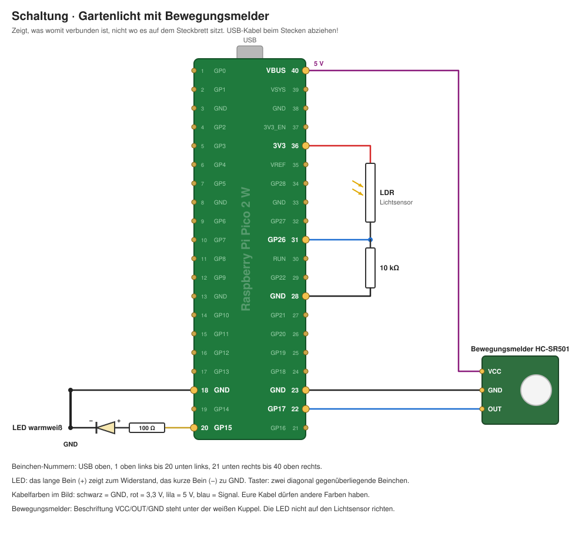
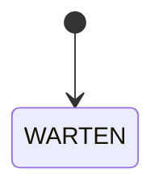
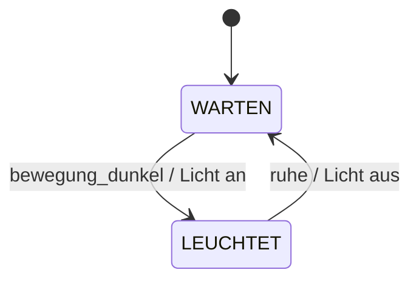

# Bauplan · Gartenlicht mit Bewegungsmelder

**Team:** 265a-team-02 · **Board:** Raspberry Pi Pico 2 W · **Ziel:** alle Karten bis Ende Woche 6 fertig, Vorführung in Woche 7

## So arbeitet ihr mit diesem Bauplan

1. **Teil 1** enthält eure User Stories in überarbeiteter Form. Fangt mit Karte **K0** an.
2. **Teil 2** sind die Karten für euer Kanban-Board. **Ihr entscheidet**, wer welche Karte nimmt und wann. Eine Karte darf erst starten, wenn alle Karten unter „braucht vorher" fertig sind. Höchstens eine Karte pro Person in „In Arbeit".
3. **Teil 3** erklärt jede Karte Schritt für Schritt. Wo im Code `# TODO` steht, schreibt ihr selbst. Wenn ihr hängt, öffnet die Hilfe **der Reihe nach**: zuerst Tipp 1, dann Tipp 2, die Lösung nur, wenn es gar nicht geht. Notiert im Lernjournal, welche Stufe ihr gebraucht habt.

> ⚠️ Bauteile nur stecken, wenn das USB-Kabel **abgezogen** ist. LEDs immer mit Vorwiderstand.

---

## Teil 1 · Unsere User Stories (überarbeitet)

### US1 · Licht bei Bewegung in der Nacht (Muss)

Als Hausbesitzer:in möchte ich, dass das Gartenlicht bei Bewegung von selbst angeht, wenn es dunkel ist, damit ich nachts sicher durch den Garten gehe.

- [ ] Ist der Lichtsensor abgedeckt (Nacht) und bewegt sich jemand vor dem Bewegungsmelder, geht das Licht innerhalb von 2 s an.
- [ ] Ist der Lichtsensor nicht abgedeckt (Tag), bleibt das Licht bei Bewegung aus.

### US2 · Licht geht von selbst wieder aus (Muss)

Als Hausbesitzer:in möchte ich, dass das Licht von selbst ausgeht, wenn niemand mehr da ist, damit es keinen Strom verschwendet.

- [ ] 30 s (±5 s) nach der **letzten** Bewegung geht das Licht aus.
- [ ] Bewegt sich jemand, während das Licht leuchtet, beginnen die 30 s von vorn.

> **Was wir geändert haben:** Eure eine Story hatte zwei Verhalten (angehen und ausgehen), deshalb sind es jetzt zwei Stories. „Weil es dunkel und gruselig ist" war der Grund, kein Nutzen: Der Nutzen ist, sicher zu gehen. Euer Kriterium „bei Nacht Licht an mit Bewegung" hat jetzt eine Zeit (2 s), und „Tag" und „Nacht" sind so beschrieben, dass man sie in der Klasse vorführen kann (Sensor abdecken). Neu: Bewegung verlängert die Zeit. Das macht jedes echte Gartenlicht so.

> ℹ️ **Ihr braucht zusätzlich einen Lichtsensor (LDR) und einen 10-kΩ-Widerstand**, sonst kann das Gadget Tag und Nacht nicht unterscheiden. Ihr kennt ihn aus Woche 4.

**Karte K0:** Kopiert Teil 1 in eure `ANFORDERUNGEN.md` (die alte Story ersetzen) und committet mit der Nachricht `Stories überarbeitet`.

---

## Teil 2 · Karten für euer Kanban-Board

| Karte | Story | braucht vorher | fertig, wenn … |
|-------|-------|----------------|----------------|
| K0 Stories übernehmen | – | – | `ANFORDERUNGEN.md` enthält Teil 1, committet |
| K1 Licht und Lichtsensor anschließen | US1 | – | Testcode: LED leuchtet, Helligkeit ändert sich beim Abdecken |
| K2 Bewegungsmelder anschließen und einstellen | US1, US2 | – | Testcode zeigt `True` bei Bewegung, `False` nach ca. 3 s Ruhe |
| K3 Schwellwert „dunkel" finden | US1 | K1 | `SCHWELLE_DUNKEL` steht mit Begründung in `logik.py` |
| K4 Zustandsdiagramm zeichnen | US1, US2 | K0 | Mermaid-Diagramm in `README.md` |
| K5 `logik.py` schreiben | US1, US2 | K4 | Tests in K6 sind grün |
| K6 `test_logik.py` | US1, US2 | K5 | alle Tests grün am PC |
| K7 `main.py` am Board | US1, US2 | K2, K3, K6 | Licht geht nachts bei Bewegung an und 30 s später aus |
| K8 Testprotokoll `TESTS.md` | US1, US2 | K7 | jedes Akzeptanzkriterium hat eine Zeile mit ✅ oder ❌ |
| K9 `README.md` fertig | – | K7 | README nach der Vorlage aus Woche 6 |
| K10 Präsentation + Demo-Video | – | K8 | 3-Minuten-Ablauf geprobt, 30-s-Video im Repository |

K1, K2 und K4 können **gleichzeitig** von drei Personen erledigt werden.

---

## Teil 3 · Anleitungen pro Karte

### K1 · Licht und Lichtsensor anschließen

Ihr braucht: LED warmweiß, Widerstand **100 Ω**, Lichtsensor (LDR), Widerstand 10 kΩ, Kabel.

| Bauteil | Anschluss |
|---------|-----------|
| LED warmweiß | **GP15** (Beinchen 20) → **100 Ω** → langes Bein, kurzes Bein → GND (Beinchen 18) |
| Lichtsensor (LDR) | **3V3** (Beinchen 36) → LDR → **GP26** (Beinchen 31) → 10 kΩ → GND (Beinchen 28) |



Das Bild zeigt, **was womit verbunden** ist, nicht wo es auf dem Steckbrett sitzt. Es zeigt schon die ganze Schaltung, auch den Lichtsensor und den Bewegungsmelder (K2).

Warum 100 Ω statt 220 Ω? Weiße LEDs brauchen fast die ganze Spannung des Pico (ca. 3 V von 3,3 V). Mit 220 Ω leuchten sie nur sehr schwach.

**Achtung, eigenes Licht:** Stellt die LED so, dass sie **nicht** auf den Lichtsensor leuchtet, z. B. auf die andere Seite des Steckbretts.

Speichert `hardware.py` **auf dem Pico** (Datei → Speichern unter → MicroPython-Gerät):

```python
# hardware.py – Raspberry Pi Pico 2 W · Gartenlicht
from machine import Pin, ADC

_licht = Pin(15, Pin.OUT)
_pir = Pin(17, Pin.IN)
_sensor = ADC(26)


def licht(an):
    _licht.value(1 if an else 0)


def bewegung():
    """True, solange der Bewegungsmelder etwas erkennt."""
    return _pir.value() == 1


def helligkeit():
    """Umgebungslicht in Prozent (0 = dunkel, 100 = hell)."""
    return _sensor.read_u16() * 100 // 65535
```

Testet in der Thonny-Kommandozeile:

```python
from hardware import licht, helligkeit
licht(True)
licht(False)
helligkeit()      # einmal normal, einmal mit der Hand abgedeckt
```

### K2 · Bewegungsmelder anschließen und einstellen

Bewegungsmelder HC-SR501 (PIR). Er braucht **5 V**, sein Signal hat aber nur 3,3 V und ist deshalb für den Pico ungefährlich.

| PIR-Anschluss | Pico |
|---------------|------|
| VCC | **VBUS** (Beinchen 40), 5 V vom USB-Kabel |
| OUT | **GP17** (Beinchen 22) |
| GND | GND (Beinchen 23) |

Die Beschriftung steht unter der weißen Kuppel. Kuppel vorsichtig abziehen, nachschauen, wieder aufstecken.

**Einstellen** (auf der Rückseite):

1. Den Drehregler **Zeit** (meist der linke, „Tx" oder „Time") ganz nach **links**, also auf die kürzeste Zeit (ca. 3 s). Die 30 s macht euer Programm, nicht der Sensor.
2. Den Jumper (die kleine Steckbrücke) auf **H** (wiederholt auslösen).
3. Nach dem Einstecken braucht der PIR ca. **60 s**, um sich einzustellen. In dieser Zeit meldet er manchmal Unsinn.

Testet in der Thonny-Kommandozeile (hardware.py aus K1 ist schon auf dem Pico):

```python
from hardware import bewegung
import time
while True:
    print(bewegung())
    time.sleep(0.5)
```

Mit **Strg+C** beendet ihr die Schleife.

### K3 · Schwellwert „dunkel" finden

1. Messt mit `helligkeit()` (siehe K1) dreimal: normales Klassenlicht, Sensor mit der Hand abgedeckt, Sensor mit der Hand **halb** abgedeckt.
2. Tragt die Werte als Kommentar in `logik.py` ein.
3. Wählt `SCHWELLE_DUNKEL` **zwischen** „abgedeckt" und „halb abgedeckt".

Beispiel (eure Werte sind anders!):

```python
SCHWELLE_DUNKEL = 30      # gemessen: Klasse 72, halb abgedeckt 41, abgedeckt 12
```

### K4 · Zustandsdiagramm zeichnen

Euer Gartenlicht hat **2 Zustände**: `WARTEN` (Licht aus, wartet auf Bewegung im Dunkeln) und `LEUCHTET`. Es gibt **2 Ereignisse**:

- `bewegung_dunkel`: Es bewegt sich etwas **und** es ist dunkel.
- `ruhe`: Seit 30 s keine Bewegung mehr.

Ergänzt die Pfeile und schreibt das Diagramm in `README.md` ([Mermaid im Kursbuch](https://glandl.github.io/Coursebook-maker-reise-grade-9/werkzeuge/mermaid/)):

````markdown

````

<details>
<summary>Tipp 1</summary>

Von `WARTEN` führt ein Pfeil nach `LEUCHTET`, von `LEUCHTET` einer zurück. Welches Ereignis gehört zu welchem Pfeil?

</details>

<details>
<summary>Lösung</summary>



</details>

**Denkfrage für die Präsentation:** Warum zählt im Zustand `LEUCHTET` die Helligkeit nicht mehr? (Denkt an das eigene Licht.)

### K5 · `logik.py` schreiben

`logik.py` enthält zwei Funktionen, die **ohne Hardware** funktionieren:

- `naechster_zustand`: die Pfeile des Diagramms (Rezept aus [Woche 5, Abschnitt 2a](https://glandl.github.io/Coursebook-maker-reise-grade-9/projekte/p1-code-gadget/woche-05-zustandsautomat/)).
- `ereignis_bestimmen`: macht aus den Messwerten ein Ereignis. Sie bekommt die Werte als Parameter, deshalb kann man sie am PC testen.

```python
# logik.py – keine Imports von hardware!

SCHWELLE_DUNKEL = 30      # TODO: euer Wert aus K3, mit Messwerten als Kommentar
NACHLAUF_MS = 30000       # so lange bleibt das Licht nach der letzten Bewegung an


def naechster_zustand(zustand, ereignis):
    """Die Pfeile des Zustandsdiagramms, sonst nichts."""
    if zustand == "WARTEN":
        if ereignis == "bewegung_dunkel":
            return "LEUCHTET"
    # TODO: der Pfeil von LEUCHTET zurück
    return zustand


def ereignis_bestimmen(bewegung, helligkeit, ms_seit_bewegung):
    """Macht aus den Messwerten ein Ereignis (oder None)."""
    # TODO 1: Bewegung UND dunkel → "bewegung_dunkel"
    # TODO 2: seit mindestens NACHLAUF_MS keine Bewegung → "ruhe"
    return None
```

<details>
<summary>Tipp 1</summary>

Für „Bewegung **und** dunkel" verknüpft ihr zwei Bedingungen mit `and`. Dunkel heißt: `helligkeit` ist **kleiner** als `SCHWELLE_DUNKEL`.

</details>

<details>
<summary>Tipp 2</summary>

```python
    if bewegung and helligkeit < ...:
        return "bewegung_dunkel"
    if ms_seit_bewegung >= ...:
        return "ruhe"
    return None
```

</details>

<details>
<summary>Lösung</summary>

```python
def naechster_zustand(zustand, ereignis):
    """Die Pfeile des Zustandsdiagramms, sonst nichts."""
    if zustand == "WARTEN":
        if ereignis == "bewegung_dunkel":
            return "LEUCHTET"
    elif zustand == "LEUCHTET":
        if ereignis == "ruhe":
            return "WARTEN"
    return zustand


def ereignis_bestimmen(bewegung, helligkeit, ms_seit_bewegung):
    """Macht aus den Messwerten ein Ereignis (oder None)."""
    if bewegung and helligkeit < SCHWELLE_DUNKEL:
        return "bewegung_dunkel"
    if ms_seit_bewegung >= NACHLAUF_MS:
        return "ruhe"
    return None
```

</details>

### K6 · `test_logik.py`

Legt `test_logik.py` **am PC** im selben Ordner wie `logik.py` an und startet ihn mit dem Interpreter **Lokales Python 3** ([Woche 6, Abschnitt 2b](https://glandl.github.io/Coursebook-maker-reise-grade-9/projekte/p1-code-gadget/woche-06-testen-doku/)).

```python
from logik import naechster_zustand, ereignis_bestimmen

TESTS = [
    ("WARTEN",   "bewegung_dunkel", "LEUCHTET"),
    # TODO: der zweite Pfeil
    ("WARTEN",   "ruhe",            "WARTEN"),    # kein Pfeil: bleibt
    # TODO: noch ein Fall ohne Pfeil
]
EREIGNIS_TESTS = [
    # (Bewegung, Helligkeit, ms seit Bewegung, erwartetes Ereignis)
    (True,  10, 0,     "bewegung_dunkel"),
    (True,  80, 0,     None),              # Tag: Bewegung zählt nicht
    # TODO: ein Test für "ruhe" und einer, bei dem die 30 s noch nicht um sind
]

bestanden = 0
for zustand, ereignis, erwartet in TESTS:
    ergebnis = naechster_zustand(zustand, ereignis)
    if ergebnis == erwartet:
        bestanden = bestanden + 1
        print("ok     ", zustand, "+", ereignis, "→", ergebnis)
    else:
        print("FEHLER ", zustand, "+", ereignis, "→", ergebnis, "erwartet:", erwartet)
for bewegung, hell, ms, erwartet in EREIGNIS_TESTS:
    ergebnis = ereignis_bestimmen(bewegung, hell, ms)
    if ergebnis == erwartet:
        bestanden = bestanden + 1
        print("ok     ", bewegung, hell, ms, "→", ergebnis)
    else:
        print("FEHLER ", bewegung, hell, ms, "→", ergebnis, "erwartet:", erwartet)

print(bestanden, "von", len(TESTS) + len(EREIGNIS_TESTS), "Tests bestanden")
```

### K7 · `main.py` am Board

Die Hauptschleife merkt sich, **wann zuletzt Bewegung war**. Daraus berechnet sie `ms_seit_bewegung`.

1. `logik.py` auf den Pico kopieren.
2. `main.py` auf dem Pico speichern:

```python
from hardware import licht, bewegung, helligkeit
from logik import naechster_zustand, ereignis_bestimmen
import time

print("Bewegungsmelder kalibriert sich, 60 s warten …")
time.sleep(60)
print("bereit")

zustand = "WARTEN"
letzte_bewegung = time.ticks_ms()
licht(False)

while True:
    bewegt = bewegung()
    if bewegt:
        letzte_bewegung = time.ticks_ms()    # Nachlaufzeit beginnt neu
    ms_seit = time.ticks_diff(time.ticks_ms(), letzte_bewegung)

    ereignis = ereignis_bestimmen(bewegt, helligkeit(), ms_seit)
    neu = naechster_zustand(zustand, ereignis)
    if neu != zustand:
        print(zustand, "→", neu)
        zustand = neu
        # TODO: Licht an, wenn der neue Zustand LEUCHTET ist, sonst aus
    time.sleep_ms(50)
```

<details>
<summary>Tipp 1</summary>

`licht()` will `True` oder `False`. Der Vergleich `zustand == "LEUCHTET"` liefert genau das.

</details>

<details>
<summary>Lösung</summary>

```python
        licht(zustand == "LEUCHTET")
```

</details>

**Zum Ausprobieren** könnt ihr `NACHLAUF_MS` kurz auf `5000` stellen, dann müsst ihr nicht so lange warten. Für das Testprotokoll und die Vorführung wieder auf `30000`.

### K8 · Testprotokoll `TESTS.md`

Vorlage: [Woche 6, Abschnitt 2c](https://glandl.github.io/Coursebook-maker-reise-grade-9/projekte/p1-code-gadget/woche-06-testen-doku/). Eine Zeile pro Akzeptanzkriterium aus Teil 1, z. B.:

```markdown
| # | Ausgangszustand | Aktion | Erwartet | Beobachtet | ok? |
|---|-----------------|--------|----------|------------|-----|
| 1 | WARTEN, Sensor frei | vor dem PIR winken | Licht bleibt aus | | |
| 2 | WARTEN, Sensor abgedeckt | vor dem PIR winken | Licht an innerhalb 2 s | | |
| 3 | LEUCHTET | stillhalten, Stoppuhr | Licht aus nach 30 s (±5 s) | | |
| … | | | | | |
```

Tipp: Der PIR sieht euch auch beim Stillhalten, wenn ihr direkt davor sitzt. Für Test 3 aus seinem Blickfeld gehen.

### K9 · `README.md` fertig

Nach der Vorlage aus [Woche 6, Abschnitt 4](https://glandl.github.io/Coursebook-maker-reise-grade-9/projekte/p1-code-gadget/woche-06-testen-doku/). Diagramm aus K4, Hardware-Tabellen aus K1 und K2.

### K10 · Präsentation + Demo-Video

Ablauf aus [Woche 6, Abschnitt 5](https://glandl.github.io/Coursebook-maker-reise-grade-9/projekte/p1-code-gadget/woche-06-testen-doku/). Für die Demo: zuerst „Tag" zeigen (winken, nichts passiert), dann den Sensor abdecken („Nacht"), winken, Licht geht an. Stellt `NACHLAUF_MS` für die Vorführung auf 10 s und sagt das dazu, sonst wartet das Publikum zu lange. 30-s-Video ins Repository.

---

## Wenn ihr schneller seid

- **Sanftes Ausgehen:** Statt schlagartig aus wird das Licht in 2 s dunkler. Dafür braucht ihr PWM (`from machine import PWM`, `duty_u16`), siehe den Summer in [Woche 4](https://glandl.github.io/Coursebook-maker-reise-grade-9/projekte/p1-code-gadget/woche-04-sensoren-review/).
- **Dauerlicht-Taste:** Eine Taste (GP14 ↔ GND) schaltet in einen Zustand `DAUERLICHT`, z. B. für eine Gartenparty. Nochmal drücken: zurück zu `WARTEN`.
