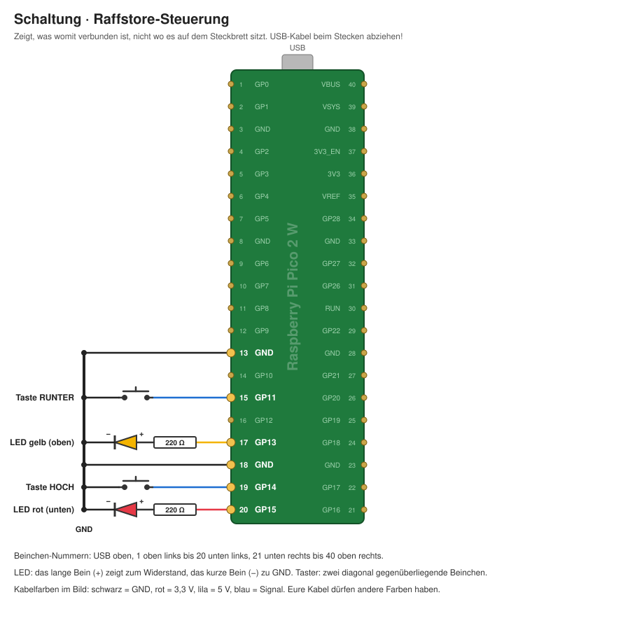
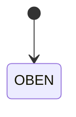
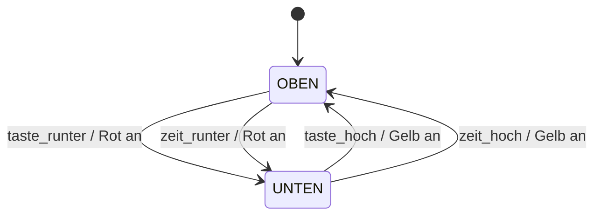

# Bauplan · Raffstore-Steuerung

**Team:** 265a-team-03 · **Board:** Raspberry Pi Pico 2 W · **Ziel:** alle Karten bis Ende Woche 6 fertig, Vorführung in Woche 7

## So arbeitet ihr mit diesem Bauplan

1. **Teil 1** enthält eure User Stories in überarbeiteter Form. Fangt mit Karte **K0** an.
2. **Teil 2** sind die Karten für euer Kanban-Board. **Ihr entscheidet**, wer welche Karte nimmt und wann. Eine Karte darf erst starten, wenn alle Karten unter „braucht vorher" fertig sind. Höchstens eine Karte pro Person in „In Arbeit".
3. **Teil 3** erklärt jede Karte Schritt für Schritt. Wo im Code `# TODO` steht, schreibt ihr selbst. Wenn ihr hängt, öffnet die Hilfe **der Reihe nach**: zuerst Tipp 1, dann Tipp 2, die Lösung nur, wenn es gar nicht geht. Notiert im Lernjournal, welche Stufe ihr gebraucht habt.

> ⚠️ Bauteile nur stecken, wenn das USB-Kabel **abgezogen** ist. LEDs immer mit Vorwiderstand.

Ihr habt keinen echten Raffstore, deshalb zeigen zwei LEDs seine Stellung: **Gelb = oben, Rot = unten**. Zwei Tasten ersetzen die Handbewegung.

---

## Teil 1 · Unsere User Stories (überarbeitet)

### US1 · Raffstore per Taste bedienen (Muss)

Als Hausbesitzer:in möchte ich den Raffstore mit zwei Tasten hoch- und runterfahren, damit ich ihn bedienen kann, ohne zum Fenster zu gehen.

- [ ] Ein Druck auf die Taste **HOCH** fährt den Raffstore hoch: Innerhalb von 0,5 s leuchtet Gelb, Rot ist aus.
- [ ] Ein Druck auf die Taste **RUNTER** fährt ihn runter: Innerhalb von 0,5 s leuchtet Rot, Gelb ist aus.
- [ ] Ist er schon oben, ändert ein weiterer Druck auf HOCH nichts (ebenso unten und RUNTER).

### US2 · Raffstore nach Uhrzeit (Muss)

Als Hausbesitzer:in möchte ich, dass der Raffstore morgens von selbst hoch- und abends runterfährt, damit ich mich nicht jeden Tag darum kümmern muss.

- [ ] Zur Uhrzeit `HOCH` (eingestellt: 5:30) fährt der Raffstore hoch, egal wie er vorher stand.
- [ ] Zur Uhrzeit `RUNTER` (eingestellt: 19:30) fährt er runter.
- [ ] Nach dem automatischen Fahren kann man ihn sofort wieder per Taste bedienen.

> **Was wir geändert haben:** Bei US1 sagten beide Kriterien „gehen hoch", jetzt gibt es eines für hoch und eines für runter. Die Handbewegung ist durch zwei Tasten ersetzt, der Raffstore durch zwei LEDs, so wie es eure Lehrkraft festgelegt hat. Bei US2 fehlte der Satz „damit …", jetzt steht der Nutzen da. US3 (Wind) ist gestrichen, dafür gibt es keinen Sensor. Damit man US2 in der Klasse vorführen kann, ohne bis 19:30 zu warten, stellt ihr die Uhrzeit für die Vorführung um (siehe K10).

**Karte K0:** Kopiert Teil 1 in eure `ANFORDERUNGEN.md` (die alten Stories ersetzen) und committet mit der Nachricht `Stories überarbeitet`.

---

## Teil 2 · Karten für euer Kanban-Board

| Karte | Story | braucht vorher | fertig, wenn … |
|-------|-------|----------------|----------------|
| K0 Stories übernehmen | – | – | `ANFORDERUNGEN.md` enthält Teil 1, committet |
| K1 LEDs und Tasten anschließen | US1 | – | Testcode: beide LEDs leuchten, beide Tasten werden erkannt |
| K2 Uhr im Pico prüfen | US2 | – | `uhrzeit()` zeigt die richtige Uhrzeit (±1 min) |
| K3 Zustandsdiagramm zeichnen | US1, US2 | K0 | Mermaid-Diagramm in `README.md` |
| K4 `naechster_zustand` schreiben | US1, US2 | K3 | Tests zu `naechster_zustand` in K6 sind grün |
| K5 `zeit_ereignis` schreiben | US2 | K3 | Tests zu `zeit_ereignis` in K6 sind grün |
| K6 `test_logik.py` | US1, US2 | K4, K5 | alle Tests grün am PC |
| K7 `main.py` am Board | US1, US2 | K1, K2, K6 | Tasten und Uhrzeit fahren den Raffstore |
| K8 Testprotokoll `TESTS.md` | US1, US2 | K7 | jedes Akzeptanzkriterium hat eine Zeile mit ✅ oder ❌ |
| K9 `README.md` fertig | – | K7 | README nach der Vorlage aus Woche 6 |
| K10 Präsentation + Demo-Video | – | K8 | 3-Minuten-Ablauf geprobt, 30-s-Video im Repository |

K1, K2 und K3 können **gleichzeitig** von drei Personen erledigt werden, ebenso K4 und K5.

---

## Teil 3 · Anleitungen pro Karte

### K1 · LEDs und Tasten anschließen

Ihr braucht: LED gelb, LED rot, zwei Widerstände 220 Ω, zwei Taster, Kabel.

| Bauteil | Anschluss |
|---------|-----------|
| LED gelb (oben) | **GP13** (Beinchen 17) → 220 Ω → langes Bein, kurzes Bein → GND |
| LED rot (unten) | **GP15** (Beinchen 20) → 220 Ω → langes Bein, kurzes Bein → GND |
| Taste HOCH | **GP14** (Beinchen 19) ↔ GND (Beinchen 18) |
| Taste RUNTER | **GP11** (Beinchen 15) ↔ GND (Beinchen 13) |



Das Bild zeigt, **was womit verbunden** ist, nicht wo es auf dem Steckbrett sitzt.

Taster mit vier Beinchen: zwei **diagonal gegenüberliegende** Beinchen verwenden, Taster über die Mittelrille stecken.

Speichert `hardware.py` **auf dem Pico** (Datei → Speichern unter → MicroPython-Gerät):

```python
# hardware.py – Raspberry Pi Pico 2 W · Raffstore
from machine import Pin
import time

_led_oben = Pin(13, Pin.OUT)     # gelb
_led_unten = Pin(15, Pin.OUT)    # rot
_taste_hoch = Pin(14, Pin.IN, Pin.PULL_UP)
_taste_runter = Pin(11, Pin.IN, Pin.PULL_UP)
_vorher_hoch = 1
_vorher_runter = 1


def anzeigen(oben):
    """Gelb = Raffstore oben, Rot = Raffstore unten."""
    _led_oben.value(1 if oben else 0)
    _led_unten.value(0 if oben else 1)


def hoch_gedrueckt():
    """True einmal pro Druck auf die Taste HOCH."""
    global _vorher_hoch
    jetzt = _taste_hoch.value()
    neu = _vorher_hoch == 1 and jetzt == 0
    _vorher_hoch = jetzt
    return neu


def runter_gedrueckt():
    """True einmal pro Druck auf die Taste RUNTER."""
    global _vorher_runter
    jetzt = _taste_runter.value()
    neu = _vorher_runter == 1 and jetzt == 0
    _vorher_runter = jetzt
    return neu


def uhrzeit():
    """Liefert (stunde, minute, sekunde) der Uhr im Pico."""
    t = time.localtime()
    return t[3], t[4], t[5]
```

Testet in der Thonny-Kommandozeile:

```python
from hardware import *
anzeigen(True)       # Gelb an, Rot aus
anzeigen(False)      # Rot an, Gelb aus
```

Und die Tasten (mit **Strg+C** beenden):

```python
import time
while True:
    if hoch_gedrueckt():
        print("HOCH")
    if runter_gedrueckt():
        print("RUNTER")
    time.sleep_ms(50)
```

### K2 · Uhr im Pico prüfen

Der Pico 2 W hat eine eingebaute Uhr. Sie kennt die richtige Zeit aber nur, wenn **Thonny sie beim Verbinden stellt**. Ein extra Uhren-Modul braucht ihr nicht.

1. In Thonny: **Extras → Optionen → Interpreter**. Prüft, dass das Häkchen bei **„Echtzeituhr synchronisieren"** (englisch *Synchronize device's real time clock*) und **„Lokale Zeit verwenden"** (*Use local time in real time clock*) gesetzt ist.
2. Pico neu verbinden (Stopp-Taste in Thonny).
3. In der Kommandozeile: `from hardware import uhrzeit` und `uhrzeit()`. Stimmt die Uhrzeit mit eurem Handy überein?

**Wichtig:** Wird der Pico vom Strom getrennt, vergisst er die Uhrzeit und beginnt bei 0:00. Für die Vorführung den Pico also über Thonny am Laptop lassen.

### K3 · Zustandsdiagramm zeichnen

Euer Raffstore hat **2 Zustände**: `OBEN` und `UNTEN`. Es gibt **4 Ereignisse**: `taste_hoch`, `taste_runter`, `zeit_hoch`, `zeit_runter`.

Ergänzt die Pfeile und schreibt das Diagramm in `README.md` ([Mermaid im Kursbuch](https://glandl.github.io/Coursebook-maker-reise-grade-9/werkzeuge/mermaid/)):

````markdown

````

<details>
<summary>Tipp 1</summary>

Zwei Ereignisse führen von `OBEN` nach `UNTEN`, zwei zurück. Ihr könnt zwei Pfeile zeichnen oder einen Pfeil mit beiden Ereignissen beschriften (`taste_runter, zeit_runter`).

</details>

<details>
<summary>Lösung</summary>



</details>

### K4 · `naechster_zustand` schreiben

Nach dem **Automaten-Rezept** aus [Woche 5, Abschnitt 2a](https://glandl.github.io/Coursebook-maker-reise-grade-9/projekte/p1-code-gadget/woche-05-zustandsautomat/). Legt am PC `logik.py` an:

```python
# logik.py – keine Imports von hardware!

HOCH_STUNDE = 5
HOCH_MINUTE = 30
RUNTER_STUNDE = 19
RUNTER_MINUTE = 30


def naechster_zustand(zustand, ereignis):
    """Die Pfeile des Zustandsdiagramms, sonst nichts."""
    if zustand == "OBEN":
        # TODO: taste_runter oder zeit_runter → UNTEN
        pass
    elif zustand == "UNTEN":
        # TODO
        pass
    return zustand
```

<details>
<summary>Tipp 1</summary>

Zwei Ereignisse führen zum selben Ziel. Ihr könnt zwei `if` untereinander schreiben oder beide Bedingungen mit `or` verbinden.

</details>

<details>
<summary>Tipp 2</summary>

```python
    if zustand == "OBEN":
        if ereignis == "taste_runter" or ereignis == ...:
            return "UNTEN"
```

Achtung: `ereignis == "taste_runter" or "zeit_runter"` ist **falsch**. Auf beiden Seiten von `or` muss ein ganzer Vergleich stehen.

</details>

<details>
<summary>Lösung</summary>

```python
def naechster_zustand(zustand, ereignis):
    """Die Pfeile des Zustandsdiagramms, sonst nichts."""
    if zustand == "OBEN":
        if ereignis == "taste_runter" or ereignis == "zeit_runter":
            return "UNTEN"
    elif zustand == "UNTEN":
        if ereignis == "taste_hoch" or ereignis == "zeit_hoch":
            return "OBEN"
    return zustand
```

</details>

### K5 · `zeit_ereignis` schreiben

Diese Funktion bekommt die Uhrzeit und sagt, ob **jetzt** gefahren werden soll. Sie meldet das Ereignis nur in **Sekunde 0** der eingestellten Minute. Sonst würde der Raffstore eine ganze Minute lang immer wieder hochfahren, auch wenn jemand in dieser Minute RUNTER drückt.

Ergänzt in `logik.py`:

```python
def zeit_ereignis(stunde, minute, sekunde):
    """'zeit_hoch' oder 'zeit_runter' genau in Sekunde 0 der eingestellten Minute, sonst None."""
    if sekunde != 0:
        return None
    # TODO: ist es HOCH_STUNDE:HOCH_MINUTE? → "zeit_hoch"
    # TODO: ist es RUNTER_STUNDE:RUNTER_MINUTE? → "zeit_runter"
    return None
```

<details>
<summary>Tipp 1</summary>

Stunde **und** Minute müssen beide passen: zwei Vergleiche mit `and` verbinden.

</details>

<details>
<summary>Lösung</summary>

```python
def zeit_ereignis(stunde, minute, sekunde):
    """'zeit_hoch' oder 'zeit_runter' genau in Sekunde 0 der eingestellten Minute, sonst None."""
    if sekunde != 0:
        return None
    if stunde == HOCH_STUNDE and minute == HOCH_MINUTE:
        return "zeit_hoch"
    if stunde == RUNTER_STUNDE and minute == RUNTER_MINUTE:
        return "zeit_runter"
    return None
```

</details>

### K6 · `test_logik.py`

Legt `test_logik.py` **am PC** im selben Ordner wie `logik.py` an und startet ihn mit dem Interpreter **Lokales Python 3** ([Woche 6, Abschnitt 2b](https://glandl.github.io/Coursebook-maker-reise-grade-9/projekte/p1-code-gadget/woche-06-testen-doku/)).

```python
from logik import naechster_zustand, zeit_ereignis

TESTS = [
    ("OBEN",  "taste_runter", "UNTEN"),
    ("OBEN",  "zeit_runter",  "UNTEN"),
    # TODO: die zwei Pfeile von UNTEN
    ("OBEN",  "taste_hoch",   "OBEN"),     # schon oben: bleibt
    # TODO: noch ein Fall ohne Pfeil
]
ZEIT_TESTS = [
    (5, 30, 0,  "zeit_hoch"),
    (5, 30, 1,  None),            # nur einmal pro Minute
    # TODO: 19:30:00, eine Uhrzeit, bei der nichts passiert, und 5:31:00
]

bestanden = 0
for zustand, ereignis, erwartet in TESTS:
    ergebnis = naechster_zustand(zustand, ereignis)
    if ergebnis == erwartet:
        bestanden = bestanden + 1
        print("ok     ", zustand, "+", ereignis, "→", ergebnis)
    else:
        print("FEHLER ", zustand, "+", ereignis, "→", ergebnis, "erwartet:", erwartet)
for stunde, minute, sekunde, erwartet in ZEIT_TESTS:
    ergebnis = zeit_ereignis(stunde, minute, sekunde)
    if ergebnis == erwartet:
        bestanden = bestanden + 1
        print("ok     ", stunde, ":", minute, ":", sekunde, "→", ergebnis)
    else:
        print("FEHLER ", stunde, ":", minute, ":", sekunde, "→", ergebnis, "erwartet:", erwartet)

print(bestanden, "von", len(TESTS) + len(ZEIT_TESTS), "Tests bestanden")
```

### K7 · `main.py` am Board

1. `logik.py` auf den Pico kopieren.
2. `main.py` auf dem Pico speichern:

```python
from hardware import anzeigen, hoch_gedrueckt, runter_gedrueckt, uhrzeit
from logik import naechster_zustand, zeit_ereignis
import time

zustand = "OBEN"
anzeigen(True)
print("Uhrzeit im Pico:", uhrzeit())

while True:
    ereignis = None
    if hoch_gedrueckt():
        ereignis = "taste_hoch"
    elif runter_gedrueckt():
        ereignis = "taste_runter"
    else:
        stunde, minute, sekunde = uhrzeit()
        ereignis = None      # TODO: frag zeit_ereignis nach dem Ereignis

    neu = naechster_zustand(zustand, ereignis)
    if neu != zustand:
        print(uhrzeit(), zustand, "→", neu)
        zustand = neu
        anzeigen(zustand == "OBEN")
    time.sleep_ms(50)
```

`stunde, minute, sekunde = uhrzeit()` packt die drei Werte, die `uhrzeit()` liefert, in drei Variablen aus.

<details>
<summary>Lösung</summary>

```python
        ereignis = zeit_ereignis(stunde, minute, sekunde)
```

</details>

**Zum Ausprobieren:** Stellt `RUNTER_STUNDE` und `RUNTER_MINUTE` in `logik.py` auf die Uhrzeit in **zwei Minuten** und schaut, ob der Raffstore dann runterfährt.

### K8 · Testprotokoll `TESTS.md`

Vorlage: [Woche 6, Abschnitt 2c](https://glandl.github.io/Coursebook-maker-reise-grade-9/projekte/p1-code-gadget/woche-06-testen-doku/). Eine Zeile pro Akzeptanzkriterium aus Teil 1, z. B.:

```markdown
| # | Ausgangszustand | Aktion | Erwartet | Beobachtet | ok? |
|---|-----------------|--------|----------|------------|-----|
| 1 | OBEN | Taste RUNTER | Rot an, Gelb aus | | |
| 2 | OBEN | Taste HOCH | nichts ändert sich | | |
| 3 | OBEN, RUNTER auf in 2 min gestellt | warten | Rot an zur eingestellten Minute | | |
| … | | | | | |
```

### K9 · `README.md` fertig

Nach der Vorlage aus [Woche 6, Abschnitt 4](https://glandl.github.io/Coursebook-maker-reise-grade-9/projekte/p1-code-gadget/woche-06-testen-doku/). Diagramm aus K3, Hardware-Tabelle aus K1. Schreibt in „Starten" dazu, dass Thonny die Uhr stellen muss (K2).

### K10 · Präsentation + Demo-Video

Ablauf aus [Woche 6, Abschnitt 5](https://glandl.github.io/Coursebook-maker-reise-grade-9/projekte/p1-code-gadget/woche-06-testen-doku/). Für die Demo: Stellt vor der Präsentation `RUNTER` auf eine Minute **während** eurer Vorführung. Zeigt zuerst die Tasten, dann sagt: „Gleich ist es 19:30" und wartet, bis der Raffstore von selbst runterfährt. 30-s-Video ins Repository.

---

## Wenn ihr schneller seid

- **Fahrzeit:** Ein echter Raffstore braucht etwa 20 s. Fügt Zustände `FAEHRT_HOCH` und `FAEHRT_RUNTER` hinzu, in denen die Ziel-LED 5 s lang blinkt, bevor sie dauerhaft leuchtet. Ein Tastendruck während der Fahrt stoppt sie.
- **Uhrzeit aus dem Internet:** Der Pico 2 W hat WLAN. Mit `network` und `ntptime` holt er sich die Uhrzeit selbst und braucht Thonny dafür nicht mehr. Achtung: `ntptime` liefert die Weltzeit (UTC), in Österreich ist es 1 Stunde später (im Sommer 2 Stunden).
