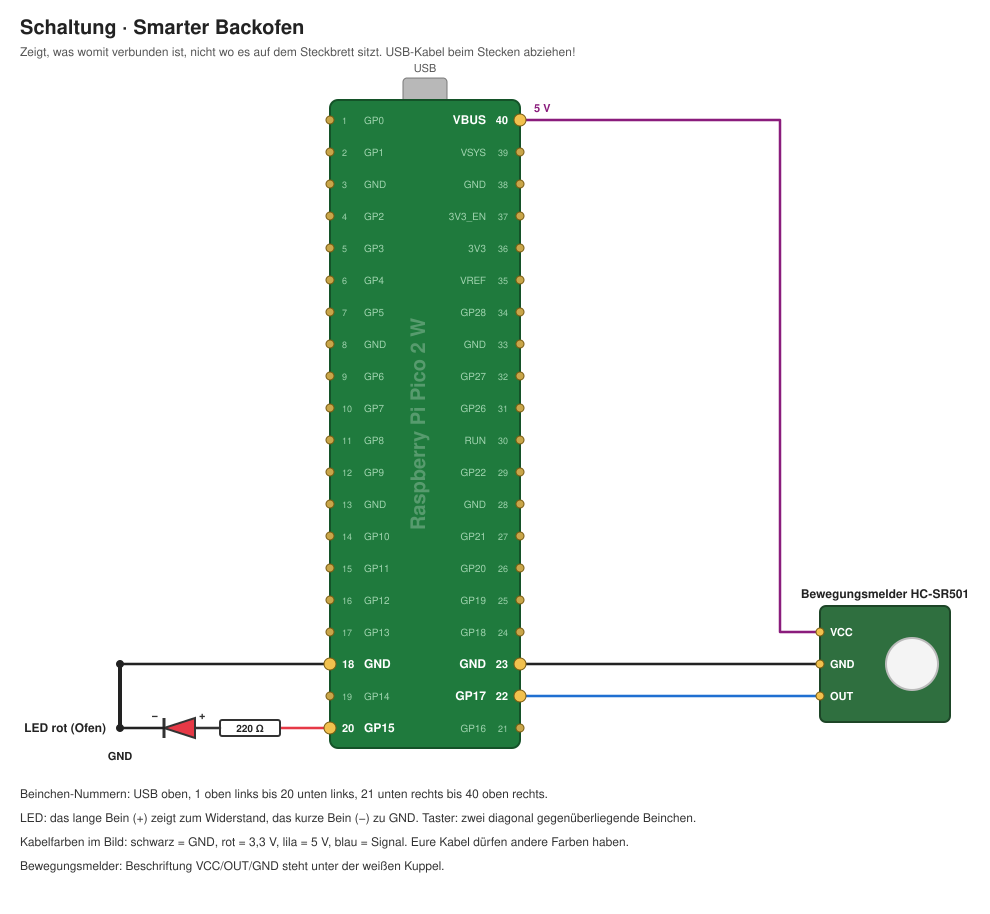
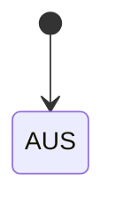
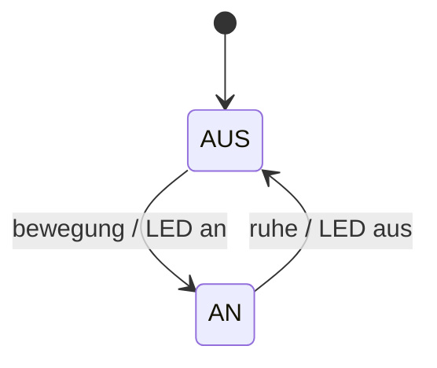

# Bauplan · Smarter Backofen

**Team:** 265a-team-04 · **Board:** Raspberry Pi Pico 2 W · **Ziel:** alle Karten bis Ende Woche 6 fertig, Vorführung in Woche 7

## So arbeitet ihr mit diesem Bauplan

1. **Teil 1** enthält eure User Stories in überarbeiteter Form. Fangt mit Karte **K0** an.
2. **Teil 2** sind die Karten für euer Kanban-Board. **Ihr entscheidet**, wer welche Karte nimmt und wann. Eine Karte darf erst starten, wenn alle Karten unter „braucht vorher" fertig sind. Höchstens eine Karte pro Person in „In Arbeit".
3. **Teil 3** erklärt jede Karte Schritt für Schritt. Wo im Code `# TODO` steht, schreibt ihr selbst. Wenn ihr hängt, öffnet die Hilfe **der Reihe nach**: zuerst Tipp 1, dann Tipp 2, die Lösung nur, wenn es gar nicht geht. Notiert im Lernjournal, welche Stufe ihr gebraucht habt.

> ⚠️ Bauteile nur stecken, wenn das USB-Kabel **abgezogen** ist. LEDs immer mit Vorwiderstand.

Ihr habt keinen echten Backofen, deshalb zeigt eine **rote LED**, ob er eingeschaltet ist.

---

## Teil 1 · Unsere User Stories (überarbeitet)

### US1 · Backofen geht beim Betreten der Küche an (Muss)

Als Vollzeitarbeitende:r möchte ich, dass der Backofen von selbst angeht, wenn ich die Küche betrete, damit er schon vorheizt und ich beim Kochen Zeit spare.

- [ ] Bewegt sich jemand vor dem Bewegungsmelder, leuchtet die rote LED (Backofen an) innerhalb von 2 s.
- [ ] Solange sich jemand in der Küche bewegt, bleibt der Backofen an.

### US2 · Sicherheitsabschaltung (Muss)

Als Bewohner:in möchte ich, dass der Backofen von selbst ausgeht, wenn niemand mehr in der Küche ist, damit nichts anbrennt und kein Strom verschwendet wird.

- [ ] 60 s (±5 s) nach der **letzten** Bewegung geht der Backofen aus (LED aus).
- [ ] Bewegt sich jemand, während der Backofen an ist, beginnen die 60 s von vorn.

> **Was wir geändert haben:** Eure drei Stories widersprechen sich: US1 will den Ofen beim Betreten **an**, US2 beim Betreten **aus**, US3 auf niedriger Stufe. Ein Gerät kann nicht wissen, ob jemand backen oder nur Wasser trinken will. Deshalb bleibt nur US1, so wie es eure Lehrkraft festgelegt hat. Neu ist US2: Ohne sie würde der Ofen nach dem ersten Betreten **nie wieder** ausgehen, und das wäre gefährlich. Eure Kriterien sagen jetzt, was man sieht (LED) und wie schnell (2 s, 60 s).

**Karte K0:** Kopiert Teil 1 in eure `ANFORDERUNGEN.md` (die alten Stories ersetzen) und committet mit der Nachricht `Stories überarbeitet`.

---

## Teil 2 · Karten für euer Kanban-Board

| Karte | Story | braucht vorher | fertig, wenn … |
|-------|-------|----------------|----------------|
| K0 Stories übernehmen | – | – | `ANFORDERUNGEN.md` enthält Teil 1, committet |
| K1 LED anschließen | US1 | – | Testcode: LED geht an und aus |
| K2 Bewegungsmelder anschließen und einstellen | US1, US2 | – | Testcode zeigt `True` bei Bewegung, `False` nach ca. 3 s Ruhe |
| K3 Zustandsdiagramm zeichnen | US1, US2 | K0 | Mermaid-Diagramm in `README.md` |
| K4 `logik.py` schreiben | US1, US2 | K3 | Tests in K5 sind grün |
| K5 `test_logik.py` | US1, US2 | K4 | alle Tests grün am PC |
| K6 `main.py` am Board | US1, US2 | K1, K2, K5 | Ofen geht bei Bewegung an und 60 s später aus |
| K7 Testprotokoll `TESTS.md` | US1, US2 | K6 | jedes Akzeptanzkriterium hat eine Zeile mit ✅ oder ❌ |
| K8 `README.md` fertig | – | K6 | README nach der Vorlage aus Woche 6 |
| K9 Präsentation + Demo-Video | – | K7 | 3-Minuten-Ablauf geprobt, 30-s-Video im Repository |

K1, K2 und K3 können **gleichzeitig** von drei Personen erledigt werden.

---

## Teil 3 · Anleitungen pro Karte

### K1 · LED anschließen

Ihr braucht: LED rot, Widerstand 220 Ω, Kabel.

| Bauteil | Anschluss |
|---------|-----------|
| LED rot (Backofen) | **GP15** (Beinchen 20) → 220 Ω → langes Bein, kurzes Bein → GND (Beinchen 18) |
| Bewegungsmelder | siehe K2 |



Das Bild zeigt, **was womit verbunden** ist, nicht wo es auf dem Steckbrett sitzt. Es zeigt schon die ganze Schaltung, auch den Bewegungsmelder (K2).

Speichert `hardware.py` **auf dem Pico** (Datei → Speichern unter → MicroPython-Gerät). Sie enthält schon die Funktion für den Bewegungsmelder aus K2:

```python
# hardware.py – Raspberry Pi Pico 2 W · Backofen
from machine import Pin

_ofen = Pin(15, Pin.OUT)
_pir = Pin(17, Pin.IN)


def ofen(an):
    """Die rote LED steht für den Backofen."""
    _ofen.value(1 if an else 0)


def bewegung():
    """True, solange der Bewegungsmelder etwas erkennt."""
    return _pir.value() == 1
```

Testet in der Thonny-Kommandozeile:

```python
from hardware import ofen
ofen(True)
ofen(False)
```

### K2 · Bewegungsmelder anschließen und einstellen

Bewegungsmelder HC-SR501 (PIR). Er braucht **5 V**, sein Signal hat aber nur 3,3 V und ist deshalb für den Pico ungefährlich.

| PIR-Anschluss | Pico |
|---------------|------|
| VCC | **VBUS** (Beinchen 40), 5 V vom USB-Kabel |
| OUT | **GP17** (Beinchen 22) |
| GND | GND (Beinchen 23) |

Die Beschriftung steht unter der weißen Kuppel. Kuppel vorsichtig abziehen, nachschauen, wieder aufstecken.

**Einstellen** (auf der Rückseite):

1. Den Drehregler **Zeit** (meist der linke, „Tx" oder „Time") ganz nach **links**, also auf die kürzeste Zeit (ca. 3 s). Die 60 s macht euer Programm, nicht der Sensor.
2. Den Jumper (die kleine Steckbrücke) auf **H** (wiederholt auslösen).
3. Nach dem Einstecken braucht der PIR ca. **60 s**, um sich einzustellen. In dieser Zeit meldet er manchmal Unsinn.

Testet in der Thonny-Kommandozeile (mit **Strg+C** beenden):

```python
from hardware import bewegung
import time
while True:
    print(bewegung())
    time.sleep(0.5)
```

### K3 · Zustandsdiagramm zeichnen

Euer Backofen hat **2 Zustände**: `AUS` und `AN`. Es gibt **2 Ereignisse**:

- `bewegung`: Der Bewegungsmelder erkennt jemanden.
- `ruhe`: Seit 60 s keine Bewegung mehr.

Ergänzt die Pfeile und schreibt das Diagramm in `README.md` ([Mermaid im Kursbuch](https://glandl.github.io/Coursebook-maker-reise-grade-9/werkzeuge/mermaid/)):

````markdown

````

<details>
<summary>Lösung</summary>



</details>

### K4 · `logik.py` schreiben

`logik.py` enthält zwei Funktionen, die **ohne Hardware** funktionieren:

- `naechster_zustand`: die Pfeile des Diagramms (Rezept aus [Woche 5, Abschnitt 2a](https://glandl.github.io/Coursebook-maker-reise-grade-9/projekte/p1-code-gadget/woche-05-zustandsautomat/)).
- `ereignis_bestimmen`: macht aus den Messwerten ein Ereignis. Sie bekommt die Werte als Parameter, deshalb kann man sie am PC testen.

```python
# logik.py – keine Imports von hardware!

ABSCHALTEN_MS = 60000     # Sicherheitsabschaltung: 60 s ohne Bewegung


def naechster_zustand(zustand, ereignis):
    """Die Pfeile des Zustandsdiagramms, sonst nichts."""
    if zustand == "AUS":
        if ereignis == "bewegung":
            return "AN"
    # TODO: der Pfeil von AN zurück
    return zustand


def ereignis_bestimmen(bewegung, ms_seit_bewegung):
    """Macht aus den Messwerten ein Ereignis (oder None)."""
    # TODO 1: Bewegung → "bewegung"
    # TODO 2: seit mindestens ABSCHALTEN_MS keine Bewegung → "ruhe"
    return None
```

<details>
<summary>Tipp 1</summary>

`bewegung` ist schon `True` oder `False`, ihr könnt direkt `if bewegung:` schreiben. Für die Zeit vergleicht ihr `ms_seit_bewegung` mit `ABSCHALTEN_MS`.

</details>

<details>
<summary>Tipp 2</summary>

```python
    if bewegung:
        return ...
    if ms_seit_bewegung >= ...:
        return ...
    return None
```

</details>

<details>
<summary>Lösung</summary>

```python
def naechster_zustand(zustand, ereignis):
    """Die Pfeile des Zustandsdiagramms, sonst nichts."""
    if zustand == "AUS":
        if ereignis == "bewegung":
            return "AN"
    elif zustand == "AN":
        if ereignis == "ruhe":
            return "AUS"
    return zustand


def ereignis_bestimmen(bewegung, ms_seit_bewegung):
    """Macht aus den Messwerten ein Ereignis (oder None)."""
    if bewegung:
        return "bewegung"
    if ms_seit_bewegung >= ABSCHALTEN_MS:
        return "ruhe"
    return None
```

</details>

### K5 · `test_logik.py`

Legt `test_logik.py` **am PC** im selben Ordner wie `logik.py` an und startet ihn mit dem Interpreter **Lokales Python 3** ([Woche 6, Abschnitt 2b](https://glandl.github.io/Coursebook-maker-reise-grade-9/projekte/p1-code-gadget/woche-06-testen-doku/)).

```python
from logik import naechster_zustand, ereignis_bestimmen

TESTS = [
    ("AUS", "bewegung", "AN"),
    # TODO: der zweite Pfeil
    ("AUS", "ruhe",     "AUS"),     # kein Pfeil: bleibt
    # TODO: noch ein Fall ohne Pfeil
]
EREIGNIS_TESTS = [
    # (Bewegung, ms seit Bewegung, erwartetes Ereignis)
    (True,  0,     "bewegung"),
    # TODO: ein Test für "ruhe" und einer, bei dem die 60 s noch nicht um sind
]

bestanden = 0
for zustand, ereignis, erwartet in TESTS:
    ergebnis = naechster_zustand(zustand, ereignis)
    if ergebnis == erwartet:
        bestanden = bestanden + 1
        print("ok     ", zustand, "+", ereignis, "→", ergebnis)
    else:
        print("FEHLER ", zustand, "+", ereignis, "→", ergebnis, "erwartet:", erwartet)
for bewegung, ms, erwartet in EREIGNIS_TESTS:
    ergebnis = ereignis_bestimmen(bewegung, ms)
    if ergebnis == erwartet:
        bestanden = bestanden + 1
        print("ok     ", bewegung, ms, "→", ergebnis)
    else:
        print("FEHLER ", bewegung, ms, "→", ergebnis, "erwartet:", erwartet)

print(bestanden, "von", len(TESTS) + len(EREIGNIS_TESTS), "Tests bestanden")
```

### K6 · `main.py` am Board

Die Hauptschleife merkt sich, **wann zuletzt Bewegung war**. Daraus berechnet sie, wie lange es schon ruhig ist.

1. `logik.py` auf den Pico kopieren.
2. `main.py` auf dem Pico speichern:

```python
from hardware import ofen, bewegung
from logik import naechster_zustand, ereignis_bestimmen
import time

print("Bewegungsmelder kalibriert sich, 60 s warten …")
time.sleep(60)
print("bereit")

zustand = "AUS"
letzte_bewegung = time.ticks_ms()
ofen(False)

while True:
    bewegt = bewegung()
    if bewegt:
        letzte_bewegung = time.ticks_ms()
    ms_seit = time.ticks_diff(time.ticks_ms(), letzte_bewegung)

    neu = naechster_zustand(zustand, ereignis_bestimmen(bewegt, ms_seit))
    if neu != zustand:
        print(zustand, "→", neu)
        zustand = neu
        # TODO: LED an, wenn der neue Zustand AN ist, sonst aus
    time.sleep_ms(50)
```

<details>
<summary>Lösung</summary>

```python
        ofen(zustand == "AN")
```

</details>

**Zum Ausprobieren** könnt ihr `ABSCHALTEN_MS` kurz auf `5000` stellen. Für das Testprotokoll wieder auf `60000`.

### K7 · Testprotokoll `TESTS.md`

Vorlage: [Woche 6, Abschnitt 2c](https://glandl.github.io/Coursebook-maker-reise-grade-9/projekte/p1-code-gadget/woche-06-testen-doku/). Eine Zeile pro Akzeptanzkriterium aus Teil 1, z. B.:

```markdown
| # | Ausgangszustand | Aktion | Erwartet | Beobachtet | ok? |
|---|-----------------|--------|----------|------------|-----|
| 1 | AUS | vor dem PIR vorbeigehen | LED an innerhalb 2 s | | |
| 2 | AN | aus dem Blickfeld gehen, Stoppuhr | LED aus nach 60 s (±5 s) | | |
| … | | | | | |
```

### K8 · `README.md` fertig

Nach der Vorlage aus [Woche 6, Abschnitt 4](https://glandl.github.io/Coursebook-maker-reise-grade-9/projekte/p1-code-gadget/woche-06-testen-doku/). Diagramm aus K3, Hardware-Tabellen aus K1 und K2.

### K9 · Präsentation + Demo-Video

Ablauf aus [Woche 6, Abschnitt 5](https://glandl.github.io/Coursebook-maker-reise-grade-9/projekte/p1-code-gadget/woche-06-testen-doku/). Für die Demo: Eine Person „betritt die Küche" (geht am Sensor vorbei), der Ofen geht an. Stellt `ABSCHALTEN_MS` für die Vorführung auf 10 s und sagt das dazu. Erklärt, warum ihr US2 braucht. 30-s-Video ins Repository.

---

## Wenn ihr schneller seid

- **Aufheizen:** Nach dem Einschalten blinkt die LED 10 s lang (Zustand `HEIZT_AUF`), danach leuchtet sie dauerhaft (Zustand `HEISS`). Neues Ereignis: `aufgeheizt`, wenn 10 s im Zustand `HEIZT_AUF` vergangen sind.
- **Warnung vor dem Abschalten:** 10 s vor dem Abschalten blinkt die LED schnell, damit man noch rechtzeitig winken kann.
