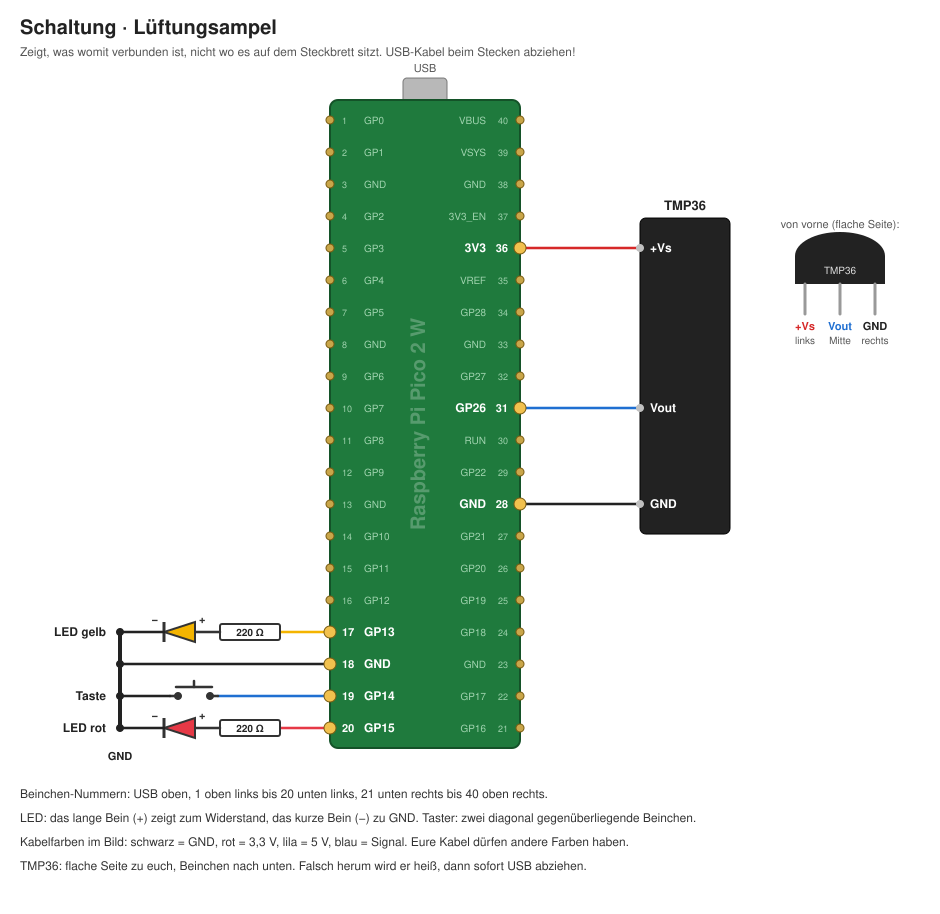
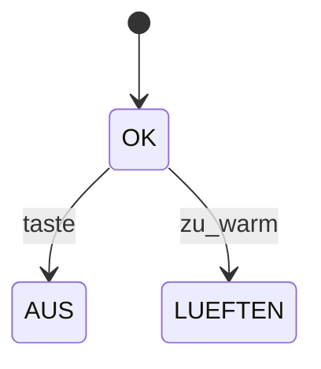
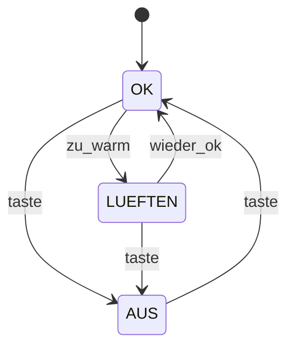

# Bauplan · Lüftungsampel

**Team:** 265a-team-05 · **Board:** Raspberry Pi Pico 2 W · **Ziel:** alle Karten bis Ende Woche 6 fertig, Vorführung in Woche 7

## So arbeitet ihr mit diesem Bauplan

1. **Teil 1** enthält eure User Stories in überarbeiteter Form. Fangt mit Karte **K0** an.
2. **Teil 2** sind die Karten für euer Kanban-Board. **Ihr entscheidet**, wer welche Karte nimmt und wann. Eine Karte darf erst starten, wenn alle Karten unter „braucht vorher" fertig sind. Höchstens eine Karte pro Person in „In Arbeit".
3. **Teil 3** erklärt jede Karte Schritt für Schritt. Wo im Code `# TODO` steht, schreibt ihr selbst. Wenn ihr hängt, öffnet die Hilfe **der Reihe nach**: zuerst Tipp 1, dann Tipp 2, die Lösung nur, wenn es gar nicht geht. Notiert im Lernjournal, welche Stufe ihr gebraucht habt.

> ⚠️ Bauteile nur stecken, wenn das USB-Kabel **abgezogen** ist. LEDs immer mit Vorwiderstand.

Eure Ampel hat zwei Lampen: **Gelb = alles in Ordnung, Rot = bitte lüften**. Zusätzlich schreibt das Gadget `bitte Lüften!` in Thonny.

---

## Teil 1 · Unsere User Stories (überarbeitet)

### US1 · Hinweis, wenn es zu warm ist (Muss)

Als Schüler:in möchte ich sehen, wann es in der Klasse zu warm ist, damit wir rechtzeitig lüften und konzentriert arbeiten können.

- [ ] Steigt die gemessene Temperatur auf `GRENZE_HOCH` (eingestellt: 25 °C) oder höher, leuchtet innerhalb von 2 s Rot, Gelb geht aus, und Thonny zeigt `bitte Lüften!`.
- [ ] Erst wenn die Temperatur unter `GRENZE_NIEDRIG` (eingestellt: 23 °C) sinkt, geht Rot aus und Gelb wieder an. Zwischen 23 und 25 °C flackert nichts.
- [ ] Thonny zeigt jede Sekunde die gemessene Temperatur. Sie weicht höchstens 1 °C von einem Raumthermometer ab.

### US2 · Lehrkraft schaltet die Ampel aus (Muss)

Als Lehrkraft möchte ich die Ampel mit einer Taste ausschalten können, damit ich nicht ständig zum Fenster gehen muss.

- [ ] Ein Tastendruck schaltet zwischen AUS und EIN um. Nach dem Einstecken ist die Ampel EIN.
- [ ] Im Zustand AUS leuchtet keine Lampe und Thonny zeigt keinen Hinweis, **auch nicht** über 25 °C.
- [ ] Wird die Ampel über 25 °C wieder eingeschaltet, zeigt sie innerhalb von 2 s Rot.

> **Was wir geändert haben:** Bei US1 stand „bei zu hohen Temperaturen", jetzt steht eine Zahl da (25 °C), sonst kann niemand prüfen, ob es stimmt. Neu sind **zwei** Grenzen: Würde die Ampel bei genau einer Grenze umschalten, flackert sie, sobald die Temperatur um 25 °C herum zittert (das kennt ihr aus Woche 4). Statt „damit uns nicht mehr heiß ist" steht jetzt der Nutzen für den Unterricht da. US2 war kein Story-Satz („Wenn der Lehrer genervt …"), jetzt hat sie die Form „Als … möchte ich …, damit …". US3 (Außenthermometer) ist gestrichen, weil ihr nur **einen** Temperatursensor habt. Sie steht unter „Wenn ihr schneller seid".

**Karte K0:** Kopiert Teil 1 in eure `ANFORDERUNGEN.md` (die alten Stories ersetzen) und committet mit der Nachricht `Stories überarbeitet`.

---

## Teil 2 · Karten für euer Kanban-Board

| Karte | Story | braucht vorher | fertig, wenn … |
|-------|-------|----------------|----------------|
| K0 Stories übernehmen | – | – | `ANFORDERUNGEN.md` enthält Teil 1, committet |
| K1 LEDs und Taste anschließen | US1, US2 | – | Testcode: beide LEDs leuchten, die Taste wird erkannt |
| K2 Temperatursensor anschließen | US1 | K1 | `temperatur()` liefert die Raumtemperatur, sie steigt beim Anfassen |
| K3 Temperatur prüfen | US1 | K2 | Vergleich mit Raumthermometer als Kommentar in `hardware.py`, `KORREKTUR` eingetragen |
| K4 Zustandsdiagramm zeichnen | US1, US2 | K0 | Mermaid-Diagramm mit 3 Zuständen in `README.md` |
| K5 `naechster_zustand` und `lampen` schreiben | US1, US2 | K4 | Tests zu `naechster_zustand` und `lampen` in K7 sind grün |
| K6 `ereignis_bestimmen` schreiben | US1, US2 | K4 | Tests zu `ereignis_bestimmen` in K7 sind grün |
| K7 `test_logik.py` | US1, US2 | K5, K6 | alle Tests grün am PC |
| K8 `main.py` am Board | US1, US2 | K3, K7 | die Ampel zeigt Rot beim Erwärmen und lässt sich ausschalten |
| K9 Testprotokoll `TESTS.md` | US1, US2 | K8 | jedes Akzeptanzkriterium hat eine Zeile mit ✅ oder ❌ |
| K10 `README.md` fertig | – | K8 | README nach der Vorlage aus Woche 6 |
| K11 Präsentation + Demo-Video | – | K9 | 3-Minuten-Ablauf geprobt, 30-s-Video im Repository |

K1 und K4 können **gleichzeitig** von zwei Personen erledigt werden, ebenso K5 und K6.

---

## Teil 3 · Anleitungen pro Karte

### K1 · LEDs und Taste anschließen

Ihr braucht: LED gelb, LED rot, zwei Widerstände 220 Ω, einen Taster, Kabel.

| Bauteil | Anschluss |
|---------|-----------|
| LED gelb (in Ordnung) | **GP13** (Beinchen 17) → 220 Ω → langes Bein, kurzes Bein → GND |
| LED rot (lüften) | **GP15** (Beinchen 20) → 220 Ω → langes Bein, kurzes Bein → GND |
| Taste | **GP14** (Beinchen 19) ↔ GND (Beinchen 18) |



Das Bild zeigt, **was womit verbunden** ist, nicht wo es auf dem Steckbrett sitzt. Es zeigt schon die ganze Schaltung, auch den Temperatursensor (K2).

Taster mit vier Beinchen: zwei **diagonal gegenüberliegende** Beinchen verwenden, Taster über die Mittelrille stecken.

Speichert `hardware.py` **auf dem Pico** (Datei → Speichern unter → MicroPython-Gerät). Die Funktion `temperatur()` braucht ihr erst in K2, sie steht aber schon drin:

```python
# hardware.py – Raspberry Pi Pico 2 W · Lüftungsampel
from machine import Pin, ADC

KORREKTUR = 0.0      # TODO in K3: so viel °C weicht euer Sensor vom Thermometer ab

_gelb = Pin(13, Pin.OUT)
_rot = Pin(15, Pin.OUT)
_taste = Pin(14, Pin.IN, Pin.PULL_UP)
_sensor = ADC(26)
_vorher = 1


def anzeigen(gelb, rot):
    """Schaltet die zwei Lampen: True = an, False = aus."""
    _gelb.value(1 if gelb else 0)
    _rot.value(1 if rot else 0)


def gedrueckt():
    """True einmal pro Tastendruck."""
    global _vorher
    jetzt = _taste.value()
    neu = _vorher == 1 and jetzt == 0
    _vorher = jetzt
    return neu


def temperatur():
    """Temperatur am TMP36 in °C, Mittelwert aus 20 Messungen."""
    summe = 0
    for i in range(20):
        summe = summe + _sensor.read_u16()
    spannung = summe / 20 * 3.3 / 65535       # 0 bis 3,3 V
    grad = (spannung - 0.5) * 100             # TMP36: 0,5 V bei 0 °C, 0,01 V pro °C
    return round(grad + KORREKTUR, 1)
```

Testet in der Thonny-Kommandozeile:

```python
from hardware import *
anzeigen(True, False)    # nur Gelb
anzeigen(False, True)    # nur Rot
anzeigen(False, False)   # alles aus
```

Und die Taste (mit **Strg+C** beenden):

```python
import time
while True:
    if gedrueckt():
        print("Taste!")
    time.sleep_ms(50)
```

### K2 · Temperatursensor anschließen

Der **TMP36** sieht aus wie ein kleiner Transistor: schwarz, drei Beinchen, eine flache Seite mit Aufdruck. Er liefert eine Spannung, die mit der Temperatur steigt: 0,5 V bei 0 °C, jedes Grad mehr 0,01 V mehr. Bei 22 °C sind es also 0,72 V. Diese Rechnung macht `temperatur()` für euch.

Haltet ihn so, dass die **flache Seite zu euch** zeigt und die Beinchen nach unten:

| TMP36-Beinchen | Pico |
|----------------|------|
| links (+Vs) | **3V3** (Beinchen 36) |
| Mitte (Vout) | **GP26** (Beinchen 31) |
| rechts (GND) | GND (Beinchen 28) |

> ⚠️ **Falsch herum gesteckt, wird der TMP36 heiß.** Nach dem Einstecken vorsichtig mit dem Finger antippen. Ist er heiß: sofort USB abziehen, umdrehen.

Testet in der Thonny-Kommandozeile (`hardware.py` aus K1 ist schon auf dem Pico):

```python
from hardware import temperatur
import time
while True:
    print(temperatur())
    time.sleep(1)
```

Jetzt den Sensor zwischen zwei Fingern halten: Die Temperatur muss innerhalb einer Minute um einige Grad steigen. Lasst ihr los, sinkt sie langsam wieder.

**Zeigt er −50 °C oder über 100 °C?** Das mittlere Beinchen steckt nicht an GP26, oder der Sensor hat keinen Strom.

### K3 · Temperatur prüfen

Ein Sensor misst nie ganz genau. Prüft ihn mit einem echten Thermometer (in der Klasse, beim Schulwart oder von zuhause).

1. Legt Sensor und Thermometer 5 Minuten nebeneinander, nicht in die Sonne und nicht auf die Heizung.
2. Lest beide gleichzeitig ab.
3. Rechnet: `KORREKTUR = Thermometer − Sensor`. Zeigt das Thermometer 22,0 °C und euer Sensor 23,4 °C, ist `KORREKTUR = -1.4`.
4. Tragt den Wert in `hardware.py` ein, mit den Messwerten als Kommentar:

```python
KORREKTUR = -1.4     # gemessen: Thermometer 22,0 °C, Sensor 23,4 °C
```

5. **Für die Vorführung:** Haltet den Sensor 1 Minute zwischen den Fingern. Wie hoch steigt die Temperatur? Schafft sie 25 °C nicht, schreibt ihr das in `README.md` und stellt `GRENZE_HOCH` für die Vorführung niedriger (siehe K11).

### K4 · Zustandsdiagramm zeichnen

Eure Ampel hat **3 Zustände**: `AUS`, `OK` (Gelb) und `LUEFTEN` (Rot). Es gibt **3 Ereignisse**: `taste`, `zu_warm` (mindestens 25 °C) und `wieder_ok` (unter 23 °C).

Ergänzt die fehlenden Pfeile und schreibt das Diagramm in `README.md` ([Mermaid im Kursbuch](https://glandl.github.io/Coursebook-maker-reise-grade-9/werkzeuge/mermaid/)):

````markdown

````

<details>
<summary>Tipp 1</summary>

Fragt euch für jeden Zustand: Was passiert, wenn jemand die Taste drückt? Und: Aus welchem Zustand kommt man zurück zu `OK`, wenn es wieder kühl ist?

</details>

<details>
<summary>Lösung</summary>



</details>

**Denkfrage für die Präsentation:** Von `AUS` führt kein Pfeil mit `zu_warm` weg. Welches Akzeptanzkriterium aus US2 ist damit schon erfüllt?

### K5 · `naechster_zustand` und `lampen` schreiben

Nach dem **Automaten-Rezept** aus [Woche 5, Abschnitt 2a](https://glandl.github.io/Coursebook-maker-reise-grade-9/projekte/p1-code-gadget/woche-05-zustandsautomat/). Legt am PC eine Datei `logik.py` an (später auch auf den Pico kopieren):

```python
# logik.py – keine Imports von hardware!

GRENZE_HOCH = 25.0      # ab hier: bitte lüften
GRENZE_NIEDRIG = 23.0   # erst darunter wieder in Ordnung


def naechster_zustand(zustand, ereignis):
    """Die Pfeile des Zustandsdiagramms, sonst nichts."""
    if zustand == "AUS":
        if ereignis == "taste":
            return "OK"
    elif zustand == "OK":
        if ereignis == "taste":
            return "AUS"
        # TODO: der Pfeil nach LUEFTEN
    elif zustand == "LUEFTEN":
        # TODO: zwei Pfeile
        pass
    return zustand


def lampen(zustand):
    """Liefert (gelb, rot): welche Lampe leuchtet in diesem Zustand?"""
    if zustand == "OK":
        return (True, False)
    # TODO: LUEFTEN
    return (False, False)
```

<details>
<summary>Tipp 1</summary>

Jeder Pfeil in eurem Diagramm aus K4 wird zu einem `if ereignis == …: return …` im Block seines Startzustands. `LUEFTEN` hat zwei Pfeile hinaus, also zwei `if`.

</details>

<details>
<summary>Tipp 2</summary>

```python
    elif zustand == "LUEFTEN":
        if ereignis == "wieder_ok":
            return ...
        if ereignis == ...:
            return "AUS"
```

</details>

<details>
<summary>Lösung</summary>

```python
def naechster_zustand(zustand, ereignis):
    """Die Pfeile des Zustandsdiagramms, sonst nichts."""
    if zustand == "AUS":
        if ereignis == "taste":
            return "OK"
    elif zustand == "OK":
        if ereignis == "taste":
            return "AUS"
        if ereignis == "zu_warm":
            return "LUEFTEN"
    elif zustand == "LUEFTEN":
        if ereignis == "wieder_ok":
            return "OK"
        if ereignis == "taste":
            return "AUS"
    return zustand


def lampen(zustand):
    """Liefert (gelb, rot): welche Lampe leuchtet in diesem Zustand?"""
    if zustand == "OK":
        return (True, False)
    if zustand == "LUEFTEN":
        return (False, True)
    return (False, False)
```

</details>

### K6 · `ereignis_bestimmen` schreiben

Diese Funktion macht aus den Messwerten **ein** Ereignis. Sie bekommt Taste und Temperatur als Parameter, deshalb könnt ihr sie am PC testen, ganz ohne Sensor. Ergänzt in `logik.py`:

```python
def ereignis_bestimmen(gedrueckt, temperatur):
    """Macht aus Taste und Temperatur ein Ereignis (oder None)."""
    # TODO 1: Taste gedrückt → "taste"
    # TODO 2: mindestens GRENZE_HOCH → "zu_warm"
    # TODO 3: unter GRENZE_NIEDRIG → "wieder_ok"
    return None          # dazwischen: kein Ereignis
```

<details>
<summary>Tipp 1</summary>

Die Reihenfolge ist wichtig: Die Taste kommt **zuerst**, sonst könnte man die Ampel bei Hitze nicht ausschalten. Für „mindestens" verwendet ihr `>=`, für „unter" `<`.

</details>

<details>
<summary>Tipp 2</summary>

```python
    if gedrueckt:
        return "taste"
    if temperatur >= ...:
        return ...
    if ...:
        return "wieder_ok"
    return None
```

</details>

<details>
<summary>Lösung</summary>

```python
def ereignis_bestimmen(gedrueckt, temperatur):
    """Macht aus Taste und Temperatur ein Ereignis (oder None)."""
    if gedrueckt:
        return "taste"
    if temperatur >= GRENZE_HOCH:
        return "zu_warm"
    if temperatur < GRENZE_NIEDRIG:
        return "wieder_ok"
    return None
```

</details>

Zwischen 23 und 25 °C gibt es **kein** Ereignis. Darum bleibt die Ampel dort, wo sie ist, und flackert nicht. Das ist die **Hysterese** aus [Woche 5](https://glandl.github.io/Coursebook-maker-reise-grade-9/projekte/p1-code-gadget/woche-05-zustandsautomat/).

### K7 · `test_logik.py`

Legt `test_logik.py` **am PC** im selben Ordner wie `logik.py` an und startet ihn mit dem Interpreter **Lokales Python 3** ([Woche 6, Abschnitt 2b](https://glandl.github.io/Coursebook-maker-reise-grade-9/projekte/p1-code-gadget/woche-06-testen-doku/)).

```python
from logik import naechster_zustand, lampen, ereignis_bestimmen

TESTS = [
    ("AUS",     "taste",     "OK"),
    ("OK",      "zu_warm",   "LUEFTEN"),
    # TODO: die anderen drei Pfeile
    ("AUS",     "zu_warm",   "AUS"),       # US2: im Zustand AUS kein Hinweis!
    ("OK",      None,        "OK"),        # kein Ereignis: Zustand bleibt
]
LAMPEN_TESTS = [
    ("OK",      (True, False)),
    # TODO: LUEFTEN und AUS
]
EREIGNIS_TESTS = [
    # (Taste gedrückt, Temperatur, erwartetes Ereignis)
    (False, 26.0, "zu_warm"),
    (False, 24.0, None),                   # zwischen den Grenzen
    (True,  30.0, "taste"),                # Taste geht vor
    # TODO: genau 25,0 °C, 22,0 °C und genau 23,0 °C
]

bestanden = 0
for zustand, ereignis, erwartet in TESTS:
    ergebnis = naechster_zustand(zustand, ereignis)
    if ergebnis == erwartet:
        bestanden = bestanden + 1
        print("ok     ", zustand, "+", ereignis, "→", ergebnis)
    else:
        print("FEHLER ", zustand, "+", ereignis, "→", ergebnis, "erwartet:", erwartet)
for zustand, erwartet in LAMPEN_TESTS:
    ergebnis = lampen(zustand)
    if ergebnis == erwartet:
        bestanden = bestanden + 1
        print("ok     ", zustand, "→", ergebnis)
    else:
        print("FEHLER ", zustand, "→", ergebnis, "erwartet:", erwartet)
for taste, grad, erwartet in EREIGNIS_TESTS:
    ergebnis = ereignis_bestimmen(taste, grad)
    if ergebnis == erwartet:
        bestanden = bestanden + 1
        print("ok     ", taste, grad, "°C →", ergebnis)
    else:
        print("FEHLER ", taste, grad, "°C →", ergebnis, "erwartet:", erwartet)

print(bestanden, "von", len(TESTS) + len(LAMPEN_TESTS) + len(EREIGNIS_TESTS), "Tests bestanden")
```

<details>
<summary>Tipp 1 (für die Grenzfälle)</summary>

Bei genau 25,0 °C gilt „mindestens 25", also `"zu_warm"`. Bei genau 23,0 °C gilt „unter 23" **nicht**, also `None`.

</details>

**Fertig, wenn** alle Tests grün sind. Dann baut absichtlich einen Fehler ein (z. B. `>` statt `>=`): Findet ihn der Test?

### K8 · `main.py` am Board

1. Kopiert `logik.py` auf den Pico (Datei → Speichern unter → MicroPython-Gerät).
2. Speichert dort auch `main.py`:

```python
from hardware import anzeigen, gedrueckt, temperatur
from logik import naechster_zustand, lampen, ereignis_bestimmen
import time

zustand = "OK"
gelb, rot = lampen(zustand)
anzeigen(gelb, rot)
letzte_ausgabe = time.ticks_ms()

while True:
    grad = temperatur()
    ereignis = ereignis_bestimmen(gedrueckt(), grad)
    neu = naechster_zustand(zustand, ereignis)
    if neu != zustand:
        print(zustand, "→", neu)
        # TODO: wenn der neue Zustand LUEFTEN ist, "bitte Lüften!" ausgeben
        zustand = neu
        gelb, rot = lampen(zustand)
        anzeigen(gelb, rot)

    if time.ticks_diff(time.ticks_ms(), letzte_ausgabe) >= 1000:
        print(grad, "°C", zustand)
        letzte_ausgabe = time.ticks_ms()
    time.sleep_ms(50)
```

`gelb, rot = lampen(zustand)` packt die zwei Werte, die `lampen` liefert, in zwei Variablen aus.

<details>
<summary>Tipp 1</summary>

Ein `if`, das `neu` mit `"LUEFTEN"` vergleicht, und darin ein `print`.

</details>

<details>
<summary>Lösung</summary>

```python
        if neu == "LUEFTEN":
            print("bitte Lüften!")
```

</details>

**Fertig, wenn** Gelb nach dem Einstecken leuchtet, Rot beim Erwärmen mit den Fingern angeht und die Taste die Ampel aus- und wieder einschaltet.

### K9 · Testprotokoll `TESTS.md`

Vorlage: [Woche 6, Abschnitt 2c](https://glandl.github.io/Coursebook-maker-reise-grade-9/projekte/p1-code-gadget/woche-06-testen-doku/). Eine Person hält den Sensor, eine beobachtet Lampen und Thonny, eine trägt ein. Eine Zeile pro Akzeptanzkriterium aus Teil 1, z. B.:

```markdown
| # | Ausgangszustand | Aktion | Erwartet | Beobachtet | ok? |
|---|-----------------|--------|----------|------------|-----|
| 1 | OK, 22 °C | Sensor zwischen den Fingern | ab 25 °C: Rot, `bitte Lüften!` | | |
| 2 | LUEFTEN | loslassen, bei 24 °C beobachten | Rot bleibt | | |
| 3 | OK | Taste, dann Sensor erwärmen | keine Lampe, kein Hinweis | | |
| … | | | | | |
```

Jedes ❌ wird eine neue Karte.

### K10 · `README.md` fertig

Nach der Vorlage aus [Woche 6, Abschnitt 4](https://glandl.github.io/Coursebook-maker-reise-grade-9/projekte/p1-code-gadget/woche-06-testen-doku/). Das Zustandsdiagramm aus K4 gehört hinein, die Hardware-Tabellen aus K1 und K2 auch, ebenso eure Messwerte aus K3.

### K11 · Präsentation + Demo-Video

Ablauf aus [Woche 6, Abschnitt 5](https://glandl.github.io/Coursebook-maker-reise-grade-9/projekte/p1-code-gadget/woche-06-testen-doku/). Für die Demo: Zeigt Thonny mit der laufenden Temperatur auf dem Beamer. Eine Person hält den Sensor zwischen den Fingern („die Klasse wird warm"), bis Rot angeht. Dann spielt eine Person die Lehrkraft und schaltet die Ampel aus: Sie bleibt dunkel, obwohl es noch warm ist. Wenn die Fingerwärme in K3 nicht für 25 °C gereicht hat, stellt `GRENZE_HOCH` für die Vorführung auf 2 °C über die Raumtemperatur und sagt das dazu. 30-s-Video ins Repository.

---

## Wenn ihr schneller seid

- **Außenthermometer (eure US3):** Mit einem zweiten TMP36 an **GP27** (fragt eure Lehrkraft danach) misst das Gadget auch draußen. Ist es draußen wärmer als drinnen, bringt Lüften nichts. `ereignis_bestimmen` bekommt dann einen dritten Parameter `aussen` und liefert in diesem Fall kein `"zu_warm"`.
- **Vorwarnung:** Ein neuer Zustand `WARM` zwischen `OK` und `LUEFTEN`, in dem Gelb und Rot gleichzeitig leuchten. Ihr braucht dafür ein drittes Ereignis (z. B. `warm` ab 24 °C) und müsst die Grenzen so wählen, dass nichts flackert. Zeichnet zuerst das Diagramm!
- **Erinnerung ans Schließen:** Nach 10 Minuten im Zustand `LUEFTEN` meldet Thonny `Fenster wieder zu?`. Ein neues Ereignis `zeit_um` wie beim Reaktionsspiel in Woche 5.
