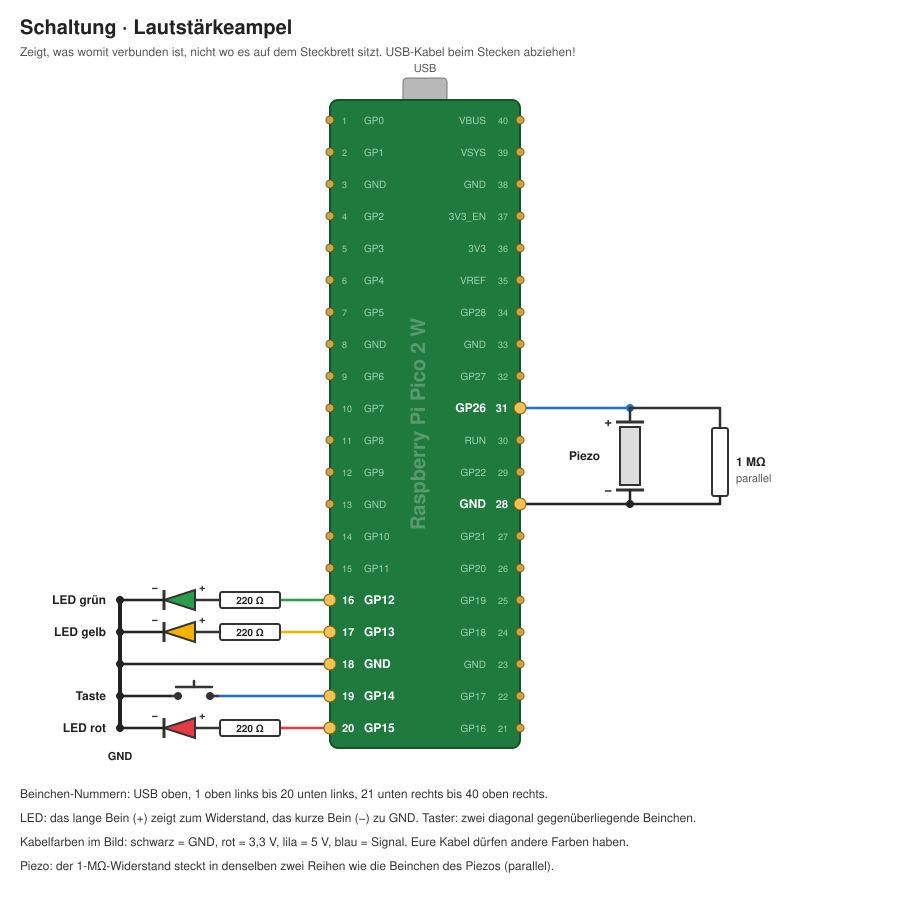
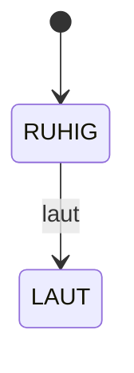
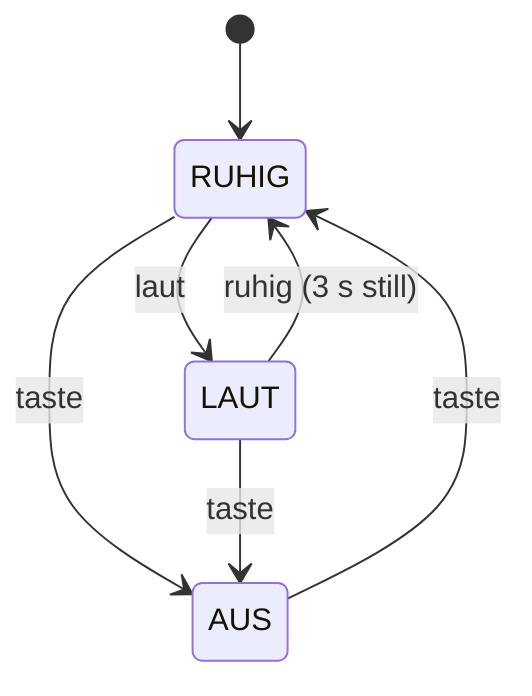

# Bauplan · Lautstärkeampel

**Team:** 265a-team-06 · **Board:** Raspberry Pi Pico 2 W · **Ziel:** alle Karten bis Ende Woche 6 fertig, Vorführung in Woche 7

## So arbeitet ihr mit diesem Bauplan

1. **Teil 1** enthält eure User Stories in überarbeiteter Form. Fangt mit Karte **K0** an.
2. **Teil 2** sind die Karten für euer Kanban-Board. **Ihr entscheidet**, wer welche Karte nimmt und wann. Eine Karte darf erst starten, wenn alle Karten unter „braucht vorher" fertig sind. Höchstens eine Karte pro Person in „In Arbeit".
3. **Teil 3** erklärt jede Karte Schritt für Schritt. Wo im Code `# TODO` steht, schreibt ihr selbst. Wenn ihr hängt, öffnet die Hilfe **der Reihe nach**: zuerst Tipp 1, dann Tipp 2, die Lösung nur, wenn es gar nicht geht. Notiert im Lernjournal, welche Stufe ihr gebraucht habt.

> ⚠️ Bauteile nur stecken, wenn das USB-Kabel **abgezogen** ist. LEDs immer mit Vorwiderstand.

Wie mit eurer Lehrkraft besprochen, baut ihr zuerst **Grün (ruhig) und Gelb (zu laut)**. Rot kommt dazu, wenn ihr schneller seid. Ihr steckt die rote LED aber gleich in K1 mit an.

---

## Teil 1 · Unsere User Stories (überarbeitet)

### US1 · Die Ampel zeigt, wenn es zu laut ist (Muss)

Als Schüler:in möchte ich, dass alle sehen, wenn es in der Klasse zu laut wird, damit ich niemanden einzeln ermahnen muss.

- [ ] Ist es ruhig, leuchtet nur Grün.
- [ ] Ein lautes Geräusch (Klatschen 10 cm über dem Sensor) schaltet innerhalb von 0,5 s auf Gelb, Grün geht aus.
- [ ] Gelb bleibt an, bis es **3 s** (±1 s) lang ruhig war. Dann leuchtet wieder Grün.
- [ ] Normales Sprechen in 1 m Abstand schaltet **nicht** auf Gelb.

### US2 · Ampel ein- und ausschalten (Muss)

Als Lehrkraft möchte ich die Ampel mit einer Taste ausschalten können, damit sie z. B. in der Gruppenarbeit nicht ständig Gelb zeigt.

- [ ] Ein Tastendruck schaltet zwischen AUS und AUTOMATIK um. Nach dem Einstecken ist die Ampel in AUTOMATIK und zeigt Grün.
- [ ] Im Zustand AUS leuchtet keine Lampe, **auch nicht**, wenn es laut ist.

> **Was wir geändert haben:** Eure US1 und US3 wollten dasselbe (die Ampel geht an, wenn es laut ist), deshalb sind sie jetzt **eine** Story. „Sofort" aus US3 ist jetzt ein Kriterium mit Zahl (0,5 s). „Zu laut" ist so beschrieben, dass man es vorführen kann (Klatschen, Sprechen). Neu: Gelb bleibt 3 s an. Ein Klatschen dauert nur einen Augenblick, ohne diese Zeit würde Gelb nur kurz aufblitzen. Bei US2 stand „Im Zustand AUS ist die Ampel aus, wenn es ruhig ist", aber AUS soll **immer** dunkel sein, auch bei Lärm. Statt „Elternteil" ist es jetzt die Lehrkraft, denn sie drückt die Taste in der Klasse.

> ℹ️ **Ihr braucht zusätzlich einen Widerstand mit 1 MΩ** (braun-schwarz-grün). Ohne ihn liefert der Piezo zufällige Werte. Fragt eure Lehrkraft danach.

**Karte K0:** Kopiert Teil 1 in eure `ANFORDERUNGEN.md` (die alten Stories ersetzen) und committet mit der Nachricht `Stories überarbeitet`.

---

## Teil 2 · Karten für euer Kanban-Board

| Karte | Story | braucht vorher | fertig, wenn … |
|-------|-------|----------------|----------------|
| K0 Stories übernehmen | – | – | `ANFORDERUNGEN.md` enthält Teil 1, committet |
| K1 LEDs und Taste anschließen | US1, US2 | – | Testcode: alle drei LEDs leuchten, die Taste wird erkannt |
| K2 Piezo als Mikrofon anschließen | US1 | K1 | `lautstaerke()` steigt beim Klatschen deutlich |
| K3 Schwellwert „laut" finden | US1 | K2 | `SCHWELLE_LAUT` steht mit Messwerten in `logik.py` |
| K4 Zustandsdiagramm zeichnen | US1, US2 | K0 | Mermaid-Diagramm mit 3 Zuständen in `README.md` |
| K5 `naechster_zustand` und `lampen` schreiben | US1, US2 | K4 | Tests zu `naechster_zustand` und `lampen` in K7 sind grün |
| K6 `ereignis_bestimmen` schreiben | US1, US2 | K4 | Tests zu `ereignis_bestimmen` in K7 sind grün |
| K7 `test_logik.py` | US1, US2 | K5, K6 | alle Tests grün am PC |
| K8 `main.py` am Board | US1, US2 | K3, K7 | Klatschen schaltet auf Gelb, 3 s später Grün, Taste schaltet aus |
| K9 Testprotokoll `TESTS.md` | US1, US2 | K8 | jedes Akzeptanzkriterium hat eine Zeile mit ✅ oder ❌ |
| K10 `README.md` fertig | – | K8 | README nach der Vorlage aus Woche 6 |
| K11 Präsentation + Demo-Video | – | K9 | 3-Minuten-Ablauf geprobt, 30-s-Video im Repository |

K1 und K4 können **gleichzeitig** von zwei Personen erledigt werden, ebenso K5 und K6.

---

## Teil 3 · Anleitungen pro Karte

### K1 · LEDs und Taste anschließen

Ihr braucht: LED grün, gelb, rot, **drei** Widerstände 220 Ω, einen Taster, Kabel.

| Bauteil | Anschluss |
|---------|-----------|
| LED rot | **GP15** (Beinchen 20) → 220 Ω → langes Bein, kurzes Bein → GND |
| LED gelb | **GP13** (Beinchen 17) → 220 Ω → langes Bein, kurzes Bein → GND |
| LED grün | **GP12** (Beinchen 16) → 220 Ω → langes Bein, kurzes Bein → GND |
| Taste | **GP14** (Beinchen 19) ↔ GND (Beinchen 18) |



Das Bild zeigt, **was womit verbunden** ist, nicht wo es auf dem Steckbrett sitzt. Es zeigt schon die ganze Schaltung, auch den Piezo (K2).

Steckt die LEDs wie bei einer Ampel untereinander, Rot oben. Taster mit vier Beinchen: zwei **diagonal gegenüberliegende** Beinchen verwenden, Taster über die Mittelrille stecken.

Speichert `hardware.py` **auf dem Pico** (Datei → Speichern unter → MicroPython-Gerät). Die Funktion `lautstaerke()` braucht ihr erst in K2, sie steht aber schon drin:

```python
# hardware.py – Raspberry Pi Pico 2 W · Lautstärkeampel
from machine import Pin, ADC

_gruen = Pin(12, Pin.OUT)
_gelb = Pin(13, Pin.OUT)
_rot = Pin(15, Pin.OUT)
_taste = Pin(14, Pin.IN, Pin.PULL_UP)
_mikro = ADC(26)
_vorher = 1


def ampel(gruen, gelb, rot):
    """Schaltet die drei Lampen: True = an, False = aus."""
    _gruen.value(1 if gruen else 0)
    _gelb.value(1 if gelb else 0)
    _rot.value(1 if rot else 0)


def gedrueckt():
    """True einmal pro Tastendruck."""
    global _vorher
    jetzt = _taste.value()
    neu = _vorher == 1 and jetzt == 0
    _vorher = jetzt
    return neu


def lautstaerke():
    """Lautstärke von 0 (still) bis 1023 (sehr laut).

    Misst 200-mal ganz schnell hintereinander und liefert, wie weit
    der größte und der kleinste Wert auseinanderliegen.
    """
    kleinster = 65535
    groesster = 0
    for i in range(200):
        wert = _mikro.read_u16()
        if wert < kleinster:
            kleinster = wert
        if wert > groesster:
            groesster = wert
    return (groesster - kleinster) // 64
```

Testet in der Thonny-Kommandozeile:

```python
from hardware import *
ampel(True, False, False)    # nur Grün
ampel(False, True, False)    # nur Gelb
ampel(False, False, True)    # nur Rot
ampel(False, False, False)   # alles aus
```

Und die Taste (mit **Strg+C** beenden):

```python
import time
while True:
    if gedrueckt():
        print("Taste!")
    time.sleep_ms(50)
```

### K2 · Piezo als Mikrofon anschließen

Ein Piezo-Summer kann nicht nur Töne machen, er funktioniert auch umgekehrt: Schall und Erschütterung bringen das Plättchen darin zum Schwingen, und es erzeugt eine kleine Spannung. Die misst der Pico.

Ihr braucht: Piezo-Summer, Widerstand **1 MΩ**, Kabel.

| Bauteil | Anschluss |
|---------|-----------|
| Piezo, Bein **+** (oft das längere oder rote) | **GP26** (Beinchen 31) |
| Piezo, Bein **−** | GND (Beinchen 28) |
| Widerstand 1 MΩ | **parallel** zum Piezo: ein Ende in die Reihe von GP26, das andere in die Reihe von GND |

Der Widerstand leitet die Spannung des Piezos langsam ab. Ohne ihn „hängt" der Messwert und zeigt Unsinn.

**Ehrlich gesagt:** Ein Piezo ist ein schlechtes Mikrofon. Er hört vor allem **laute, kurze** Geräusche in der Nähe (Klatschen, Klopfen auf den Tisch), leises Reden kaum. Für eure Ampel reicht das. Klebt ihn mit Klebeband flach auf den Tisch, dann spürt er auch Klopfen.

Testet in der Thonny-Kommandozeile (`hardware.py` aus K1 ist schon auf dem Pico):

```python
from hardware import lautstaerke
import time
while True:
    print(lautstaerke())
    time.sleep_ms(100)
```

Seid still, dann klatscht über dem Piezo. Die Zahl muss deutlich steigen. **Ändert sich gar nichts?** Prüft, ob der Piezo wirklich an GP26 steckt und ob der 1-MΩ-Widerstand in denselben Reihen steckt wie die Piezo-Beine.

### K3 · Schwellwert „laut" finden

1. Messt mit dem Testcode aus K2 und notiert jeweils den **größten** Wert, den ihr in 10 Sekunden seht:
   - alle still,
   - normales Sprechen in 1 m Abstand,
   - Klatschen 10 cm über dem Sensor,
   - lautes Rufen in 1 m Abstand.
2. Wählt `SCHWELLE_LAUT` **zwischen** „Sprechen" und „Klatschen".
3. Tragt den Wert mit den Messwerten als Kommentar in `logik.py` ein. Gibt es die Datei noch nicht (sie entsteht in K5), notiert ihn auf der Karte.

Beispiel (eure Werte sind anders!):

```python
SCHWELLE_LAUT = 40      # gemessen: still 2, Sprechen 9, Klatschen 180, Rufen 55
```

### K4 · Zustandsdiagramm zeichnen

Eure Ampel hat **3 Zustände**: `AUS`, `RUHIG` (Grün) und `LAUT` (Gelb). `RUHIG` und `LAUT` zusammen sind eure AUTOMATIK. Es gibt **3 Ereignisse**: `taste`, `laut` (lauter als `SCHWELLE_LAUT`) und `ruhig` (seit 3 s nichts Lautes).

Ergänzt die fehlenden Pfeile und schreibt das Diagramm in `README.md` ([Mermaid im Kursbuch](https://glandl.github.io/Coursebook-maker-reise-grade-9/werkzeuge/mermaid/)):

````markdown

````

<details>
<summary>Tipp 1</summary>

Von **jedem** Zustand führt ein Pfeil mit `taste` weg. Wohin? Und wie kommt man von `LAUT` zurück zu `RUHIG`?

</details>

<details>
<summary>Lösung</summary>



</details>

**Denkfrage für die Präsentation:** Was passiert, wenn es im Zustand `LAUT` noch einmal laut ist? Es gibt keinen Pfeil, der Zustand bleibt. Aber warum dauert es dann trotzdem wieder 3 s bis Grün? (Antwort steckt in K8.)

### K5 · `naechster_zustand` und `lampen` schreiben

Nach dem **Automaten-Rezept** aus [Woche 5, Abschnitt 2a](https://glandl.github.io/Coursebook-maker-reise-grade-9/projekte/p1-code-gadget/woche-05-zustandsautomat/). Legt am PC eine Datei `logik.py` an (später auch auf den Pico kopieren):

```python
# logik.py – keine Imports von hardware!

SCHWELLE_LAUT = 40      # TODO: euer Wert aus K3, mit Messwerten als Kommentar
NACHLAUF_MS = 3000      # so lange bleibt Gelb nach dem letzten lauten Geräusch


def naechster_zustand(zustand, ereignis):
    """Die Pfeile des Zustandsdiagramms, sonst nichts."""
    if zustand == "AUS":
        if ereignis == "taste":
            return "RUHIG"
    elif zustand == "RUHIG":
        # TODO: zwei Pfeile
        pass
    elif zustand == "LAUT":
        # TODO: zwei Pfeile
        pass
    return zustand


def lampen(zustand):
    """Liefert (gruen, gelb, rot): welche Lampe leuchtet in diesem Zustand?"""
    if zustand == "RUHIG":
        return (True, False, False)
    # TODO: LAUT
    return (False, False, False)
```

<details>
<summary>Tipp 1</summary>

Jeder Pfeil in eurem Diagramm aus K4 wird zu einem `if ereignis == …: return …` im Block seines Startzustands.

</details>

<details>
<summary>Tipp 2</summary>

```python
    elif zustand == "RUHIG":
        if ereignis == "laut":
            return "LAUT"
        if ereignis == "taste":
            return ...
```

</details>

<details>
<summary>Lösung</summary>

```python
def naechster_zustand(zustand, ereignis):
    """Die Pfeile des Zustandsdiagramms, sonst nichts."""
    if zustand == "AUS":
        if ereignis == "taste":
            return "RUHIG"
    elif zustand == "RUHIG":
        if ereignis == "laut":
            return "LAUT"
        if ereignis == "taste":
            return "AUS"
    elif zustand == "LAUT":
        if ereignis == "ruhig":
            return "RUHIG"
        if ereignis == "taste":
            return "AUS"
    return zustand


def lampen(zustand):
    """Liefert (gruen, gelb, rot): welche Lampe leuchtet in diesem Zustand?"""
    if zustand == "RUHIG":
        return (True, False, False)
    if zustand == "LAUT":
        return (False, True, False)
    return (False, False, False)
```

</details>

### K6 · `ereignis_bestimmen` schreiben

Diese Funktion macht aus den Messwerten **ein** Ereignis. Sie bekommt alles als Parameter, deshalb könnt ihr sie am PC testen, ganz ohne Piezo. Ergänzt in `logik.py`:

```python
def ereignis_bestimmen(gedrueckt, lautstaerke, ms_seit_laut):
    """Macht aus Taste, Lautstärke und Zeit ein Ereignis (oder None)."""
    # TODO 1: Taste gedrückt → "taste"
    # TODO 2: lautstaerke mindestens SCHWELLE_LAUT → "laut"
    # TODO 3: seit mindestens NACHLAUF_MS nichts Lautes → "ruhig"
    return None
```

<details>
<summary>Tipp 1</summary>

Die Reihenfolge ist wichtig: Die Taste kommt **zuerst**, sonst könnte man die Ampel bei Lärm nicht ausschalten. Für „mindestens" verwendet ihr `>=`.

</details>

<details>
<summary>Tipp 2</summary>

```python
    if gedrueckt:
        return "taste"
    if lautstaerke >= ...:
        return "laut"
    if ms_seit_laut >= ...:
        return ...
    return None
```

</details>

<details>
<summary>Lösung</summary>

```python
def ereignis_bestimmen(gedrueckt, lautstaerke, ms_seit_laut):
    """Macht aus Taste, Lautstärke und Zeit ein Ereignis (oder None)."""
    if gedrueckt:
        return "taste"
    if lautstaerke >= SCHWELLE_LAUT:
        return "laut"
    if ms_seit_laut >= NACHLAUF_MS:
        return "ruhig"
    return None
```

</details>

### K7 · `test_logik.py`

Legt `test_logik.py` **am PC** im selben Ordner wie `logik.py` an und startet ihn mit dem Interpreter **Lokales Python 3** ([Woche 6, Abschnitt 2b](https://glandl.github.io/Coursebook-maker-reise-grade-9/projekte/p1-code-gadget/woche-06-testen-doku/)).

```python
from logik import naechster_zustand, lampen, ereignis_bestimmen, SCHWELLE_LAUT

TESTS = [
    ("RUHIG",  "laut",   "LAUT"),
    ("AUS",    "taste",  "RUHIG"),
    # TODO: die anderen drei Pfeile
    ("AUS",    "laut",   "AUS"),       # US2: im Zustand AUS bleibt alles dunkel
    ("LAUT",   None,     "LAUT"),      # kein Ereignis: Zustand bleibt
]
LAMPEN_TESTS = [
    ("RUHIG",  (True, False, False)),
    # TODO: LAUT und AUS
]
EREIGNIS_TESTS = [
    # (Taste gedrückt, Lautstärke, ms seit laut, erwartetes Ereignis)
    (False, SCHWELLE_LAUT + 50, 0,    "laut"),
    (False, 0,                  1000, None),       # still, aber erst 1 s
    (True,  SCHWELLE_LAUT + 50, 0,    "taste"),    # Taste geht vor
    # TODO: still seit 3000 ms, und genau SCHWELLE_LAUT
]

bestanden = 0
for zustand, ereignis, erwartet in TESTS:
    ergebnis = naechster_zustand(zustand, ereignis)
    if ergebnis == erwartet:
        bestanden = bestanden + 1
        print("ok     ", zustand, "+", ereignis, "→", ergebnis)
    else:
        print("FEHLER ", zustand, "+", ereignis, "→", ergebnis, "erwartet:", erwartet)
for zustand, erwartet in LAMPEN_TESTS:
    ergebnis = lampen(zustand)
    if ergebnis == erwartet:
        bestanden = bestanden + 1
        print("ok     ", zustand, "→", ergebnis)
    else:
        print("FEHLER ", zustand, "→", ergebnis, "erwartet:", erwartet)
for taste, laut, ms, erwartet in EREIGNIS_TESTS:
    ergebnis = ereignis_bestimmen(taste, laut, ms)
    if ergebnis == erwartet:
        bestanden = bestanden + 1
        print("ok     ", taste, laut, ms, "→", ergebnis)
    else:
        print("FEHLER ", taste, laut, ms, "→", ergebnis, "erwartet:", erwartet)

print(bestanden, "von", len(TESTS) + len(LAMPEN_TESTS) + len(EREIGNIS_TESTS), "Tests bestanden")
```

Die Tests verwenden `SCHWELLE_LAUT + 50` statt einer festen Zahl. So stimmen sie auch noch, wenn ihr den Schwellwert später ändert.

**Fertig, wenn** alle Tests grün sind. Dann baut absichtlich einen Fehler ein: Findet ihn der Test?

### K8 · `main.py` am Board

Die Hauptschleife merkt sich, **wann es zuletzt laut war**. Daraus berechnet sie `ms_seit_laut`.

1. Kopiert `logik.py` auf den Pico (Datei → Speichern unter → MicroPython-Gerät).
2. Speichert dort auch `main.py`:

```python
from hardware import ampel, gedrueckt, lautstaerke
from logik import naechster_zustand, lampen, ereignis_bestimmen, SCHWELLE_LAUT
import time

zustand = "RUHIG"
gruen, gelb, rot = lampen(zustand)
ampel(gruen, gelb, rot)
letztes_laut = time.ticks_ms()

while True:
    pegel = lautstaerke()
    if pegel >= SCHWELLE_LAUT:
        letztes_laut = time.ticks_ms()        # die 3 s beginnen von vorn
    ms_seit = 0                               # TODO: wie viele ms seit letztes_laut?

    ereignis = ereignis_bestimmen(gedrueckt(), pegel, ms_seit)
    neu = naechster_zustand(zustand, ereignis)
    if neu != zustand:
        print(zustand, "→", neu, "· Lautstärke", pegel)
        zustand = neu
        gruen, gelb, rot = lampen(zustand)
        ampel(gruen, gelb, rot)
    time.sleep_ms(20)
```

`gruen, gelb, rot = lampen(zustand)` packt die drei Werte, die `lampen` liefert, in drei Variablen aus.

<details>
<summary>Tipp 1</summary>

`time.ticks_ms()` ist „jetzt". `time.ticks_diff(a, b)` rechnet `a − b` aus, auch wenn der Zähler einmal überläuft.

</details>

<details>
<summary>Lösung</summary>

```python
    ms_seit = time.ticks_diff(time.ticks_ms(), letztes_laut)
```

</details>

**Fertig, wenn** die Ampel Grün zeigt, beim Klatschen auf Gelb springt, 3 s nach dem letzten Klatschen wieder Grün zeigt und die Taste sie aus- und einschaltet.

**Springt sie schon beim Reden auf Gelb?** `SCHWELLE_LAUT` höher stellen. **Springt sie nie?** Niedriger stellen oder den Piezo näher an die Geräuschquelle legen.

### K9 · Testprotokoll `TESTS.md`

Vorlage: [Woche 6, Abschnitt 2c](https://glandl.github.io/Coursebook-maker-reise-grade-9/projekte/p1-code-gadget/woche-06-testen-doku/). Eine Person macht Geräusche, eine stoppt die Zeit mit dem Handy, eine trägt ein. Eine Zeile pro Akzeptanzkriterium aus Teil 1, z. B.:

```markdown
| # | Ausgangszustand | Aktion | Erwartet | Beobachtet | ok? |
|---|-----------------|--------|----------|------------|-----|
| 1 | RUHIG | einmal klatschen, 10 cm | sofort Gelb | | |
| 2 | LAUT | Stoppuhr ab letztem Klatschen | nach 3 s (±1 s) Grün | | |
| 3 | RUHIG | 10 s normal reden, 1 m | bleibt Grün | | |
| … | | | | | |
```

Jedes ❌ wird eine neue Karte.

### K10 · `README.md` fertig

Nach der Vorlage aus [Woche 6, Abschnitt 4](https://glandl.github.io/Coursebook-maker-reise-grade-9/projekte/p1-code-gadget/woche-06-testen-doku/). Das Zustandsdiagramm aus K4 gehört hinein, die Hardware-Tabellen aus K1 und K2 auch, ebenso eure Messwerte aus K3. Schreibt ehrlich dazu, was der Piezo hört und was nicht.

### K11 · Präsentation + Demo-Video

Ablauf aus [Woche 6, Abschnitt 5](https://glandl.github.io/Coursebook-maker-reise-grade-9/projekte/p1-code-gadget/woche-06-testen-doku/). Für die Demo: Eine Person erklärt ruhig das Gadget (Ampel bleibt Grün). Auf ein Zeichen klatscht die Klasse einmal: Gelb. Alle sind still, nach 3 s: Grün. Dann spielt eine Person die Lehrkraft und schaltet die Ampel aus, und die Klasse darf klatschen, ohne dass etwas passiert. 30-s-Video ins Repository.

---

## Wenn ihr schneller seid

- **Rot für sehr laut:** Ein vierter Zustand `SEHR_LAUT` mit eigener Schwelle `SCHWELLE_SEHR_LAUT` (z. B. aus euren Messwerten für „Rufen" oder „Klopfen"). Ihr braucht ein neues Ereignis `sehr_laut`, neue Pfeile im Diagramm und eine Zeile mehr in `lampen`. Die rote LED steckt schon.
- **Laut-Zähler:** Thonny zeigt, wie oft die Ampel in dieser Stunde auf Gelb gesprungen ist. Eine Variable in `main.py`, die bei jedem Wechsel nach `LAUT` um 1 steigt.
- **Besseres Mikrofon:** Mit einem Mikrofon-Modul (z. B. KY-038 oder MAX4466, fragt eure Lehrkraft) hört die Ampel auch Reden. Der Ausgang **AO** kommt an GP26, der Code bleibt gleich, nur `SCHWELLE_LAUT` misst ihr neu.
