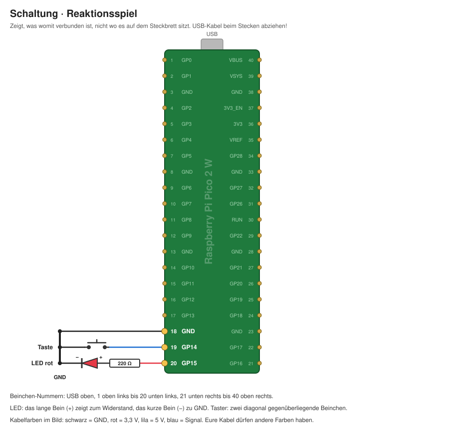
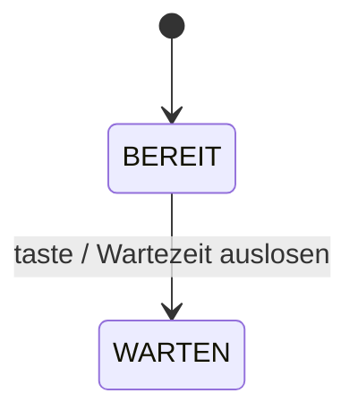
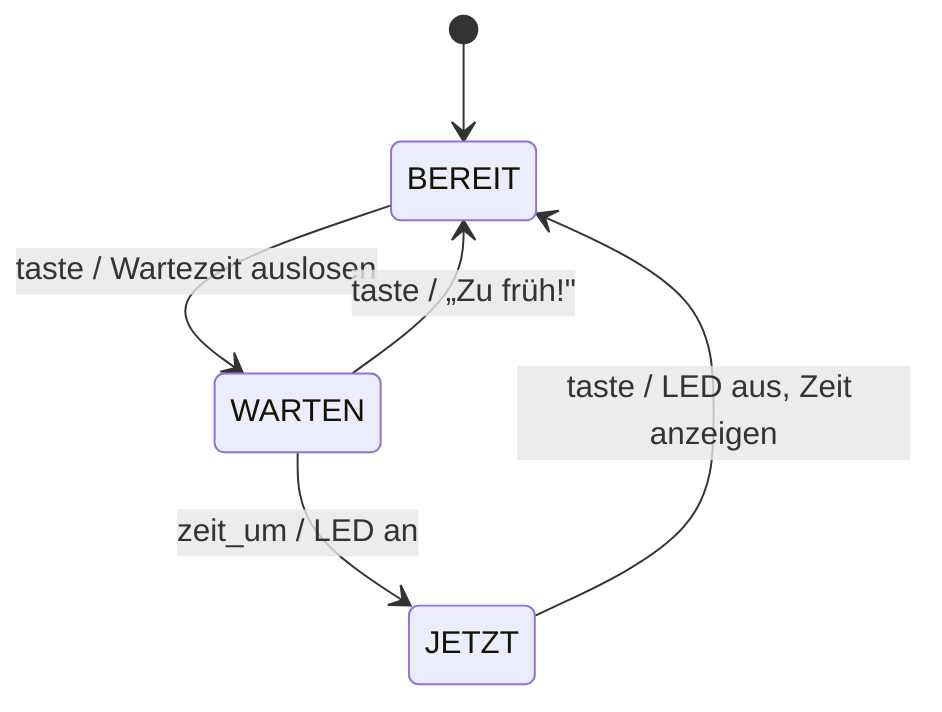

# Bauplan · Reaktionsspiel

**Team:** 265a-team-07 · **Board:** Raspberry Pi Pico 2 W · **Ziel:** alle Karten bis Ende Woche 6 fertig, Vorführung in Woche 7

## So arbeitet ihr mit diesem Bauplan

1. **Teil 1** enthält eure User Stories in überarbeiteter Form. Fangt mit Karte **K0** an.
2. **Teil 2** sind die Karten für euer Kanban-Board. **Ihr entscheidet**, wer welche Karte nimmt und wann. Eine Karte darf erst starten, wenn alle Karten unter „braucht vorher" fertig sind. Höchstens eine Karte pro Person in „In Arbeit".
3. **Teil 3** erklärt jede Karte Schritt für Schritt. Wo im Code `# TODO` steht, schreibt ihr selbst. Wenn ihr hängt, öffnet die Hilfe **der Reihe nach**: zuerst Tipp 1, dann Tipp 2, die Lösung nur, wenn es gar nicht geht. Notiert im Lernjournal, welche Stufe ihr gebraucht habt.

> ⚠️ Bauteile nur stecken, wenn das USB-Kabel **abgezogen** ist. LEDs immer mit Vorwiderstand.

**Ihr kennt das Spiel schon:** In [Woche 5, Abschnitt 3](https://glandl.github.io/Coursebook-maker-reise-grade-9/projekte/p1-code-gadget/woche-05-zustandsautomat/) steckt das ganze Reaktionsspiel in **einer** Schleife. Euer Gadget baut ihr sauberer: Die Logik kommt in `logik.py`, damit ihr sie am PC testen könnt, und die Taste wird entprellt, damit die gemessene Zeit stimmt. Ihr dürft `reaktion.py` anschauen, aber kopiert es nicht.

---

## Teil 1 · Unsere User Stories (überarbeitet)

### US1 · Das Licht geht nach einer zufälligen Zeit an (Muss)

Als Spieler:in möchte ich, dass das Licht nach einer zufälligen Wartezeit angeht, damit ich nicht vorher weiß, wann ich drücken muss.

- [ ] Nach dem Einstecken zeigt Thonny `Taste drücken zum Starten`, die LED ist aus.
- [ ] Ein Tastendruck startet die Runde. Die LED geht nach einer Wartezeit zwischen **2 und 5 s** an (mit der Handy-Stoppuhr gemessen).
- [ ] Bei 5 Runden hintereinander ist die Wartezeit nicht jedes Mal gleich.
- [ ] Drückt man während der Wartezeit, zeigt Thonny `Zu früh!`, die LED bleibt aus und man muss neu starten.

### US2 · Die Reaktionszeit wird angezeigt (Muss)

Als Spieler:in möchte ich nach dem Drücken sehen, wie schnell ich war, damit ich mich mit anderen vergleichen kann.

- [ ] Drückt man, während die LED leuchtet, geht sie sofort aus und Thonny zeigt `Reaktionszeit: … ms`.
- [ ] Die angezeigte Zeit liegt bei normalem Spielen zwischen 100 und 1000 ms (nie 0, nie negativ).
- [ ] Danach startet ein Tastendruck sofort die nächste Runde.

> **Was wir geändert haben:** Eure drei Stichworte (Licht geht random an, Ausschalten, Anzeige der Geschwindigkeit) beschreiben ein Spiel, das eure Lehrkraft als Reaktionsspiel erkannt hat. „Ausschalten" und „Anzeige" passieren beim selben Tastendruck, deshalb sind sie jetzt **eine** Story (US2). Alle Stories haben jetzt die Form „Als … möchte ich …, damit …". „Random" ist jetzt eine Zahl (2 bis 5 s). Neu ist „Zu früh!": Ohne diese Regel könnte man einfach ständig drücken und hätte eine super Zeit. Die „richtige Taste" aus eurer US3 gibt es nicht mehr, weil ihr nur eine Taste habt. Die Zeit erscheint im Thonny-Fenster (der seriellen Ausgabe), wie mit eurer Lehrkraft besprochen.

**Karte K0:** Kopiert Teil 1 in eure `ANFORDERUNGEN.md` (die alten Stories ersetzen) und committet mit der Nachricht `Stories überarbeitet`.

---

## Teil 2 · Karten für euer Kanban-Board

| Karte | Story | braucht vorher | fertig, wenn … |
|-------|-------|----------------|----------------|
| K0 Stories übernehmen | – | – | `ANFORDERUNGEN.md` enthält Teil 1, committet |
| K1 LED und Taste anschließen | US1, US2 | – | Testcode: LED leuchtet, jeder Druck wird **genau einmal** erkannt |
| K2 Zustandsdiagramm zeichnen | US1, US2 | K0 | Mermaid-Diagramm mit 3 Zuständen in `README.md` |
| K3 `naechster_zustand` schreiben | US1, US2 | K2 | Tests zu `naechster_zustand` in K5 sind grün |
| K4 `ereignis_bestimmen` schreiben | US1 | K2 | Tests zu `ereignis_bestimmen` in K5 sind grün |
| K5 `test_logik.py` | US1, US2 | K3, K4 | alle Tests grün am PC |
| K6 `main.py` am Board | US1, US2 | K1, K5 | das Spiel läuft: Start, Wartezeit, LED, Reaktionszeit, „Zu früh!" |
| K7 Testprotokoll `TESTS.md` | US1, US2 | K6 | jedes Akzeptanzkriterium hat eine Zeile mit ✅ oder ❌ |
| K8 `README.md` fertig | – | K6 | README nach der Vorlage aus Woche 6 |
| K9 Präsentation + Demo-Video | – | K7 | 3-Minuten-Ablauf geprobt, 30-s-Video im Repository |

K1 und K2 können **gleichzeitig** von zwei Personen erledigt werden, ebenso K3 und K4.

---

## Teil 3 · Anleitungen pro Karte

### K1 · LED und Taste anschließen

Ihr braucht: LED rot, Widerstand 220 Ω, einen Taster, Kabel.

| Bauteil | Anschluss |
|---------|-----------|
| LED rot | **GP15** (Beinchen 20) → 220 Ω → langes Bein, kurzes Bein → GND |
| Taste | **GP14** (Beinchen 19) ↔ GND (Beinchen 18) |



Das Bild zeigt, **was womit verbunden** ist, nicht wo es auf dem Steckbrett sitzt.

Taster mit vier Beinchen: zwei **diagonal gegenüberliegende** Beinchen verwenden, Taster über die Mittelrille stecken.

**Warum „entprellen"?** Drückt ihr eine Taste, schließt der Kontakt nicht sauber. Er zittert ein paar Millisekunden lang: zu, offen, zu, offen, zu. Ein schnelles Programm sieht dann **mehrere** Drücke. Beim Reaktionsspiel wäre das fatal: Das Zittern beim Start würde sofort als „Zu früh!" zählen. Deshalb schaut `gedrueckt()` nach jeder Änderung 50 ms lang nicht mehr auf die Taste.

Speichert `hardware.py` **auf dem Pico** (Datei → Speichern unter → MicroPython-Gerät):

```python
# hardware.py – Raspberry Pi Pico 2 W · Reaktionsspiel
from machine import Pin
import time

_led = Pin(15, Pin.OUT)
_taste = Pin(14, Pin.IN, Pin.PULL_UP)
_stabil = 1                  # zuletzt sicher erkannt: 1 = losgelassen, 0 = gedrückt
_letzte_aenderung = 0


def led(an):
    _led.value(1 if an else 0)


def gedrueckt():
    """True genau einmal pro Tastendruck, auch wenn der Kontakt zittert."""
    global _stabil, _letzte_aenderung
    if time.ticks_diff(time.ticks_ms(), _letzte_aenderung) < 50:
        return False         # Kontakt zittert vielleicht noch: nicht hinschauen
    wert = _taste.value()
    if wert != _stabil:
        _stabil = wert
        _letzte_aenderung = time.ticks_ms()
        return wert == 0     # nur das Drücken zählt, nicht das Loslassen
    return False
```

Testet in der Thonny-Kommandozeile:

```python
from hardware import *
led(True)
led(False)
```

Und die Taste: **10-mal** drücken, der Zähler muss genau bis 10 gehen (mit **Strg+C** beenden):

```python
zaehler = 0
while True:
    if gedrueckt():
        zaehler = zaehler + 1
        print(zaehler)
```

Die Schleife hat absichtlich **kein** `sleep`: So schnell fragt auch euer Spiel die Taste ab.

### K2 · Zustandsdiagramm zeichnen

Euer Spiel hat **3 Zustände**: `BEREIT` (LED aus, wartet auf Start), `WARTEN` (die zufällige Zeit läuft, LED aus) und `JETZT` (LED an, schnell drücken!). Es gibt **2 Ereignisse**: `taste` und `zeit_um` (die Wartezeit ist abgelaufen).

Ergänzt die fehlenden Pfeile und schreibt das Diagramm in `README.md` ([Mermaid im Kursbuch](https://glandl.github.io/Coursebook-maker-reise-grade-9/werkzeuge/mermaid/)). Hinter dem `/` steht, was beim Übergang passiert:

````markdown

````

<details>
<summary>Tipp 1</summary>

Aus `WARTEN` führen **zwei** Pfeile hinaus: einer, wenn die Zeit um ist, und einer, wenn jemand zu früh drückt. Aus `JETZT` führt einer hinaus.

</details>

<details>
<summary>Lösung</summary>



</details>

**Denkfrage für die Präsentation:** Vergleicht euer Diagramm mit dem aus Woche 5. Was ist gleich, was ist anders?

### K3 · `naechster_zustand` schreiben

Nach dem **Automaten-Rezept** aus [Woche 5, Abschnitt 2a](https://glandl.github.io/Coursebook-maker-reise-grade-9/projekte/p1-code-gadget/woche-05-zustandsautomat/). Legt am PC eine Datei `logik.py` an (später auch auf den Pico kopieren):

```python
# logik.py – keine Imports von hardware!

MIN_WARTEZEIT_MS = 2000
MAX_WARTEZEIT_MS = 5000


def naechster_zustand(zustand, ereignis):
    """Die Pfeile des Zustandsdiagramms, sonst nichts."""
    if zustand == "BEREIT":
        if ereignis == "taste":
            return "WARTEN"
    elif zustand == "WARTEN":
        # TODO: zwei Pfeile
        pass
    # TODO: JETZT
    return zustand
```

<details>
<summary>Tipp 1</summary>

Jeder Pfeil in eurem Diagramm aus K2 wird zu einem `if ereignis == …: return …` im Block seines Startzustands. Was **beim** Übergang passiert (LED an, Text ausgeben), gehört **nicht** hierher, sondern in `main.py`.

</details>

<details>
<summary>Tipp 2</summary>

```python
    elif zustand == "WARTEN":
        if ereignis == "zeit_um":
            return ...
        if ereignis == "taste":
            return ...
    elif zustand == "JETZT":
        ...
```

</details>

<details>
<summary>Lösung</summary>

```python
def naechster_zustand(zustand, ereignis):
    """Die Pfeile des Zustandsdiagramms, sonst nichts."""
    if zustand == "BEREIT":
        if ereignis == "taste":
            return "WARTEN"
    elif zustand == "WARTEN":
        if ereignis == "zeit_um":
            return "JETZT"
        if ereignis == "taste":
            return "BEREIT"
    elif zustand == "JETZT":
        if ereignis == "taste":
            return "BEREIT"
    return zustand
```

</details>

### K4 · `ereignis_bestimmen` schreiben

Diese Funktion macht aus der Taste und der Zeit **ein** Ereignis. Sie bekommt alles als Parameter, deshalb könnt ihr sie am PC testen. Ergänzt in `logik.py`:

```python
def ereignis_bestimmen(gedrueckt, ms_im_zustand, wartezeit_ms):
    """Macht aus Taste und Zeit ein Ereignis (oder None)."""
    # TODO 1: Taste gedrückt → "taste"
    # TODO 2: ms_im_zustand mindestens wartezeit_ms → "zeit_um"
    return None
```

<details>
<summary>Tipp 1</summary>

Die Taste kommt **zuerst**: Wer genau im selben Moment drückt, in dem die Zeit um ist, war zu früh. Für „mindestens" verwendet ihr `>=`.

</details>

<details>
<summary>Lösung</summary>

```python
def ereignis_bestimmen(gedrueckt, ms_im_zustand, wartezeit_ms):
    """Macht aus Taste und Zeit ein Ereignis (oder None)."""
    if gedrueckt:
        return "taste"
    if ms_im_zustand >= wartezeit_ms:
        return "zeit_um"
    return None
```

</details>

Im Zustand `BEREIT` oder `JETZT` liefert die Funktion manchmal auch `"zeit_um"`. Das stört nicht: Dort gibt es keinen Pfeil mit `zeit_um`, der Zustand bleibt.

### K5 · `test_logik.py`

Legt `test_logik.py` **am PC** im selben Ordner wie `logik.py` an und startet ihn mit dem Interpreter **Lokales Python 3** ([Woche 6, Abschnitt 2b](https://glandl.github.io/Coursebook-maker-reise-grade-9/projekte/p1-code-gadget/woche-06-testen-doku/)).

```python
from logik import naechster_zustand, ereignis_bestimmen

TESTS = [
    ("BEREIT", "taste",   "WARTEN"),
    ("WARTEN", "taste",   "BEREIT"),     # zu früh
    # TODO: die anderen zwei Pfeile
    ("BEREIT", "zeit_um", "BEREIT"),     # kein Pfeil: Zustand bleibt
    ("JETZT",  None,      "JETZT"),      # kein Ereignis: Zustand bleibt
]
EREIGNIS_TESTS = [
    # (Taste gedrückt, ms im Zustand, Wartezeit, erwartetes Ereignis)
    (False, 1000, 3000, None),
    (False, 3500, 3000, "zeit_um"),
    # TODO: genau 3000 ms, und Taste gedrückt bei 3500 ms
]

bestanden = 0
for zustand, ereignis, erwartet in TESTS:
    ergebnis = naechster_zustand(zustand, ereignis)
    if ergebnis == erwartet:
        bestanden = bestanden + 1
        print("ok     ", zustand, "+", ereignis, "→", ergebnis)
    else:
        print("FEHLER ", zustand, "+", ereignis, "→", ergebnis, "erwartet:", erwartet)
for taste, ms, warte, erwartet in EREIGNIS_TESTS:
    ergebnis = ereignis_bestimmen(taste, ms, warte)
    if ergebnis == erwartet:
        bestanden = bestanden + 1
        print("ok     ", taste, ms, warte, "→", ergebnis)
    else:
        print("FEHLER ", taste, ms, warte, "→", ergebnis, "erwartet:", erwartet)

print(bestanden, "von", len(TESTS) + len(EREIGNIS_TESTS), "Tests bestanden")
```

**Fertig, wenn** alle Tests grün sind. Dann baut absichtlich einen Fehler ein: Findet ihn der Test?

### K6 · `main.py` am Board

Die Hauptschleife misst, wie lange der aktuelle Zustand schon dauert. **Beim Wechsel** passiert das, was in eurem Diagramm hinter dem `/` steht.

1. Kopiert `logik.py` auf den Pico (Datei → Speichern unter → MicroPython-Gerät).
2. Speichert dort auch `main.py`:

```python
from hardware import led, gedrueckt
from logik import naechster_zustand, ereignis_bestimmen, MIN_WARTEZEIT_MS, MAX_WARTEZEIT_MS
import time
import random

zustand = "BEREIT"
start = time.ticks_ms()          # wann hat der aktuelle Zustand begonnen?
wartezeit = 0
led(False)
print("Taste drücken zum Starten")

while True:
    taste = gedrueckt()
    jetzt = time.ticks_ms()
    im_zustand = time.ticks_diff(jetzt, start)

    ereignis = ereignis_bestimmen(taste, im_zustand, wartezeit)
    neu = naechster_zustand(zustand, ereignis)
    if neu != zustand:
        # was beim Übergang passiert (hinter dem / im Diagramm):
        if neu == "WARTEN":
            wartezeit = random.randint(MIN_WARTEZEIT_MS, MAX_WARTEZEIT_MS)
            print("Achtung …")
        elif neu == "JETZT":
            led(True)
        elif zustand == "WARTEN":            # von WARTEN nach BEREIT
            print("Zu früh! Taste drücken zum Starten")
        elif zustand == "JETZT":             # von JETZT nach BEREIT
            pass                             # TODO: LED aus, Reaktionszeit ausgeben
        zustand = neu
        start = jetzt                        # neuer Zustand, die Zeit beginnt von vorn
```

Die Schleife hat absichtlich **kein** `sleep`: Ein `time.sleep_ms(50)` würde jede Reaktionszeit um bis zu 50 ms verfälschen.

<details>
<summary>Tipp 1</summary>

Wie lange war das Spiel im Zustand `JETZT`? Genau so lange, wie die LED geleuchtet hat. Diese Zahl steht schon in einer Variablen.

</details>

<details>
<summary>Tipp 2</summary>

```python
        elif zustand == "JETZT":
            led(False)
            print("Reaktionszeit:", ..., "ms")
```

</details>

<details>
<summary>Lösung</summary>

```python
        elif zustand == "JETZT":             # von JETZT nach BEREIT
            led(False)
            print("Reaktionszeit:", im_zustand, "ms")
            print("Taste drücken für die nächste Runde")
```

</details>

**Fertig, wenn** das Spiel nach dem Einstecken startet, die LED zufällig angeht, die Reaktionszeit erscheint und zu frühes Drücken erkannt wird.

**Steht nach jedem Start sofort „Zu früh!"?** Dann zittert eure Taste länger als 50 ms. Stellt in `hardware.py` die `50` auf `100`.

### K7 · Testprotokoll `TESTS.md`

Vorlage: [Woche 6, Abschnitt 2c](https://glandl.github.io/Coursebook-maker-reise-grade-9/projekte/p1-code-gadget/woche-06-testen-doku/). Eine Person spielt, eine stoppt die Wartezeit mit dem Handy, eine trägt ein. Eine Zeile pro Akzeptanzkriterium aus Teil 1, z. B.:

```markdown
| # | Ausgangszustand | Aktion | Erwartet | Beobachtet | ok? |
|---|-----------------|--------|----------|------------|-----|
| 1 | BEREIT | Taste, Stoppuhr bis LED an | 2 bis 5 s | | |
| 2 | BEREIT | 5 Runden, Wartezeiten notieren | nicht alle gleich | | |
| 3 | WARTEN | sofort nochmal drücken | „Zu früh!", LED bleibt aus | | |
| … | | | | | |
```

Jedes ❌ wird eine neue Karte.

### K8 · `README.md` fertig

Nach der Vorlage aus [Woche 6, Abschnitt 4](https://glandl.github.io/Coursebook-maker-reise-grade-9/projekte/p1-code-gadget/woche-06-testen-doku/). Das Zustandsdiagramm aus K2 gehört hinein, die Hardware-Tabelle aus K1 auch. Erklärt in zwei Sätzen, was Entprellen ist und warum euer Spiel es braucht.

### K9 · Präsentation + Demo-Video

Ablauf aus [Woche 6, Abschnitt 5](https://glandl.github.io/Coursebook-maker-reise-grade-9/projekte/p1-code-gadget/woche-06-testen-doku/). Für die Demo: Zeigt Thonny auf dem Beamer und holt eine Person aus der Klasse als Gegner:in. Jede:r spielt 3 Runden, wer hat die beste Zeit? Zeigt auch einmal absichtlich „Zu früh!". 30-s-Video ins Repository.

---

## Wenn ihr schneller seid

- **Bestzeit und Mittelwert:** Thonny zeigt nach jeder Runde eure bisher beste Zeit und den Mittelwert aller Runden. Speichert die Zeiten in einer Liste wie in Woche 5.
- **Bewertung:** Eine Funktion `bewertung(ms)` in `logik.py` liefert einen Text, z. B. unter 200 ms `"Blitzschnell!"`, unter 350 ms `"Gut"`, sonst `"Weiter üben"`. Weil sie in `logik.py` steht, könnt ihr sie am PC testen.
- **Zwei Spieler:innen:** Eine zweite Taste an **GP11** (Beinchen 15) ↔ GND (Beinchen 13). Wer zuerst drückt, nachdem die LED angeht, gewinnt. Wer zu früh drückt, verliert sofort. Ihr braucht zwei Ereignisse `taste_1` und `taste_2`.
