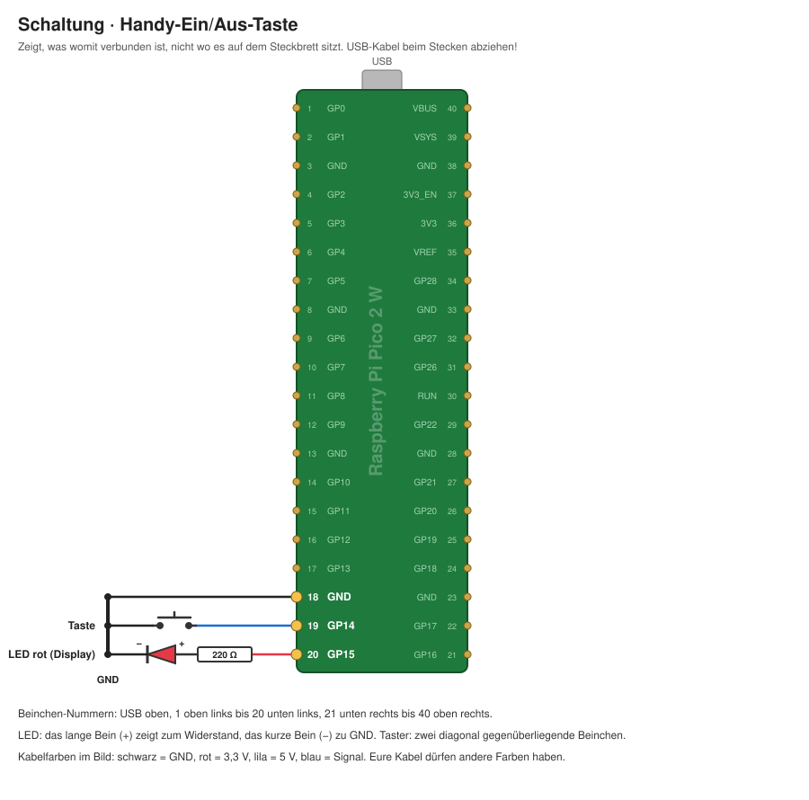
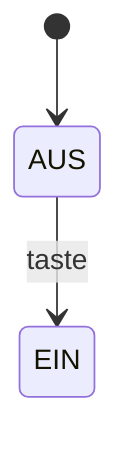
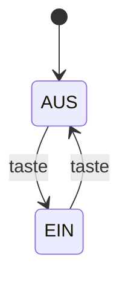

# Bauplan · Handy-Ein/Aus-Taste

**Team:** 265a-team-08 · **Board:** Raspberry Pi Pico 2 W · **Ziel:** alle Karten bis Ende Woche 6 fertig, Vorführung in Woche 7

## So arbeitet ihr mit diesem Bauplan

1. **Teil 1** enthält eure User Stories in überarbeiteter Form. Fangt mit Karte **K0** an.
2. **Teil 2** sind die Karten für euer Kanban-Board. **Ihr entscheidet**, wer welche Karte nimmt und wann. Eine Karte darf erst starten, wenn alle Karten unter „braucht vorher" fertig sind. Höchstens eine Karte pro Person in „In Arbeit".
3. **Teil 3** erklärt jede Karte Schritt für Schritt. Wo im Code `# TODO` steht, schreibt ihr selbst. Wenn ihr hängt, öffnet die Hilfe **der Reihe nach**: zuerst Tipp 1, dann Tipp 2, die Lösung nur, wenn es gar nicht geht. Notiert im Lernjournal, welche Stufe ihr gebraucht habt.

> ⚠️ Bauteile nur stecken, wenn das USB-Kabel **abgezogen** ist. LEDs immer mit Vorwiderstand.

Ihr baut die Ein/Aus-Taste eines Handys. Die rote LED ist das **Display**: leuchtet = Handy EIN, dunkel = Handy AUS.

---

## Teil 1 · Unsere User Stories (überarbeitet)

### US1 · Mit einer Taste ein- und ausschalten (Muss)

Als Handybesitzer:in möchte ich mein Handy mit derselben Taste ein- und ausschalten, damit ich mir nicht merken muss, welche Taste was macht.

- [ ] Ist das Handy AUS, schaltet ein Tastendruck es EIN: Innerhalb von 0,5 s leuchtet die LED.
- [ ] Ist das Handy EIN, schaltet ein Tastendruck es AUS: Innerhalb von 0,5 s ist die LED dunkel.
- [ ] 10 Tastendrücke hintereinander ergeben **genau 10** Wechsel (Thonny zählt mit). Kein Druck schaltet doppelt.

### US2 · Ausgeschaltet bleibt das Display dunkel (Muss)

Als Handybesitzer:in möchte ich, dass das Display dunkel bleibt, solange das Handy aus ist, damit der Akku nicht leer wird.

- [ ] Nach dem Einstecken ist das Handy AUS, die LED ist dunkel.
- [ ] Im Zustand AUS bleibt die LED dunkel, solange niemand die Taste drückt (1 Minute beobachtet).
- [ ] Bei jedem Wechsel zeigt Thonny `AUS → EIN` oder `EIN → AUS`.

> **Was wir geändert haben:** Beide Stories hatten keinen Satz „Als … möchte ich …, damit …", jetzt steht da, wer etwas will und wozu. Der Satz „Der Zustand ändert sich bei jedem Tastendruck" stand bei US2, gehört aber zum Ein- und Ausschalten, deshalb steht er jetzt bei US1. Statt eines Displays zeigt eine LED, ob das Handy an ist, so wie es eure Lehrkraft festgelegt hat. Neu: „10 Drücke = 10 Wechsel". Das klingt selbstverständlich, ist es aber nicht (siehe K2).

**Karte K0:** Kopiert Teil 1 in eure `ANFORDERUNGEN.md` (die alten Stories ersetzen) und committet mit der Nachricht `Stories überarbeitet`.

---

## Teil 2 · Karten für euer Kanban-Board

| Karte | Story | braucht vorher | fertig, wenn … |
|-------|-------|----------------|----------------|
| K0 Stories übernehmen | – | – | `ANFORDERUNGEN.md` enthält Teil 1, committet |
| K1 LED und Taste anschließen | US1, US2 | – | Testcode: LED geht an und aus, Taste wird erkannt |
| K2 Prellen untersuchen | US1 | K1 | Messergebnis „ohne / mit Entprellen" als Tabelle in `README.md` |
| K3 Zustandsdiagramm zeichnen | US1, US2 | K0 | Mermaid-Diagramm in `README.md` |
| K4 `logik.py` schreiben | US1, US2 | K3 | Tests in K5 sind grün |
| K5 `test_logik.py` | US1, US2 | K4 | alle Tests grün am PC |
| K6 `main.py` am Board | US1, US2 | K2, K5 | die Taste schaltet das Handy ein und aus |
| K7 Testprotokoll `TESTS.md` | US1, US2 | K6 | jedes Akzeptanzkriterium hat eine Zeile mit ✅ oder ❌ |
| K8 `README.md` fertig | – | K6 | README nach der Vorlage aus Woche 6 |
| K9 Präsentation + Demo-Video | – | K7 | 3-Minuten-Ablauf geprobt, 30-s-Video im Repository |

K1 und K3 können **gleichzeitig** von zwei Personen erledigt werden, ebenso K2 und K4.

---

## Teil 3 · Anleitungen pro Karte

### K1 · LED und Taste anschließen

Ihr braucht: LED rot, Widerstand 220 Ω, einen Taster, Kabel.

| Bauteil | Anschluss |
|---------|-----------|
| LED rot (Display) | **GP15** (Beinchen 20) → 220 Ω → langes Bein, kurzes Bein → GND |
| Taste | **GP14** (Beinchen 19) ↔ GND (Beinchen 18) |



Das Bild zeigt, **was womit verbunden** ist, nicht wo es auf dem Steckbrett sitzt.

Taster mit vier Beinchen: zwei **diagonal gegenüberliegende** Beinchen verwenden, Taster über die Mittelrille stecken.

Speichert `hardware.py` **auf dem Pico** (Datei → Speichern unter → MicroPython-Gerät). Warum `gedrueckt()` so kompliziert aussieht, findet ihr in K2 heraus:

```python
# hardware.py – Raspberry Pi Pico 2 W · Handy
from machine import Pin
import time

_display = Pin(15, Pin.OUT)
_taste = Pin(14, Pin.IN, Pin.PULL_UP)
_stabil = 1                  # zuletzt sicher erkannt: 1 = losgelassen, 0 = gedrückt
_letzte_aenderung = 0


def display(an):
    """Die LED ist das Display: True = leuchtet, False = dunkel."""
    _display.value(1 if an else 0)


def gedrueckt():
    """True genau einmal pro Tastendruck, auch wenn der Kontakt zittert."""
    global _stabil, _letzte_aenderung
    if time.ticks_diff(time.ticks_ms(), _letzte_aenderung) < 50:
        return False         # Kontakt zittert vielleicht noch: nicht hinschauen
    wert = _taste.value()
    if wert != _stabil:
        _stabil = wert
        _letzte_aenderung = time.ticks_ms()
        return wert == 0     # nur das Drücken zählt, nicht das Loslassen
    return False
```

Testet in der Thonny-Kommandozeile:

```python
from hardware import *
display(True)      # LED an
display(False)     # LED aus
```

### K2 · Prellen untersuchen

Drückt ihr eine Taste, schließt der Kontakt nicht sauber. Er **prellt**: Ein paar Millisekunden lang zittert er zwischen zu und offen hin und her. Ein schnelles Programm sieht dann mehrere Drücke. Bei einem Handy hieße das: Es geht an und sofort wieder aus.

**Versuch 1 · ohne Entprellen.** Dieser Code fragt die Taste direkt ab. Startet ihn in der Thonny-Kommandozeile, drückt **20-mal** und notiert, bis wohin der Zähler kommt (mit **Strg+C** beenden):

```python
from machine import Pin
taste = Pin(14, Pin.IN, Pin.PULL_UP)
vorher = 1
zaehler = 0
while True:
    jetzt = taste.value()
    if vorher == 1 and jetzt == 0:
        zaehler = zaehler + 1
        print(zaehler)
    vorher = jetzt
```

Probiert verschiedene Arten zu drücken: schnell, ganz langsam, nur halb.

**Versuch 2 · mit Entprellen.** Jetzt mit `gedrueckt()` aus eurer `hardware.py`. Wieder 20-mal drücken:

```python
from hardware import gedrueckt
zaehler = 0
while True:
    if gedrueckt():
        zaehler = zaehler + 1
        print(zaehler)
```

Schreibt das Ergebnis in `README.md`:

```markdown
| Versuch | gedrückt | Zähler zeigt |
|---------|----------|--------------|
| ohne Entprellen | 20 | |
| mit Entprellen | 20 | |
```

Zeigt Versuch 1 bei euch auch genau 20? Dann prellt eure Taste wenig. Das ist Glück, keine Garantie: Eine andere Taste oder eine ältere prellt mehr.

**Für die Präsentation:** Erklärt mit eigenen Worten, was `gedrueckt()` macht. Tipp: Lest die Kommentare im Code.

### K3 · Zustandsdiagramm zeichnen

Euer Handy hat **2 Zustände**: `AUS` und `EIN`. Es gibt **1 Ereignis**: `taste`.

Ergänzt den fehlenden Pfeil und schreibt das Diagramm in `README.md` ([Mermaid im Kursbuch](https://glandl.github.io/Coursebook-maker-reise-grade-9/werkzeuge/mermaid/)):

````markdown

````

<details>
<summary>Lösung</summary>



</details>

**Denkfrage für die Präsentation:** Das Ereignis `taste` ist in beiden Zuständen gleich, trotzdem passiert etwas anderes. Warum braucht das Programm dafür einen Zustand? (Denkt an eine Taste ohne Gedächtnis.)

### K4 · `logik.py` schreiben

Nach dem **Automaten-Rezept** aus [Woche 5, Abschnitt 2a](https://glandl.github.io/Coursebook-maker-reise-grade-9/projekte/p1-code-gadget/woche-05-zustandsautomat/). Legt am PC eine Datei `logik.py` an (später auch auf den Pico kopieren):

```python
# logik.py – keine Imports von hardware!


def naechster_zustand(zustand, ereignis):
    """Die Pfeile des Zustandsdiagramms, sonst nichts."""
    if zustand == "AUS":
        if ereignis == "taste":
            return "EIN"
    # TODO: der Pfeil von EIN
    return zustand


def display_an(zustand):
    """Soll das Display in diesem Zustand leuchten?"""
    # TODO
    return False
```

<details>
<summary>Tipp 1</summary>

Für `naechster_zustand`: Schreibt einen `elif`-Block für `EIN`, genau wie den für `AUS`.

Für `display_an`: Das Display leuchtet genau dann, wenn der Zustand `EIN` ist. Ein Vergleich mit `==` liefert schon `True` oder `False`.

</details>

<details>
<summary>Tipp 2</summary>

```python
    elif zustand == "EIN":
        if ereignis == ...:
            return ...
```

```python
def display_an(zustand):
    return zustand == ...
```

</details>

<details>
<summary>Lösung</summary>

```python
def naechster_zustand(zustand, ereignis):
    """Die Pfeile des Zustandsdiagramms, sonst nichts."""
    if zustand == "AUS":
        if ereignis == "taste":
            return "EIN"
    elif zustand == "EIN":
        if ereignis == "taste":
            return "AUS"
    return zustand


def display_an(zustand):
    """Soll das Display in diesem Zustand leuchten?"""
    return zustand == "EIN"
```

</details>

### K5 · `test_logik.py`

Legt `test_logik.py` **am PC** im selben Ordner wie `logik.py` an und startet ihn mit dem Interpreter **Lokales Python 3** ([Woche 6, Abschnitt 2b](https://glandl.github.io/Coursebook-maker-reise-grade-9/projekte/p1-code-gadget/woche-06-testen-doku/)).

Neben den einzelnen Pfeilen testet ihr auch eine **Folge**: 10-mal `taste` hintereinander, ausgehend von `AUS`. Am Ende muss das Handy wieder `AUS` sein, und es muss genau 10 Wechsel gegeben haben.

```python
from logik import naechster_zustand, display_an

TESTS = [
    ("AUS", "taste", "EIN"),
    # TODO: der zweite Pfeil
    ("AUS", None,    "AUS"),     # kein Ereignis: Zustand bleibt
    # TODO: EIN ohne Ereignis
]
DISPLAY_TESTS = [
    ("AUS", False),
    # TODO: EIN
]

bestanden = 0
anzahl = len(TESTS) + len(DISPLAY_TESTS) + 1
for zustand, ereignis, erwartet in TESTS:
    ergebnis = naechster_zustand(zustand, ereignis)
    if ergebnis == erwartet:
        bestanden = bestanden + 1
        print("ok     ", zustand, "+", ereignis, "→", ergebnis)
    else:
        print("FEHLER ", zustand, "+", ereignis, "→", ergebnis, "erwartet:", erwartet)
for zustand, erwartet in DISPLAY_TESTS:
    ergebnis = display_an(zustand)
    if ergebnis == erwartet:
        bestanden = bestanden + 1
        print("ok     ", zustand, "→ Display", ergebnis)
    else:
        print("FEHLER ", zustand, "→ Display", ergebnis, "erwartet:", erwartet)

# Folge: 10-mal drücken
zustand = "AUS"
wechsel = 0
for i in range(10):
    neu = naechster_zustand(zustand, "taste")
    # TODO: wenn neu anders ist als zustand, wechsel um 1 erhöhen
    zustand = neu
if zustand == "AUS" and wechsel == 10:
    bestanden = bestanden + 1
    print("ok      10-mal taste → AUS, 10 Wechsel")
else:
    print("FEHLER  10-mal taste →", zustand, ",", wechsel, "Wechsel, erwartet: AUS, 10 Wechsel")

print(bestanden, "von", anzahl, "Tests bestanden")
```

<details>
<summary>Tipp 1 (für die Folge)</summary>

```python
    if neu != zustand:
        wechsel = wechsel + 1
```

</details>

**Fertig, wenn** alle Tests grün sind. Dann baut absichtlich einen Fehler ein (z. B. `EIN` bleibt bei `taste` `EIN`): Welche Tests finden ihn?

### K6 · `main.py` am Board

1. Kopiert `logik.py` auf den Pico (Datei → Speichern unter → MicroPython-Gerät).
2. Speichert dort auch `main.py`:

```python
from hardware import display, gedrueckt
from logik import naechster_zustand, display_an
import time

zustand = "AUS"
display(display_an(zustand))
wechsel = 0
print("Handy ist AUS")

while True:
    ereignis = None
    # TODO: wenn die Taste gedrückt wurde, ist das Ereignis "taste"

    neu = naechster_zustand(zustand, ereignis)
    if neu != zustand:
        wechsel = wechsel + 1
        print(zustand, "→", neu, "· Wechsel Nr.", wechsel)
        zustand = neu
        display(display_an(zustand))
    time.sleep_ms(10)
```

<details>
<summary>Tipp 1</summary>

`gedrueckt()` liefert `True`, wenn die Taste gerade gedrückt wurde. Ein `if` darum herum, und darin setzt ihr `ereignis`.

</details>

<details>
<summary>Lösung</summary>

```python
    if gedrueckt():
        ereignis = "taste"
```

</details>

**Fertig, wenn** die LED nach dem Einstecken dunkel ist, jeder Druck sie umschaltet und Thonny jeden Wechsel mitzählt.

### K7 · Testprotokoll `TESTS.md`

Vorlage: [Woche 6, Abschnitt 2c](https://glandl.github.io/Coursebook-maker-reise-grade-9/projekte/p1-code-gadget/woche-06-testen-doku/). Eine Person drückt, eine beobachtet LED und Thonny, eine trägt ein. Eine Zeile pro Akzeptanzkriterium aus Teil 1, z. B.:

```markdown
| # | Ausgangszustand | Aktion | Erwartet | Beobachtet | ok? |
|---|-----------------|--------|----------|------------|-----|
| 1 | Board eingesteckt | warten | LED dunkel, Thonny: „Handy ist AUS" | | |
| 2 | AUS | 1-mal drücken | LED an, Thonny: `AUS → EIN` | | |
| 3 | AUS | 10-mal drücken | Thonny zählt bis Wechsel Nr. 10, LED dunkel | | |
| … | | | | | |
```

Jedes ❌ wird eine neue Karte.

### K8 · `README.md` fertig

Nach der Vorlage aus [Woche 6, Abschnitt 4](https://glandl.github.io/Coursebook-maker-reise-grade-9/projekte/p1-code-gadget/woche-06-testen-doku/). Das Zustandsdiagramm aus K3 gehört hinein, die Hardware-Tabelle aus K1 und die Prell-Tabelle aus K2 auch.

### K9 · Präsentation + Demo-Video

Ablauf aus [Woche 6, Abschnitt 5](https://glandl.github.io/Coursebook-maker-reise-grade-9/projekte/p1-code-gadget/woche-06-testen-doku/). Für die Demo: Zeigt Thonny auf dem Beamer. Lasst eine Person aus der Klasse 10-mal drücken und zählt laut mit, Thonny muss bei 10 ankommen. Dann zeigt Versuch 1 aus K2 und erklärt, warum ein Handy ohne Entprellen unbrauchbar wäre. 30-s-Video ins Repository.

---

## Wenn ihr schneller seid

- **Lang drücken wie beim echten Handy:** Ausschalten geht nur, wenn man die Taste **2 s** gedrückt hält. Ein kurzer Druck im Zustand `EIN` macht nichts. So schaltet sich das Handy in der Hosentasche nicht aus Versehen ab. Ihr braucht ein neues Ereignis `lang` und müsst in `main.py` messen, wie lange die Taste schon gedrückt ist (`time.ticks_ms()` beim Drücken merken).
- **Bildschirmsperre:** Nach 10 s im Zustand `EIN` ohne Tastendruck wechselt das Handy in `GESPERRT`: Die LED blinkt langsam. Ein Druck weckt es auf (`EIN`). Neues Ereignis `zeit_um` wie beim Reaktionsspiel in Woche 5.
- **Hochfahren:** Nach dem Einschalten blinkt die LED 2 s lang schnell (Zustand `STARTET`), erst dann leuchtet sie dauerhaft.
