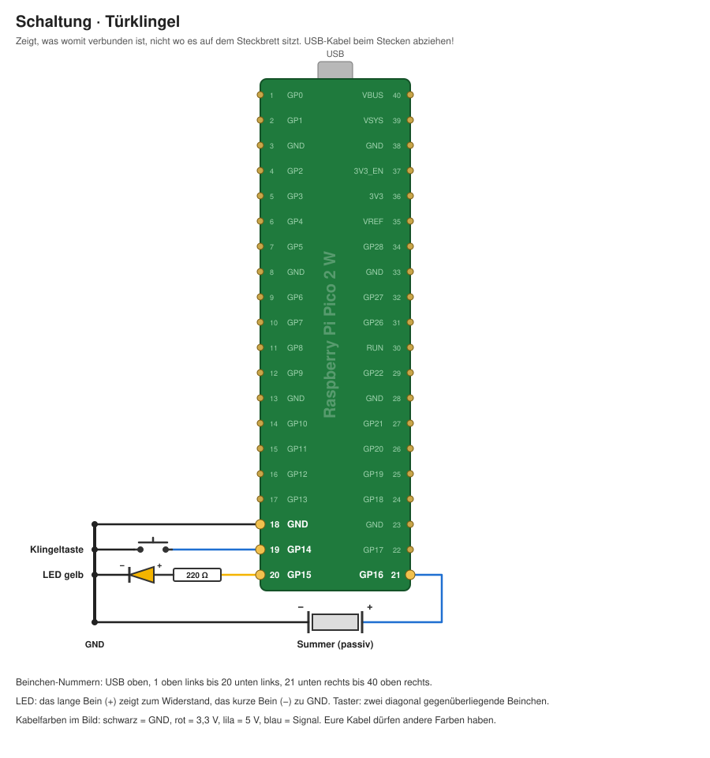
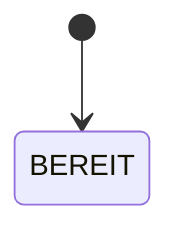
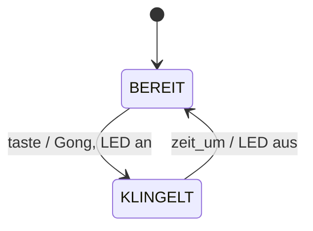

# Bauplan · Türklingel

**Team:** 265b-team-01 · **Board:** Raspberry Pi Pico 2 W · **Ziel:** alle Karten bis Ende Woche 6 fertig, Vorführung in Woche 7

## So arbeitet ihr mit diesem Bauplan

1. **Teil 1** enthält eure User Stories. Fangt mit Karte **K0** an.
2. **Teil 2** sind die Karten für euer Kanban-Board. **Ihr entscheidet**, wer welche Karte nimmt und wann. Eine Karte darf erst starten, wenn alle Karten unter „braucht vorher" fertig sind. Höchstens eine Karte pro Person in „In Arbeit".
3. **Teil 3** erklärt jede Karte Schritt für Schritt. Wo im Code `# TODO` steht, schreibt ihr selbst. Wenn ihr hängt, öffnet die Hilfe **der Reihe nach**: zuerst Tipp 1, dann Tipp 2, die Lösung nur, wenn es gar nicht geht. Notiert im Lernjournal, welche Stufe ihr gebraucht habt.

> ⚠️ Bauteile nur stecken, wenn das USB-Kabel **abgezogen** ist. LEDs immer mit Vorwiderstand.

---

## Teil 1 · Unsere User Stories

> ℹ️ **Ihr habt keine User Stories abgegeben.** Damit ihr trotzdem starten könnt, hat eure Lehrkraft ein einfaches Gadget für euch ausgesucht: eine **Türklingel** mit Ton und Licht. Die zwei Stories unten sind für euch geschrieben. Habt ihr eine eigene Idee, sprecht **diese Woche** mit eurer Lehrkraft, sonst baut ihr die Klingel.

### US1 · Klingeln (Muss)

Als Bewohner:in möchte ich einen Gong hören, wenn jemand die Klingeltaste drückt, damit ich weiß, dass Besuch vor der Tür steht.

- [ ] Ein Druck auf die Klingeltaste spielt innerhalb von 0,5 s einen Gong aus zwei verschiedenen Tönen („Ding-Dong").
- [ ] Ohne Tastendruck bleibt der Summer still.

### US2 · Licht zum Gong (Muss)

Als Person, die schlecht hört oder Kopfhörer trägt, möchte ich beim Klingeln zusätzlich ein Licht sehen, damit ich den Besuch nicht verpasse.

- [ ] Beim Klingeln leuchtet die gelbe LED 3 s (±0,5 s) lang, dann geht sie von selbst aus.
- [ ] Drückt jemand, während die LED leuchtet, noch einmal, gibt es **keinen** zweiten Gong (kein „Sturmklingeln").

**Karte K0:** Legt eine Datei `ANFORDERUNGEN.md` an, kopiert Teil 1 hinein (ohne den ℹ️-Kasten) und committet mit der Nachricht `Stories übernommen`.

---

## Teil 2 · Karten für euer Kanban-Board

| Karte | Story | braucht vorher | fertig, wenn … |
|-------|-------|----------------|----------------|
| K0 Stories übernehmen | – | – | `ANFORDERUNGEN.md` enthält Teil 1, committet |
| K1 Taste und LED anschließen | US1, US2 | – | Testcode: LED leuchtet, die Taste wird erkannt |
| K2 Summer anschließen, Gong komponieren | US1 | K1 | `gong()` spielt zwei verschiedene Töne |
| K3 Zustandsdiagramm zeichnen | US1, US2 | K0 | Mermaid-Diagramm in `README.md` |
| K4 `logik.py` schreiben | US1, US2 | K3 | Tests in K5 sind grün |
| K5 `test_logik.py` | US1, US2 | K4 | alle Tests grün am PC |
| K6 `main.py` am Board | US1, US2 | K2, K5 | Tastendruck: Gong und 3 s Licht |
| K7 Testprotokoll `TESTS.md` | US1, US2 | K6 | jedes Akzeptanzkriterium hat eine Zeile mit ✅ oder ❌ |
| K8 `README.md` fertig | – | K6 | README nach der Vorlage aus Woche 6 |
| K9 Präsentation + Demo-Video | – | K7 | 3-Minuten-Ablauf geprobt, 30-s-Video im Repository |

K1 und K3 können **gleichzeitig** von zwei Personen erledigt werden.

---

## Teil 3 · Anleitungen pro Karte

### K1 · Taste und LED anschließen

Ihr braucht: LED gelb, Widerstand 220 Ω, einen Taster, Kabel.

| Bauteil | Anschluss |
|---------|-----------|
| Klingeltaste | **GP14** (Beinchen 19) ↔ GND (Beinchen 18) |
| LED gelb | **GP15** (Beinchen 20) → 220 Ω → langes Bein, kurzes Bein → GND (Beinchen 18) |



Das Bild zeigt, **was womit verbunden** ist, nicht wo es auf dem Steckbrett sitzt. Es zeigt schon die ganze Schaltung, auch den Summer (K2).

Taster mit vier Beinchen: zwei **diagonal gegenüberliegende** Beinchen verwenden, Taster über die Mittelrille stecken.

Speichert `hardware.py` **auf dem Pico** (Datei → Speichern unter → MicroPython-Gerät). Die Funktion `ton()` braucht ihr erst in K2, sie steht aber schon drin:

```python
# hardware.py – Raspberry Pi Pico 2 W · Türklingel
from machine import Pin, PWM
import time

_taste = Pin(14, Pin.IN, Pin.PULL_UP)
_led = Pin(15, Pin.OUT)
_summer = PWM(Pin(16))
_summer.freq(1000)
_summer.duty_u16(0)
_vorher = 1


def led(an):
    _led.value(1 if an else 0)


def gedrueckt():
    """True einmal pro Tastendruck."""
    global _vorher
    jetzt = _taste.value()
    neu = _vorher == 1 and jetzt == 0
    _vorher = jetzt
    return neu


def ton(frequenz, dauer_ms):
    """Spielt einen Ton und wartet, bis er fertig ist."""
    _summer.freq(frequenz)
    _summer.duty_u16(32768)
    time.sleep_ms(dauer_ms)
    _summer.duty_u16(0)
```

Testet in der Thonny-Kommandozeile:

```python
from hardware import *
led(True)
led(False)
```

Und die Taste (mit **Strg+C** beenden):

```python
import time
while True:
    if gedrueckt():
        print("Taste!")
    time.sleep_ms(50)
```

Kommt bei **einem** Druck **ein** `Taste!`? Dann ist K1 fertig.

### K2 · Summer anschließen, Gong komponieren

Ihr braucht: den **passiven** Summer (Piezo) aus Woche 4, Kabel.

| Bauteil | Anschluss |
|---------|-----------|
| Summer, Bein **+** | **GP16** (Beinchen 21) |
| Summer, Bein **−** | GND (Beinchen 18, gleiche Reihe wie die anderen GND-Kabel) |

Testet in der Thonny-Kommandozeile (`hardware.py` aus K1 ist schon auf dem Pico):

```python
from hardware import ton
ton(440, 500)      # 440 Hz, eine halbe Sekunde
```

Ein Gong sind **zwei Töne nacheinander**, zuerst der höhere, dann der tiefere. Ein paar Töne zum Ausprobieren:

| Ton | c'' | d'' | e'' | g'' |
|-----|-----|-----|-----|-----|
| Frequenz (Hz) | 523 | 587 | 659 | 784 |

Schreibt eure Gong-Funktion **unten** in `hardware.py` dazu:

```python
def gong():
    """Ding-Dong: zwei verschiedene Töne."""
    # TODO: zuerst ein hoher Ton, dann ein tieferer, länger
    pass
```

<details>
<summary>Tipp 1</summary>

Ihr ruft `ton()` zweimal auf, mit zwei verschiedenen Frequenzen. Der zweite Ton darf ruhig länger sein, so klingt es wie eine echte Klingel.

</details>

<details>
<summary>Lösung</summary>

```python
def gong():
    """Ding-Dong: zwei verschiedene Töne."""
    ton(659, 400)
    ton(523, 600)
```

</details>

Speichern, dann in der Kommandozeile `from hardware import gong` und `gong()`. Der Gong dauert 1 s, das ist kürzer als die 3 s Licht aus US2.

### K3 · Zustandsdiagramm zeichnen

Eure Klingel hat **2 Zustände**: `BEREIT` (wartet auf Besuch) und `KLINGELT` (Gong und Licht). Es gibt **2 Ereignisse**:

- `taste`: Jemand drückt die Klingeltaste.
- `zeit_um`: Die 3 s Licht sind vorbei.

Ergänzt die Pfeile und schreibt das Diagramm in `README.md` ([Mermaid im Kursbuch](https://glandl.github.io/Coursebook-maker-reise-grade-9/werkzeuge/mermaid/)):

````markdown

````

<details>
<summary>Tipp 1</summary>

Von `BEREIT` führt ein Pfeil nach `KLINGELT`, von `KLINGELT` einer zurück. Welches Ereignis gehört zu welchem Pfeil?

</details>

<details>
<summary>Lösung</summary>



</details>

**Denkfrage für die Präsentation:** Im Zustand `KLINGELT` gibt es **keinen** Pfeil mit `taste`. Welches Akzeptanzkriterium ist damit schon erfüllt?

### K4 · `logik.py` schreiben

`logik.py` enthält zwei Funktionen, die **ohne Hardware** funktionieren. Darum könnt ihr sie am PC testen.

- `naechster_zustand`: die Pfeile des Diagramms (Rezept aus [Woche 5, Abschnitt 2a](https://glandl.github.io/Coursebook-maker-reise-grade-9/projekte/p1-code-gadget/woche-05-zustandsautomat/)).
- `ereignis_bestimmen`: macht aus Taste und Zeit ein Ereignis.

Legt am PC eine Datei `logik.py` an:

```python
# logik.py – keine Imports von hardware!

LEUCHTDAUER_MS = 3000     # so lange leuchtet die LED nach dem Klingeln


def naechster_zustand(zustand, ereignis):
    """Die Pfeile des Zustandsdiagramms, sonst nichts."""
    if zustand == "BEREIT":
        if ereignis == "taste":
            return "KLINGELT"
    # TODO: der Pfeil von KLINGELT zurück
    return zustand


def ereignis_bestimmen(gedrueckt, ms_seit_klingeln):
    """Macht aus Taste und Zeit ein Ereignis (oder None)."""
    if gedrueckt:
        return "taste"
    # TODO: mindestens LEUCHTDAUER_MS vorbei → "zeit_um"
    return None
```

<details>
<summary>Tipp 1</summary>

Der zweite Pfeil kommt in einen eigenen Block `elif zustand == "KLINGELT":`. Für „mindestens" verwendet ihr `>=`.

</details>

<details>
<summary>Tipp 2</summary>

```python
    elif zustand == "KLINGELT":
        if ereignis == ...:
            return "BEREIT"
```

```python
    if ms_seit_klingeln >= ...:
        return "zeit_um"
```

</details>

<details>
<summary>Lösung</summary>

```python
def naechster_zustand(zustand, ereignis):
    """Die Pfeile des Zustandsdiagramms, sonst nichts."""
    if zustand == "BEREIT":
        if ereignis == "taste":
            return "KLINGELT"
    elif zustand == "KLINGELT":
        if ereignis == "zeit_um":
            return "BEREIT"
    return zustand


def ereignis_bestimmen(gedrueckt, ms_seit_klingeln):
    """Macht aus Taste und Zeit ein Ereignis (oder None)."""
    if gedrueckt:
        return "taste"
    if ms_seit_klingeln >= LEUCHTDAUER_MS:
        return "zeit_um"
    return None
```

</details>

### K5 · `test_logik.py`

Legt `test_logik.py` **am PC** im selben Ordner wie `logik.py` an und startet ihn mit dem Interpreter **Lokales Python 3** ([Woche 6, Abschnitt 2b](https://glandl.github.io/Coursebook-maker-reise-grade-9/projekte/p1-code-gadget/woche-06-testen-doku/)).

```python
from logik import naechster_zustand, ereignis_bestimmen

TESTS = [
    ("BEREIT",   "taste",   "KLINGELT"),
    ("KLINGELT", "zeit_um", "BEREIT"),
    ("KLINGELT", "taste",   "KLINGELT"),   # US2: kein zweiter Gong
    ("BEREIT",   None,      "BEREIT"),     # kein Ereignis: Zustand bleibt
    # TODO: noch ein Fall ohne Pfeil (BEREIT + zeit_um)
]
EREIGNIS_TESTS = [
    # (Taste gedrückt, ms seit Klingeln, erwartetes Ereignis)
    (True,  0,    "taste"),
    (False, 1000, None),                   # erst 1 s vorbei
    # TODO: genau 3000 ms und 5000 ms
]

bestanden = 0
for zustand, ereignis, erwartet in TESTS:
    ergebnis = naechster_zustand(zustand, ereignis)
    if ergebnis == erwartet:
        bestanden = bestanden + 1
        print("ok     ", zustand, "+", ereignis, "→", ergebnis)
    else:
        print("FEHLER ", zustand, "+", ereignis, "→", ergebnis, "erwartet:", erwartet)
for taste, ms, erwartet in EREIGNIS_TESTS:
    ergebnis = ereignis_bestimmen(taste, ms)
    if ergebnis == erwartet:
        bestanden = bestanden + 1
        print("ok     ", taste, ms, "→", ergebnis)
    else:
        print("FEHLER ", taste, ms, "→", ergebnis, "erwartet:", erwartet)

print(bestanden, "von", len(TESTS) + len(EREIGNIS_TESTS), "Tests bestanden")
```

<details>
<summary>Tipp 1</summary>

Bei genau 3000 ms gilt „mindestens 3000", also `"zeit_um"`. Eine Testzeile sieht so aus: `(False, 3000, "zeit_um"),`

</details>

**Fertig, wenn** alle Tests grün sind. Dann baut absichtlich einen Fehler ein (z. B. `>` statt `>=`): Findet ihn der Test?

### K6 · `main.py` am Board

Die Hauptschleife merkt sich, **wann zuletzt geklingelt wurde**. Daraus berechnet sie `ms_seit_klingeln`.

1. `logik.py` auf den Pico kopieren (Datei → Speichern unter → MicroPython-Gerät).
2. `main.py` auf dem Pico speichern:

```python
from hardware import led, gedrueckt, gong
from logik import naechster_zustand, ereignis_bestimmen
import time

zustand = "BEREIT"
geklingelt_um = time.ticks_ms()
led(False)
print("Klingel bereit")

while True:
    ms_seit = time.ticks_diff(time.ticks_ms(), geklingelt_um)
    ereignis = ereignis_bestimmen(gedrueckt(), ms_seit)
    neu = naechster_zustand(zustand, ereignis)
    if neu != zustand:
        print(zustand, "→", neu)
        zustand = neu
        if zustand == "KLINGELT":
            geklingelt_um = time.ticks_ms()     # die 3 s beginnen jetzt
            # TODO: LED an, dann Gong
        else:
            # TODO: LED aus
            pass
    time.sleep_ms(50)
```

<details>
<summary>Tipp 1</summary>

Zuerst die LED einschalten, dann `gong()` aufrufen. Umgekehrt würde das Licht erst nach dem Gong angehen.

</details>

<details>
<summary>Lösung</summary>

```python
        if zustand == "KLINGELT":
            geklingelt_um = time.ticks_ms()     # die 3 s beginnen jetzt
            led(True)
            gong()
        else:
            led(False)
```

</details>

**Fertig, wenn** ein Tastendruck den Gong spielt, die LED 3 s leuchtet und ein zweiter Druck in dieser Zeit nichts tut.

### K7 · Testprotokoll `TESTS.md`

Vorlage: [Woche 6, Abschnitt 2c](https://glandl.github.io/Coursebook-maker-reise-grade-9/projekte/p1-code-gadget/woche-06-testen-doku/). Eine Person drückt, eine stoppt mit dem Handy, eine trägt ein. Eine Zeile pro Akzeptanzkriterium aus Teil 1, z. B.:

```markdown
| # | Ausgangszustand | Aktion | Erwartet | Beobachtet | ok? |
|---|-----------------|--------|----------|------------|-----|
| 1 | BEREIT | Klingeltaste drücken | Ding-Dong innerhalb 0,5 s | | |
| 2 | BEREIT | 10 s nichts tun | Summer still | | |
| 3 | BEREIT | drücken, Stoppuhr | LED 3 s (±0,5 s), dann aus | | |
| 4 | KLINGELT | sofort noch einmal drücken | kein zweiter Gong | | |
```

Jedes ❌ wird eine neue Karte.

### K8 · `README.md` fertig

Nach der Vorlage aus [Woche 6, Abschnitt 4](https://glandl.github.io/Coursebook-maker-reise-grade-9/projekte/p1-code-gadget/woche-06-testen-doku/). Das Zustandsdiagramm aus K3 gehört hinein, die Hardware-Tabellen aus K1 und K2 auch.

### K9 · Präsentation + Demo-Video

Ablauf aus [Woche 6, Abschnitt 5](https://glandl.github.io/Coursebook-maker-reise-grade-9/projekte/p1-code-gadget/woche-06-testen-doku/). Für die Demo: Eine Person spielt den Besuch und drückt die Klingeltaste, eine Person setzt Kopfhörer auf und zeigt, dass sie das Licht trotzdem sieht. Dann drückt der Besuch ganz schnell mehrmals: Es gibt nur einen Gong. 30-s-Video ins Repository.

---

## Wenn ihr schneller seid

- **Eigene Melodie:** Statt Ding-Dong spielt die Klingel eine kurze Melodie aus 4–5 Tönen. Schreibt die Töne als Liste `[(659, 200), (587, 200), …]` und spielt sie in einer `for`-Schleife ab.
- **Blinken statt Leuchten:** Die LED blinkt während der 3 s im halben Sekundentakt. Tipp: Ob sie gerade an oder aus ist, könnt ihr aus `ms_seit_klingeln // 500` berechnen (gerade oder ungerade?).
- **Nachtruhe:** Eine zweite Taste (GP11 ↔ GND) schaltet in einen Zustand `RUHE`, in dem nur die LED leuchtet und kein Gong kommt. Zeichnet zuerst das neue Diagramm!
