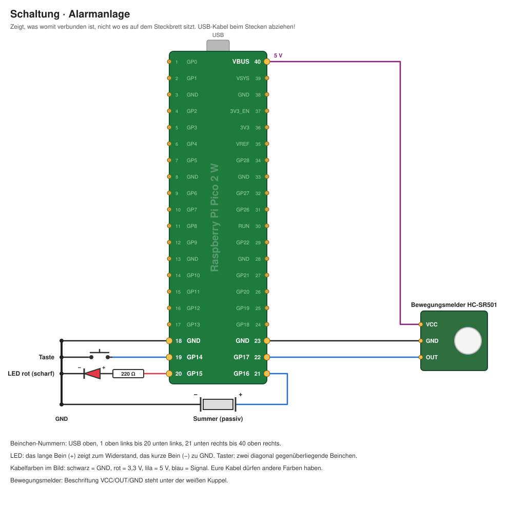
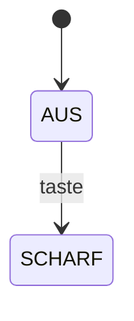
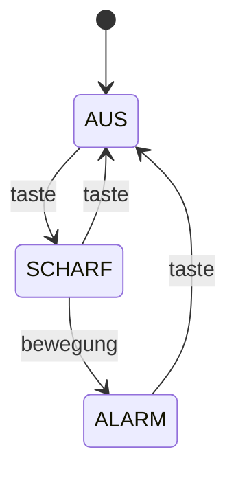

# Bauplan · Alarmanlage

**Team:** 265b-team-02 · **Board:** Raspberry Pi Pico 2 W · **Ziel:** alle Karten bis Ende Woche 6 fertig, Vorführung in Woche 7

## So arbeitet ihr mit diesem Bauplan

1. **Teil 1** enthält eure User Stories in überarbeiteter Form. Fangt mit Karte **K0** an.
2. **Teil 2** sind die Karten für euer Kanban-Board. **Ihr entscheidet**, wer welche Karte nimmt und wann. Eine Karte darf erst starten, wenn alle Karten unter „braucht vorher" fertig sind. Höchstens eine Karte pro Person in „In Arbeit".
3. **Teil 3** erklärt jede Karte Schritt für Schritt. Wo im Code `# TODO` steht, schreibt ihr selbst. Wenn ihr hängt, öffnet die Hilfe **der Reihe nach**: zuerst Tipp 1, dann Tipp 2, die Lösung nur, wenn es gar nicht geht. Notiert im Lernjournal, welche Stufe ihr gebraucht habt.

> ⚠️ Bauteile nur stecken, wenn das USB-Kabel **abgezogen** ist. LEDs immer mit Vorwiderstand.

Eure Anlage hat drei Teile: einen **Bewegungsmelder** (überwacht den Bereich), einen **Summer** (der Alarm) und eine **rote LED**, die zeigt, ob die Anlage scharf ist.

---

## Teil 1 · Unsere User Stories (überarbeitet)

### US1 · Alarm bei Bewegung (Muss)

Als Hausbesitzer:in möchte ich, dass die scharf geschaltete Alarmanlage piept, sobald sich jemand im überwachten Bereich bewegt, damit Einbrecher:innen verscheucht werden und niemand meine wertvollen Dinge mitnimmt.

- [ ] Ist die Anlage SCHARF (rote LED leuchtet) und bewegt sich jemand vor dem Bewegungsmelder, piept der Summer innerhalb von 2 s.
- [ ] Ohne Bewegung bleibt der Summer still.
- [ ] Hat der Alarm einmal begonnen, piept er weiter, auch wenn sich niemand mehr bewegt, bis jemand die Taste drückt.

### US2 · Ausschalten zum Putzen (Muss)

Als Reinigungskraft möchte ich die Alarmanlage mit einer Taste ausschalten, damit ich die wertvollen Dinge putzen kann, ohne einen Alarm auszulösen.

- [ ] Ein Tastendruck schaltet zwischen AUS und SCHARF um. Nach dem Einstecken ist die Anlage AUS.
- [ ] Im Zustand AUS ist die rote LED aus und der Summer bleibt still, auch bei Bewegung.
- [ ] Ein Tastendruck während des Alarms stoppt den Summer sofort, die Anlage ist dann AUS.

> **Was wir geändert haben:** „Wenn ein bestimmter Bereich überschritten wird" heißt jetzt: Der Bewegungsmelder sieht eine Bewegung. Das kann man vorführen. „Klingelt" ist jetzt „piept", weil ihr einen Summer verwendet. Neu ist die **rote LED**: Ohne sie weiß die Reinigungskraft nicht, ob die Anlage gerade scharf ist. Neu ist auch das dritte Kriterium bei US1: Eine echte Alarmanlage hört nicht auf, nur weil der Einbrecher stillsteht. Deshalb gibt es bei US2 jetzt auch ein Kriterium, wie man den Alarm wieder stoppt.

**Karte K0:** Kopiert Teil 1 in eure `ANFORDERUNGEN.md` (die alten Stories ersetzen) und committet mit der Nachricht `Stories überarbeitet`.

---

## Teil 2 · Karten für euer Kanban-Board

| Karte | Story | braucht vorher | fertig, wenn … |
|-------|-------|----------------|----------------|
| K0 Stories übernehmen | – | – | `ANFORDERUNGEN.md` enthält Teil 1, committet |
| K1 LED, Taste und Summer anschließen | US1, US2 | – | Testcode: LED leuchtet, Taste wird erkannt, Summer piept |
| K2 Bewegungsmelder anschließen und einstellen | US1 | – | Testcode zeigt `True` bei Bewegung, `False` nach ca. 3 s Ruhe |
| K3 Zustandsdiagramm zeichnen | US1, US2 | K0 | Mermaid-Diagramm mit 3 Zuständen in `README.md` |
| K4 `naechster_zustand` und `ausgaben` schreiben | US1, US2 | K3 | Tests zu `naechster_zustand` und `ausgaben` in K6 sind grün |
| K5 `ereignis_bestimmen` schreiben | US1, US2 | K3 | Tests zu `ereignis_bestimmen` in K6 sind grün |
| K6 `test_logik.py` | US1, US2 | K4, K5 | alle Tests grün am PC |
| K7 `main.py` am Board | US1, US2 | K1, K2, K6 | Anlage lässt sich scharf schalten, Bewegung löst Alarm aus, Taste stoppt ihn |
| K8 Testprotokoll `TESTS.md` | US1, US2 | K7 | jedes Akzeptanzkriterium hat eine Zeile mit ✅ oder ❌ |
| K9 `README.md` fertig | – | K7 | README nach der Vorlage aus Woche 6 |
| K10 Präsentation + Demo-Video | – | K8 | 3-Minuten-Ablauf geprobt, 30-s-Video im Repository |

K1, K2 und K3 können **gleichzeitig** von drei Personen erledigt werden, ebenso K4 und K5.

---

## Teil 3 · Anleitungen pro Karte

### K1 · LED, Taste und Summer anschließen

Ihr braucht: LED rot, Widerstand 220 Ω, einen Taster, den **passiven** Summer (Piezo) aus Woche 4, Kabel.

| Bauteil | Anschluss |
|---------|-----------|
| Taste | **GP14** (Beinchen 19) ↔ GND (Beinchen 18) |
| LED rot (scharf) | **GP15** (Beinchen 20) → 220 Ω → langes Bein, kurzes Bein → GND (Beinchen 18) |
| Summer, Bein **+** | **GP16** (Beinchen 21) |
| Summer, Bein **−** | GND (Beinchen 18, gleiche Reihe wie die anderen GND-Kabel) |



Das Bild zeigt, **was womit verbunden** ist, nicht wo es auf dem Steckbrett sitzt. Es zeigt schon die ganze Schaltung, auch den Bewegungsmelder (K2).

Taster mit vier Beinchen: zwei **diagonal gegenüberliegende** Beinchen verwenden, Taster über die Mittelrille stecken.

Speichert `hardware.py` **auf dem Pico** (Datei → Speichern unter → MicroPython-Gerät). Die Funktion `bewegung()` braucht ihr erst in K2, sie steht aber schon drin:

```python
# hardware.py – Raspberry Pi Pico 2 W · Alarmanlage
from machine import Pin, PWM

LAUTSTAERKE = 2000        # leise zum Testen; für die Vorführung 32768 (ganz laut)

_led = Pin(15, Pin.OUT)
_taste = Pin(14, Pin.IN, Pin.PULL_UP)
_summer = PWM(Pin(16))
_summer.freq(2000)
_summer.duty_u16(0)
_pir = Pin(17, Pin.IN)
_vorher = 1


def led(an):
    _led.value(1 if an else 0)


def summer(an):
    """Summer dauerhaft an (True) oder aus (False)."""
    _summer.duty_u16(LAUTSTAERKE if an else 0)


def gedrueckt():
    """True einmal pro Tastendruck."""
    global _vorher
    jetzt = _taste.value()
    neu = _vorher == 1 and jetzt == 0
    _vorher = jetzt
    return neu


def bewegung():
    """True, solange der Bewegungsmelder etwas erkennt."""
    return _pir.value() == 1
```

Testet in der Thonny-Kommandozeile:

```python
from hardware import *
led(True)
summer(True)
summer(False)
led(False)
```

Und die Taste (mit **Strg+C** beenden):

```python
import time
while True:
    if gedrueckt():
        print("Taste!")
    time.sleep_ms(50)
```

**Rücksicht auf die Klasse:** Mit `LAUTSTAERKE = 2000` ist der Summer gut hörbar, aber nicht nervig. Erst für die Vorführung auf `32768` stellen.

### K2 · Bewegungsmelder anschließen und einstellen

Bewegungsmelder HC-SR501 (PIR). Er braucht **5 V**, sein Signal hat aber nur 3,3 V und ist deshalb für den Pico ungefährlich.

| PIR-Anschluss | Pico |
|---------------|------|
| VCC | **VBUS** (Beinchen 40), 5 V vom USB-Kabel |
| OUT | **GP17** (Beinchen 22) |
| GND | GND (Beinchen 23) |

Die Beschriftung steht unter der weißen Kuppel. Kuppel vorsichtig abziehen, nachschauen, wieder aufstecken.

**Einstellen** (auf der Rückseite):

1. Den Drehregler **Zeit** (meist der linke, „Tx" oder „Time") ganz nach **links**, also auf die kürzeste Zeit (ca. 3 s). Wie lange der Alarm dauert, entscheidet euer Programm, nicht der Sensor.
2. Den Jumper (die kleine Steckbrücke) auf **H** (wiederholt auslösen).
3. Nach dem Einstecken braucht der PIR ca. **60 s**, um sich einzustellen. In dieser Zeit meldet er manchmal Unsinn.

Testet in der Thonny-Kommandozeile (`hardware.py` aus K1 ist schon auf dem Pico):

```python
from hardware import bewegung
import time
while True:
    print(bewegung())
    time.sleep(0.5)
```

Mit **Strg+C** beendet ihr die Schleife. Probiert aus: Ab welcher Entfernung erkennt er euch noch? Das ist euer **überwachter Bereich**. Notiert die Entfernung für die README.

### K3 · Zustandsdiagramm zeichnen

Eure Anlage hat **3 Zustände**: `AUS`, `SCHARF` (LED an, wartet auf Bewegung) und `ALARM` (LED an, Summer an). Es gibt **2 Ereignisse**: `taste` und `bewegung`.

Ergänzt die fehlenden Pfeile und schreibt das Diagramm in `README.md` ([Mermaid im Kursbuch](https://glandl.github.io/Coursebook-maker-reise-grade-9/werkzeuge/mermaid/)):

````markdown

````

<details>
<summary>Tipp 1</summary>

Fragt euch für jeden Zustand: Was passiert, wenn jemand die Taste drückt? Und: In welchem Zustand führt `bewegung` zu einem Alarm? In welchem **nicht**?

</details>

<details>
<summary>Lösung</summary>



</details>

**Denkfragen für die Präsentation:** Von `AUS` führt kein Pfeil mit `bewegung` weg. Welches Akzeptanzkriterium ist damit schon erfüllt? Und von `ALARM` führt kein Pfeil zurück, wenn die Bewegung aufhört. Welches Kriterium ist das?

### K4 · `naechster_zustand` und `ausgaben` schreiben

Nach dem **Automaten-Rezept** aus [Woche 5, Abschnitt 2a](https://glandl.github.io/Coursebook-maker-reise-grade-9/projekte/p1-code-gadget/woche-05-zustandsautomat/). Legt am PC eine Datei `logik.py` an (später auch auf den Pico kopieren):

```python
# logik.py – keine Imports von hardware!


def naechster_zustand(zustand, ereignis):
    """Die Pfeile des Zustandsdiagramms, sonst nichts."""
    if zustand == "AUS":
        if ereignis == "taste":
            return "SCHARF"
    elif zustand == "SCHARF":
        # TODO: zwei Pfeile
        pass
    elif zustand == "ALARM":
        # TODO: ein Pfeil
        pass
    return zustand


def ausgaben(zustand):
    """Liefert (led, summer): was ist in diesem Zustand an?"""
    if zustand == "SCHARF":
        return (True, False)
    # TODO: ALARM
    return (False, False)
```

<details>
<summary>Tipp 1</summary>

Jeder Pfeil in eurem Diagramm aus K3 wird zu einem `if ereignis == …: return …` im Block seines Startzustands. Das `pass` löscht ihr, sobald etwas im Block steht.

</details>

<details>
<summary>Tipp 2</summary>

```python
    elif zustand == "SCHARF":
        if ereignis == "taste":
            return ...
        if ereignis == ...:
            return "ALARM"
```

</details>

<details>
<summary>Lösung</summary>

```python
def naechster_zustand(zustand, ereignis):
    """Die Pfeile des Zustandsdiagramms, sonst nichts."""
    if zustand == "AUS":
        if ereignis == "taste":
            return "SCHARF"
    elif zustand == "SCHARF":
        if ereignis == "taste":
            return "AUS"
        if ereignis == "bewegung":
            return "ALARM"
    elif zustand == "ALARM":
        if ereignis == "taste":
            return "AUS"
    return zustand


def ausgaben(zustand):
    """Liefert (led, summer): was ist in diesem Zustand an?"""
    if zustand == "SCHARF":
        return (True, False)
    if zustand == "ALARM":
        return (True, True)
    return (False, False)
```

</details>

### K5 · `ereignis_bestimmen` schreiben

Diese Funktion macht aus Taste und Bewegungsmelder **ein** Ereignis. Sie bekommt beides als Parameter, deshalb könnt ihr sie am PC testen, ganz ohne Sensor. Ergänzt in `logik.py`:

```python
def ereignis_bestimmen(gedrueckt, bewegung):
    """Macht aus Taste und Bewegungsmelder ein Ereignis (oder None)."""
    # TODO 1: Taste gedrückt → "taste"
    # TODO 2: Bewegung → "bewegung"
    return None
```

<details>
<summary>Tipp 1</summary>

Die Reihenfolge ist wichtig: Die Taste kommt **zuerst**. Stellt euch vor, die Reinigungskraft steht vor dem Sensor und drückt die Taste. Was soll passieren?

</details>

<details>
<summary>Lösung</summary>

```python
def ereignis_bestimmen(gedrueckt, bewegung):
    """Macht aus Taste und Bewegungsmelder ein Ereignis (oder None)."""
    if gedrueckt:
        return "taste"
    if bewegung:
        return "bewegung"
    return None
```

</details>

### K6 · `test_logik.py`

Legt `test_logik.py` **am PC** im selben Ordner wie `logik.py` an und startet ihn mit dem Interpreter **Lokales Python 3** ([Woche 6, Abschnitt 2b](https://glandl.github.io/Coursebook-maker-reise-grade-9/projekte/p1-code-gadget/woche-06-testen-doku/)).

```python
from logik import naechster_zustand, ausgaben, ereignis_bestimmen

TESTS = [
    ("AUS",    "taste",    "SCHARF"),
    ("SCHARF", "bewegung", "ALARM"),
    # TODO: die anderen zwei Pfeile
    ("AUS",    "bewegung", "AUS"),         # US2: im Zustand AUS kein Alarm!
    ("ALARM",  None,       "ALARM"),       # US1: Alarm bleibt ohne Bewegung
]
AUSGABE_TESTS = [
    ("SCHARF", (True, False)),
    # TODO: ALARM und AUS
]
EREIGNIS_TESTS = [
    # (Taste gedrückt, Bewegung, erwartetes Ereignis)
    (False, True,  "bewegung"),
    (False, False, None),
    # TODO: Taste gedrückt UND Bewegung gleichzeitig
]

bestanden = 0
for zustand, ereignis, erwartet in TESTS:
    ergebnis = naechster_zustand(zustand, ereignis)
    if ergebnis == erwartet:
        bestanden = bestanden + 1
        print("ok     ", zustand, "+", ereignis, "→", ergebnis)
    else:
        print("FEHLER ", zustand, "+", ereignis, "→", ergebnis, "erwartet:", erwartet)
for zustand, erwartet in AUSGABE_TESTS:
    ergebnis = ausgaben(zustand)
    if ergebnis == erwartet:
        bestanden = bestanden + 1
        print("ok     ", zustand, "→", ergebnis)
    else:
        print("FEHLER ", zustand, "→", ergebnis, "erwartet:", erwartet)
for taste, bewegt, erwartet in EREIGNIS_TESTS:
    ergebnis = ereignis_bestimmen(taste, bewegt)
    if ergebnis == erwartet:
        bestanden = bestanden + 1
        print("ok     ", taste, bewegt, "→", ergebnis)
    else:
        print("FEHLER ", taste, bewegt, "→", ergebnis, "erwartet:", erwartet)

print(bestanden, "von", len(TESTS) + len(AUSGABE_TESTS) + len(EREIGNIS_TESTS), "Tests bestanden")
```

**Fertig, wenn** alle Tests grün sind. Dann vertauscht absichtlich die zwei `if` in `ereignis_bestimmen`: Welcher Test findet den Fehler?

### K7 · `main.py` am Board

1. Kopiert `logik.py` auf den Pico (Datei → Speichern unter → MicroPython-Gerät).
2. Speichert dort auch `main.py`:

```python
from hardware import led, summer, gedrueckt, bewegung
from logik import naechster_zustand, ausgaben, ereignis_bestimmen
import time

zustand = "AUS"
led(False)
summer(False)
print("Bewegungsmelder kalibriert sich, 60 s warten …")
time.sleep(60)
print("bereit, Anlage ist AUS")

while True:
    ereignis = ereignis_bestimmen(gedrueckt(), bewegung())
    neu = naechster_zustand(zustand, ereignis)
    if neu != zustand:
        print(zustand, "→", neu)
        zustand = neu
        # TODO: ausgaben(zustand) holen und an led() und summer() weitergeben
    time.sleep_ms(50)
```

<details>
<summary>Tipp 1</summary>

`ausgaben` liefert zwei Werte. Mit `licht, ton = ausgaben(zustand)` packt ihr sie in zwei Variablen aus.

</details>

<details>
<summary>Lösung</summary>

```python
        licht, ton = ausgaben(zustand)
        led(licht)
        summer(ton)
```

</details>

**Fertig, wenn** die Taste die rote LED ein- und ausschaltet, eine Bewegung im Zustand SCHARF den Alarm startet und die Taste ihn wieder stoppt.

### K8 · Testprotokoll `TESTS.md`

Vorlage: [Woche 6, Abschnitt 2c](https://glandl.github.io/Coursebook-maker-reise-grade-9/projekte/p1-code-gadget/woche-06-testen-doku/). Eine Person bewegt sich, eine beobachtet, eine trägt ein. Eine Zeile pro Akzeptanzkriterium aus Teil 1, z. B.:

```markdown
| # | Ausgangszustand | Aktion | Erwartet | Beobachtet | ok? |
|---|-----------------|--------|----------|------------|-----|
| 1 | SCHARF | vor dem PIR winken | Summer innerhalb 2 s | | |
| 2 | SCHARF | 30 s außer Sichtweite bleiben | Summer still | | |
| 3 | ALARM | stillhalten, 10 s warten | Summer piept weiter | | |
| 4 | AUS | vor dem PIR winken | LED aus, Summer still | | |
| … | | | | | |
```

Tipp: Der PIR sieht euch auch beim Stillsitzen, wenn ihr direkt davor sitzt. Für Test 2 legt ihn so hin, dass er an die Decke schaut, oder verlasst sein Blickfeld.

### K9 · `README.md` fertig

Nach der Vorlage aus [Woche 6, Abschnitt 4](https://glandl.github.io/Coursebook-maker-reise-grade-9/projekte/p1-code-gadget/woche-06-testen-doku/). Diagramm aus K3, Hardware-Tabellen aus K1 und K2, und die Reichweite des Bewegungsmelders aus K2.

### K10 · Präsentation + Demo-Video

Ablauf aus [Woche 6, Abschnitt 5](https://glandl.github.io/Coursebook-maker-reise-grade-9/projekte/p1-code-gadget/woche-06-testen-doku/). Für die Demo: Legt einen „wertvollen Gegenstand" vor den Bewegungsmelder. Zuerst ist die Anlage AUS, die Reinigungskraft putzt (winkt), nichts passiert. Dann Taste: rote LED an. Ein „Einbrecher" greift nach dem Gegenstand, der Alarm geht los und bleibt an, bis die Taste gedrückt wird. 30-s-Video ins Repository.

---

## Wenn ihr schneller seid

- **Sirene statt Dauerton:** Im Zustand `ALARM` wechselt der Summer alle 300 ms zwischen zwei Tönen (z. B. 1000 und 1500 Hz). Tipp: Welcher Ton gerade dran ist, könnt ihr aus `time.ticks_ms() // 300` berechnen (gerade oder ungerade?). Dafür braucht ihr in `hardware.py` eine Funktion, die die Frequenz ändert.
- **Zeit zum Verlassen des Raums:** Nach dem Scharfschalten gibt es 10 s lang keinen Alarm, damit man selbst noch hinausgehen kann. Ein neuer Zustand `VERLASSEN` mit einem Ereignis `zeit_um` wie beim Reaktionsspiel in Woche 5. Zeichnet zuerst das Diagramm!
- **Blinken im Alarm:** Die rote LED blinkt im Zustand `ALARM`, damit man auch von weitem sieht, dass etwas los ist.
