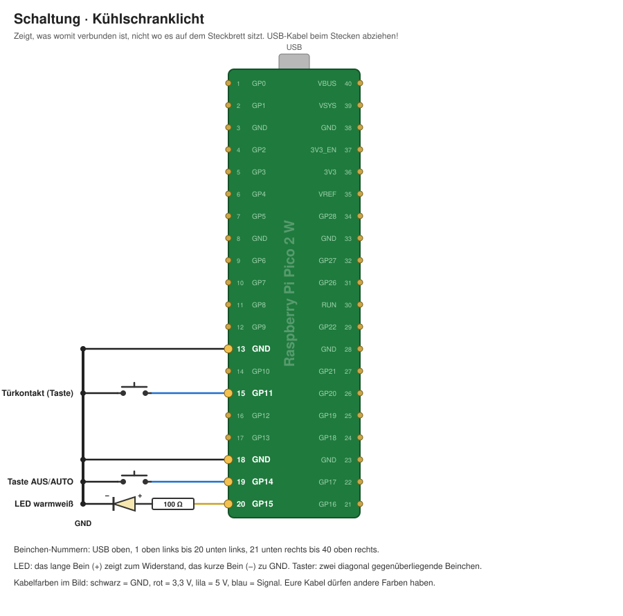
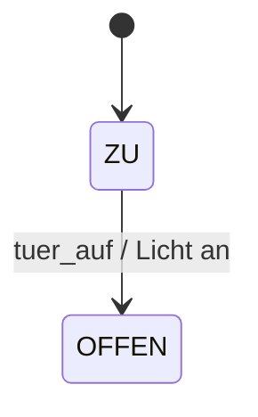
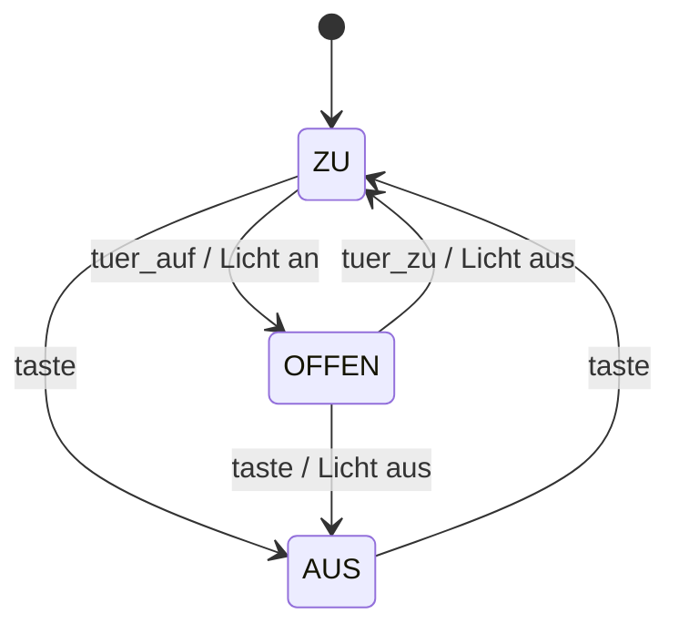

# Bauplan · Kühlschranklicht

**Team:** 265b-team-03 · **Board:** Raspberry Pi Pico 2 W · **Ziel:** alle Karten bis Ende Woche 6 fertig, Vorführung in Woche 7

## So arbeitet ihr mit diesem Bauplan

1. **Teil 1** enthält eure User Stories in überarbeiteter Form. Fangt mit Karte **K0** an.
2. **Teil 2** sind die Karten für euer Kanban-Board. **Ihr entscheidet**, wer welche Karte nimmt und wann. Eine Karte darf erst starten, wenn alle Karten unter „braucht vorher" fertig sind. Höchstens eine Karte pro Person in „In Arbeit".
3. **Teil 3** erklärt jede Karte Schritt für Schritt. Wo im Code `# TODO` steht, schreibt ihr selbst. Wenn ihr hängt, öffnet die Hilfe **der Reihe nach**: zuerst Tipp 1, dann Tipp 2, die Lösung nur, wenn es gar nicht geht. Notiert im Lernjournal, welche Stufe ihr gebraucht habt.

> ⚠️ Bauteile nur stecken, wenn das USB-Kabel **abgezogen** ist. LEDs immer mit Vorwiderstand.

Ein echter Kühlschrank merkt mit einem kleinen **Türkontakt**, ob die Tür offen ist: Ist die Tür zu, drückt sie auf einen Schalter. Genau so baut ihr es auch, mit einem Taster als Türkontakt und einem Schuhkarton als Kühlschrank.

---

## Teil 1 · Unsere User Stories (überarbeitet)

### US1 · Licht beim Öffnen (Muss)

Als Mutter von drei Kindern möchte ich, dass das Licht beim Öffnen des Kühlschranks sofort angeht, damit ich auch bei Dunkelheit gut sehe, was im Kühlschrank ist.

- [ ] Wird die Kühlschranktür geöffnet, geht die LED innerhalb von 1 s an.
- [ ] Wird die Tür geschlossen, geht die LED innerhalb von 1 s aus. Bei geschlossener Tür bleibt sie aus.

### US2 · Ausschalten (Muss)

Als Elternteil möchte ich das Kühlschranklicht mit einer Taste ganz ausschalten können, damit ich Strom sparen kann.

- [ ] Ein Tastendruck schaltet zwischen AUS und AUTOMATIK um. Nach dem Einstecken ist das Licht in AUTOMATIK.
- [ ] Im Zustand AUS leuchtet die LED nie, auch nicht bei offener Tür.

> **Was wir geändert haben:** Eure US1, US2 und US4 wollten alle dasselbe: Licht an beim Öffnen, aus beim Schließen. Drei Stories mit demselben Verhalten sind **eine** Story, deshalb gibt es jetzt US1 mit dem Story-Satz aus eurer US4. US2 sagte „nach 1 Sekunde", US4 „innerhalb von 1 s": Jetzt steht überall „innerhalb", denn schneller ist auch gut. Eure US3 (Lichtsensor mit der Hand abdecken) passt nicht zum Kühlschrank: Im geschlossenen Kühlschrank ist es **immer** dunkel. Deshalb erkennt ein Türkontakt das Öffnen, so wie es eure Lehrkraft festgelegt hat. US3 steht unter „Wenn ihr schneller seid". Eure US5 hatte den Satz „damit das Licht **nicht** angeht" und wird jetzt zu US2 „Ausschalten".

**Karte K0:** Kopiert Teil 1 in eure `ANFORDERUNGEN.md` (die alten Stories ersetzen) und committet mit der Nachricht `Stories überarbeitet`.

---

## Teil 2 · Karten für euer Kanban-Board

| Karte | Story | braucht vorher | fertig, wenn … |
|-------|-------|----------------|----------------|
| K0 Stories übernehmen | – | – | `ANFORDERUNGEN.md` enthält Teil 1, committet |
| K1 LED, Taste und Türkontakt anschließen | US1, US2 | – | Testcode: LED leuchtet, Taste und Türkontakt werden erkannt |
| K2 Kühlschrank-Modell bauen | US1 | K1 | Tür zu: Türkontakt gedrückt. Tür auf: losgelassen |
| K3 Zustandsdiagramm zeichnen | US1, US2 | K0 | Mermaid-Diagramm mit 3 Zuständen in `README.md` |
| K4 `naechster_zustand` schreiben | US1, US2 | K3 | Tests zu `naechster_zustand` in K6 sind grün |
| K5 `ereignis_bestimmen` schreiben | US1, US2 | K3 | Tests zu `ereignis_bestimmen` in K6 sind grün |
| K6 `test_logik.py` | US1, US2 | K4, K5 | alle Tests grün am PC |
| K7 `main.py` am Board | US1, US2 | K2, K6 | Licht geht beim Öffnen an, beim Schließen aus, Taste schaltet AUS |
| K8 Testprotokoll `TESTS.md` | US1, US2 | K7 | jedes Akzeptanzkriterium hat eine Zeile mit ✅ oder ❌ |
| K9 `README.md` fertig | – | K7 | README nach der Vorlage aus Woche 6 |
| K10 Präsentation + Demo-Video | – | K8 | 3-Minuten-Ablauf geprobt, 30-s-Video im Repository |

K1 und K3 können **gleichzeitig** von zwei Personen erledigt werden, ebenso K4 und K5. Den Karton für K2 könnt ihr schon vorher besorgen.

---

## Teil 3 · Anleitungen pro Karte

### K1 · LED, Taste und Türkontakt anschließen

Ihr braucht: LED warmweiß, Widerstand **100 Ω**, zwei Taster, Kabel.

| Bauteil | Anschluss |
|---------|-----------|
| Türkontakt (Taster) | **GP11** (Beinchen 15) ↔ GND (Beinchen 13) |
| Taste AUS/AUTO | **GP14** (Beinchen 19) ↔ GND (Beinchen 18) |
| LED warmweiß | **GP15** (Beinchen 20) → **100 Ω** → langes Bein, kurzes Bein → GND (Beinchen 18) |



Das Bild zeigt, **was womit verbunden** ist, nicht wo es auf dem Steckbrett sitzt.

Warum 100 Ω statt 220 Ω? Weiße LEDs brauchen fast die ganze Spannung des Pico (ca. 3 V von 3,3 V). Mit 220 Ω leuchten sie nur sehr schwach.

Taster mit vier Beinchen: zwei **diagonal gegenüberliegende** Beinchen verwenden, Taster über die Mittelrille stecken.

Speichert `hardware.py` **auf dem Pico** (Datei → Speichern unter → MicroPython-Gerät):

```python
# hardware.py – Raspberry Pi Pico 2 W · Kühlschranklicht
from machine import Pin

_licht = Pin(15, Pin.OUT)
_taste = Pin(14, Pin.IN, Pin.PULL_UP)
_tuer = Pin(11, Pin.IN, Pin.PULL_UP)
_vorher = 1


def licht(an):
    _licht.value(1 if an else 0)


def gedrueckt():
    """True einmal pro Druck auf die Taste AUS/AUTO."""
    global _vorher
    jetzt = _taste.value()
    neu = _vorher == 1 and jetzt == 0
    _vorher = jetzt
    return neu


def tuer_offen():
    """True, solange die Tür offen ist (Türkontakt NICHT gedrückt)."""
    return _tuer.value() == 1
```

Achtung, beim Türkontakt ist es **umgekehrt** wie gewohnt: Gedrückt heißt „Tür zu". Deshalb liefert `tuer_offen()` `True`, wenn der Taster **nicht** gedrückt ist.

Testet in der Thonny-Kommandozeile:

```python
from hardware import *
licht(True)
licht(False)
```

Und die zwei Taster (mit **Strg+C** beenden):

```python
import time
while True:
    if gedrueckt():
        print("Taste!")
    print("Tür offen:", tuer_offen())
    time.sleep_ms(300)
```

Haltet den Türkontakt gedrückt: Steht dann `Tür offen: False` da? Dann ist K1 fertig.

### K2 · Kühlschrank-Modell bauen

Ihr braucht: einen Schuhkarton (oder ähnlich) mit Deckel oder Klappe als Tür, Klebeband, eventuell lange Kabel (Stecker–Buchse).

1. Schneidet in eine Seite des Kartons eine Tür, die sich auf- und zuklappen lässt (z. B. drei Seiten aufschneiden, die vierte ist das Scharnier).
2. Setzt das Steckbrett so neben oder in den Karton, dass die **geschlossene Tür auf den Türkontakt drückt**. Oft hilft ein kleines Stück Karton oder ein Radiergummi auf der Innenseite der Tür, damit sie den Taster sicher trifft.
3. Die LED soll **innen** leuchten. Ist sie zu weit weg, verlängert ihr sie mit zwei Stecker–Buchse-Kabeln.
4. Prüft mit dem Testcode aus K1: Tür zu → `Tür offen: False`, Tür auf → `Tür offen: True`. Zehnmal hintereinander, ohne Ausnahme.

Macht ein Foto vom Modell für die README.

### K3 · Zustandsdiagramm zeichnen

Euer Kühlschranklicht hat **3 Zustände**: `AUS` (Taste hat ausgeschaltet), `ZU` (Automatik, Tür zu, Licht aus) und `OFFEN` (Automatik, Tür offen, Licht an). Es gibt **3 Ereignisse**: `taste`, `tuer_auf` und `tuer_zu`.

Ergänzt die fehlenden Pfeile und schreibt das Diagramm in `README.md` ([Mermaid im Kursbuch](https://glandl.github.io/Coursebook-maker-reise-grade-9/werkzeuge/mermaid/)):

````markdown

````

<details>
<summary>Tipp 1</summary>

Von `OFFEN` gibt es zwei Pfeile hinaus (Tür zu, Taste). Von `ZU` auch zwei (Tür auf, Taste). Von `AUS` nur einen: Wohin kommt man, wenn man in `AUS` die Taste drückt?

</details>

<details>
<summary>Lösung</summary>



</details>

**Denkfrage für die Präsentation:** Ihr drückt in `AUS` die Taste, während die Tür **offen** ist. Der Automat geht nach `ZU`, obwohl die Tür offen ist. Warum leuchtet das Licht trotzdem gleich darauf? (Tipp: Was liefert `ereignis_bestimmen` im nächsten Durchlauf der Schleife?)

### K4 · `naechster_zustand` schreiben

Nach dem **Automaten-Rezept** aus [Woche 5, Abschnitt 2a](https://glandl.github.io/Coursebook-maker-reise-grade-9/projekte/p1-code-gadget/woche-05-zustandsautomat/). Legt am PC eine Datei `logik.py` an (später auch auf den Pico kopieren):

```python
# logik.py – keine Imports von hardware!


def naechster_zustand(zustand, ereignis):
    """Die Pfeile des Zustandsdiagramms, sonst nichts."""
    if zustand == "AUS":
        if ereignis == "taste":
            return "ZU"
    elif zustand == "ZU":
        # TODO: zwei Pfeile
        pass
    elif zustand == "OFFEN":
        # TODO: zwei Pfeile
        pass
    return zustand
```

<details>
<summary>Tipp 1</summary>

Jeder Pfeil in eurem Diagramm aus K3 wird zu einem `if ereignis == …: return …` im Block seines Startzustands. Das `pass` löscht ihr, sobald etwas im Block steht.

</details>

<details>
<summary>Tipp 2</summary>

```python
    elif zustand == "ZU":
        if ereignis == "tuer_auf":
            return ...
        if ereignis == ...:
            return "AUS"
```

</details>

<details>
<summary>Lösung</summary>

```python
def naechster_zustand(zustand, ereignis):
    """Die Pfeile des Zustandsdiagramms, sonst nichts."""
    if zustand == "AUS":
        if ereignis == "taste":
            return "ZU"
    elif zustand == "ZU":
        if ereignis == "tuer_auf":
            return "OFFEN"
        if ereignis == "taste":
            return "AUS"
    elif zustand == "OFFEN":
        if ereignis == "tuer_zu":
            return "ZU"
        if ereignis == "taste":
            return "AUS"
    return zustand
```

</details>

### K5 · `ereignis_bestimmen` schreiben

Diese Funktion macht aus Taste und Türkontakt **ein** Ereignis. Sie bekommt beides als Parameter, deshalb könnt ihr sie am PC testen. Ergänzt in `logik.py`:

```python
def ereignis_bestimmen(gedrueckt, tuer_offen):
    """Macht aus Taste und Türkontakt ein Ereignis."""
    # TODO 1: Taste gedrückt → "taste"
    # TODO 2: Tür offen → "tuer_auf", sonst "tuer_zu"
    return None
```

<details>
<summary>Tipp 1</summary>

Die Taste kommt **zuerst**. Danach gibt es nur noch zwei Möglichkeiten: Die Tür ist offen oder nicht. Dafür reicht ein `if` mit `else`.

</details>

<details>
<summary>Lösung</summary>

```python
def ereignis_bestimmen(gedrueckt, tuer_offen):
    """Macht aus Taste und Türkontakt ein Ereignis."""
    if gedrueckt:
        return "taste"
    if tuer_offen:
        return "tuer_auf"
    return "tuer_zu"
```

</details>

Die Funktion liefert `tuer_auf` in **jedem** Durchlauf, solange die Tür offen ist, nicht nur im Moment des Öffnens. Das ist kein Problem: In `OFFEN` gibt es keinen Pfeil mit `tuer_auf`, also bleibt der Zustand.

### K6 · `test_logik.py`

Legt `test_logik.py` **am PC** im selben Ordner wie `logik.py` an und startet ihn mit dem Interpreter **Lokales Python 3** ([Woche 6, Abschnitt 2b](https://glandl.github.io/Coursebook-maker-reise-grade-9/projekte/p1-code-gadget/woche-06-testen-doku/)).

```python
from logik import naechster_zustand, ereignis_bestimmen

TESTS = [
    ("ZU",    "tuer_auf", "OFFEN"),
    ("OFFEN", "tuer_zu",  "ZU"),
    # TODO: die anderen drei Pfeile
    ("AUS",   "tuer_auf", "AUS"),          # US2: im Zustand AUS nie Licht!
    ("OFFEN", "tuer_auf", "OFFEN"),        # Tür bleibt offen: nichts passiert
]
EREIGNIS_TESTS = [
    # (Taste gedrückt, Tür offen, erwartetes Ereignis)
    (False, True,  "tuer_auf"),
    (False, False, "tuer_zu"),
    # TODO: Taste gedrückt bei offener Tür
]

bestanden = 0
for zustand, ereignis, erwartet in TESTS:
    ergebnis = naechster_zustand(zustand, ereignis)
    if ergebnis == erwartet:
        bestanden = bestanden + 1
        print("ok     ", zustand, "+", ereignis, "→", ergebnis)
    else:
        print("FEHLER ", zustand, "+", ereignis, "→", ergebnis, "erwartet:", erwartet)
for taste, offen, erwartet in EREIGNIS_TESTS:
    ergebnis = ereignis_bestimmen(taste, offen)
    if ergebnis == erwartet:
        bestanden = bestanden + 1
        print("ok     ", taste, offen, "→", ergebnis)
    else:
        print("FEHLER ", taste, offen, "→", ergebnis, "erwartet:", erwartet)

print(bestanden, "von", len(TESTS) + len(EREIGNIS_TESTS), "Tests bestanden")
```

**Fertig, wenn** alle Tests grün sind. Dann baut absichtlich einen Fehler ein (z. B. einen Pfeil `AUS → OFFEN` bei `tuer_auf`): Findet ihn der Test?

### K7 · `main.py` am Board

1. Kopiert `logik.py` auf den Pico (Datei → Speichern unter → MicroPython-Gerät).
2. Speichert dort auch `main.py`:

```python
from hardware import licht, gedrueckt, tuer_offen
from logik import naechster_zustand, ereignis_bestimmen
import time

zustand = "ZU"
licht(False)
print("Kühlschranklicht bereit (AUTOMATIK)")

while True:
    ereignis = ereignis_bestimmen(gedrueckt(), tuer_offen())
    neu = naechster_zustand(zustand, ereignis)
    if neu != zustand:
        print(zustand, "→", neu)
        zustand = neu
        # TODO: Licht an, wenn der neue Zustand OFFEN ist, sonst aus
    time.sleep_ms(50)
```

<details>
<summary>Tipp 1</summary>

`licht()` will `True` oder `False`. Der Vergleich `zustand == "OFFEN"` liefert genau das.

</details>

<details>
<summary>Lösung</summary>

```python
        licht(zustand == "OFFEN")
```

</details>

**Fertig, wenn** das Licht im Modell beim Öffnen angeht, beim Schließen ausgeht und nach einem Druck auf die Taste bei offener Tür dunkel bleibt.

### K8 · Testprotokoll `TESTS.md`

Vorlage: [Woche 6, Abschnitt 2c](https://glandl.github.io/Coursebook-maker-reise-grade-9/projekte/p1-code-gadget/woche-06-testen-doku/). Am besten testet ihr im abgedunkelten Raum oder mit einer Jacke über dem Modell. Eine Zeile pro Akzeptanzkriterium aus Teil 1, z. B.:

```markdown
| # | Ausgangszustand | Aktion | Erwartet | Beobachtet | ok? |
|---|-----------------|--------|----------|------------|-----|
| 1 | ZU | Tür öffnen | Licht an innerhalb 1 s | | |
| 2 | OFFEN | Tür schließen | Licht aus innerhalb 1 s | | |
| 3 | ZU | Taste drücken, Tür öffnen | Licht bleibt aus | | |
| … | | | | | |
```

Jedes ❌ wird eine neue Karte.

### K9 · `README.md` fertig

Nach der Vorlage aus [Woche 6, Abschnitt 4](https://glandl.github.io/Coursebook-maker-reise-grade-9/projekte/p1-code-gadget/woche-06-testen-doku/). Diagramm aus K3, Hardware-Tabelle aus K1 und das Foto vom Modell aus K2.

### K10 · Präsentation + Demo-Video

Ablauf aus [Woche 6, Abschnitt 5](https://glandl.github.io/Coursebook-maker-reise-grade-9/projekte/p1-code-gadget/woche-06-testen-doku/). Für die Demo: Licht im Raum aus oder dunkel machen. Eine Person spielt die Mutter, öffnet den Kühlschrank: Licht an. Tür zu: Licht aus. Dann drückt das Elternteil die Taste: Beim Öffnen bleibt es dunkel. 30-s-Video ins Repository.

---

## Wenn ihr schneller seid

- **Tür-offen-Warnung:** Steht die Tür länger als 30 s offen, blinkt das Licht (oder ein Summer an GP16 piept, fragt eure Lehrkraft). Ihr braucht ein neues Ereignis `zu_lange` und einen Zustand `WARNUNG`. Wie man Zeit misst, zeigt das Reaktionsspiel in Woche 5. Zeichnet zuerst das Diagramm!
- **Nur wenn es dunkel ist (eure US3):** Mit einem Lichtsensor (LDR + 10 kΩ an GP26, wie in Woche 4) geht das Licht nur an, wenn es im **Raum** dunkel ist. Tagsüber spart das Strom. Der Sensor muss dafür **außen** am Karton sitzen.
- **Sanftes Einschalten:** Das Licht wird in 1 s langsam hell statt schlagartig. Dafür braucht ihr PWM (`from machine import PWM`, `duty_u16`), siehe den Summer in [Woche 4](https://glandl.github.io/Coursebook-maker-reise-grade-9/projekte/p1-code-gadget/woche-04-sensoren-review/).
