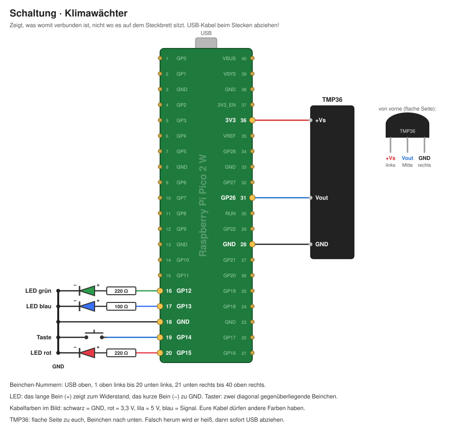
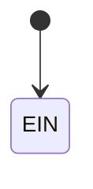
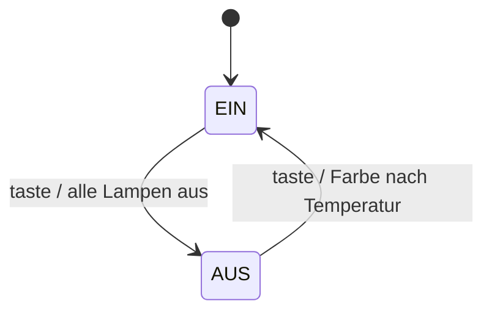

# Bauplan · Klimawächter

**Team:** 265b-team-04 · **Board:** Raspberry Pi Pico 2 W · **Ziel:** alle Karten bis Ende Woche 6 fertig, Vorführung in Woche 7

## So arbeitet ihr mit diesem Bauplan

1. **Teil 1** enthält eure User Stories in überarbeiteter Form. Fangt mit Karte **K0** an.
2. **Teil 2** sind die Karten für euer Kanban-Board. **Ihr entscheidet**, wer welche Karte nimmt und wann. Eine Karte darf erst starten, wenn alle Karten unter „braucht vorher" fertig sind. Höchstens eine Karte pro Person in „In Arbeit".
3. **Teil 3** erklärt jede Karte Schritt für Schritt. Wo im Code `# TODO` steht, schreibt ihr selbst. Wenn ihr hängt, öffnet die Hilfe **der Reihe nach**: zuerst Tipp 1, dann Tipp 2, die Lösung nur, wenn es gar nicht geht. Notiert im Lernjournal, welche Stufe ihr gebraucht habt.

> ⚠️ Bauteile nur stecken, wenn das USB-Kabel **abgezogen** ist. LEDs immer mit Vorwiderstand.

Euer Klimawächter hat drei Lampen: **Blau = zu kalt, Grün = angenehm, Rot = zu warm**. Es leuchtet immer nur eine.

---

## Teil 1 · Unsere User Stories (überarbeitet)

### US1 · Temperatur auf einen Blick (Muss)

Als Benutzer:in möchte ich an der Farbe einer Lampe sehen, ob es im Raum zu kalt, angenehm oder zu warm ist, damit ich weiß, ob ich heizen oder lüften soll.

- [ ] Das Gadget misst die Temperatur alle 2 s und zeigt sie in Thonny an. Sie weicht höchstens 1 °C von einem Raumthermometer ab.
- [ ] Von 18,0 °C bis 25,0 °C leuchtet nur Grün, unter 18,0 °C nur Blau, über 25,0 °C nur Rot.
- [ ] Wird eine Grenze überschritten, wechselt die Farbe innerhalb von 3 s.

### US2 · Ausschalten (Muss)

Als Benutzer:in möchte ich den Klimawächter mit einer Taste ausschalten können, damit er nicht leuchtet, wenn ich ihn nicht brauche (z. B. in der Nacht).

- [ ] Ein Tastendruck schaltet zwischen EIN und AUS um. Nach dem Einstecken ist der Klimawächter EIN.
- [ ] Im Zustand AUS leuchtet keine Lampe, egal wie warm oder kalt es ist.
- [ ] Nach dem Wiedereinschalten zeigt die richtige Farbe innerhalb von 3 s.

> **Was wir geändert haben:** Eure erste und zweite Story beschrieben dasselbe Verhalten (Farbe je nach Temperatur), deshalb ist es jetzt **eine** Story. „Regelmäßig" ist jetzt eine Zahl (alle 2 s aus eurer zweiten Story). Die Grenzen 18 °C und 25 °C sind genauer: Bei genau 18,0 und genau 25,0 °C leuchtet Grün. „Wechselt innerhalb von 3 s" heißt: höchstens 2 s bis zur nächsten Messung, plus etwas Reserve. Die Ausschalten-Story hatte keinen Satz „damit …", jetzt steht da, wozu man ausschaltet.

**Karte K0:** Kopiert Teil 1 in eure `ANFORDERUNGEN.md` (die alten Stories ersetzen) und committet mit der Nachricht `Stories überarbeitet`.

---

## Teil 2 · Karten für euer Kanban-Board

| Karte | Story | braucht vorher | fertig, wenn … |
|-------|-------|----------------|----------------|
| K0 Stories übernehmen | – | – | `ANFORDERUNGEN.md` enthält Teil 1, committet |
| K1 LEDs und Taste anschließen | US1, US2 | – | Testcode: alle drei LEDs leuchten einzeln, die Taste wird erkannt |
| K2 Temperatursensor anschließen | US1 | K1 | `temperatur()` liefert die Raumtemperatur, sie steigt beim Anfassen |
| K3 Temperatur prüfen | US1 | K2 | Vergleich mit Raumthermometer als Kommentar in `hardware.py`, `KORREKTUR` eingetragen |
| K4 Zustandsdiagramm zeichnen | US2 | K0 | Mermaid-Diagramm in `README.md` |
| K5 `naechster_zustand` und `ereignis_bestimmen` schreiben | US2 | K4 | Tests dazu in K7 sind grün |
| K6 `lampen` schreiben | US1, US2 | K0 | Tests zu `lampen` in K7 sind grün |
| K7 `test_logik.py` | US1, US2 | K5, K6 | alle Tests grün am PC |
| K8 `main.py` am Board | US1, US2 | K3, K7 | Farbe stimmt zur Temperatur, Taste schaltet aus und ein |
| K9 Testprotokoll `TESTS.md` | US1, US2 | K8 | jedes Akzeptanzkriterium hat eine Zeile mit ✅ oder ❌ |
| K10 `README.md` fertig | – | K8 | README nach der Vorlage aus Woche 6 |
| K11 Präsentation + Demo-Video | – | K9 | 3-Minuten-Ablauf geprobt, 30-s-Video im Repository |

K1, K4 und K6 können **gleichzeitig** von drei Personen erledigt werden.

---

## Teil 3 · Anleitungen pro Karte

### K1 · LEDs und Taste anschließen

Ihr braucht: LED blau, LED grün, LED rot, Widerstand **100 Ω** (für Blau), zwei Widerstände 220 Ω, einen Taster, Kabel.

| Bauteil | Anschluss |
|---------|-----------|
| LED grün (angenehm) | **GP12** (Beinchen 16) → 220 Ω → langes Bein, kurzes Bein → GND |
| LED blau (zu kalt) | **GP13** (Beinchen 17) → **100 Ω** → langes Bein, kurzes Bein → GND |
| LED rot (zu warm) | **GP15** (Beinchen 20) → 220 Ω → langes Bein, kurzes Bein → GND |
| Taste | **GP14** (Beinchen 19) ↔ GND (Beinchen 18) |



Das Bild zeigt, **was womit verbunden** ist, nicht wo es auf dem Steckbrett sitzt. Es zeigt schon die ganze Schaltung, auch den Temperatursensor (K2).

Warum 100 Ω bei Blau? Blaue LEDs brauchen fast die ganze Spannung des Pico (ca. 3 V von 3,3 V). Mit 220 Ω leuchten sie nur sehr schwach.

Taster mit vier Beinchen: zwei **diagonal gegenüberliegende** Beinchen verwenden, Taster über die Mittelrille stecken.

Speichert `hardware.py` **auf dem Pico** (Datei → Speichern unter → MicroPython-Gerät). Die Funktion `temperatur()` braucht ihr erst in K2, sie steht aber schon drin:

```python
# hardware.py – Raspberry Pi Pico 2 W · Klimawächter
from machine import Pin, ADC

KORREKTUR = 0.0      # TODO in K3: so viel °C weicht euer Sensor vom Thermometer ab

_blau = Pin(13, Pin.OUT)
_gruen = Pin(12, Pin.OUT)
_rot = Pin(15, Pin.OUT)
_taste = Pin(14, Pin.IN, Pin.PULL_UP)
_sensor = ADC(26)
_vorher = 1


def anzeigen(blau, gruen, rot):
    """Schaltet die drei Lampen: True = an, False = aus."""
    _blau.value(1 if blau else 0)
    _gruen.value(1 if gruen else 0)
    _rot.value(1 if rot else 0)


def gedrueckt():
    """True einmal pro Tastendruck."""
    global _vorher
    jetzt = _taste.value()
    neu = _vorher == 1 and jetzt == 0
    _vorher = jetzt
    return neu


def temperatur():
    """Temperatur am TMP36 in °C, Mittelwert aus 20 Messungen."""
    summe = 0
    for i in range(20):
        summe = summe + _sensor.read_u16()
    spannung = summe / 20 * 3.3 / 65535       # 0 bis 3,3 V
    grad = (spannung - 0.5) * 100             # TMP36: 0,5 V bei 0 °C, 0,01 V pro °C
    return round(grad + KORREKTUR, 1)
```

Testet in der Thonny-Kommandozeile:

```python
from hardware import *
anzeigen(True, False, False)    # nur Blau
anzeigen(False, True, False)    # nur Grün
anzeigen(False, False, True)    # nur Rot
anzeigen(False, False, False)   # alles aus
```

Und die Taste (mit **Strg+C** beenden):

```python
import time
while True:
    if gedrueckt():
        print("Taste!")
    time.sleep_ms(50)
```

### K2 · Temperatursensor anschließen

Der **TMP36** sieht aus wie ein kleiner Transistor: schwarz, drei Beinchen, eine flache Seite mit Aufdruck. Er liefert eine Spannung, die mit der Temperatur steigt: 0,5 V bei 0 °C, jedes Grad mehr 0,01 V mehr. Bei 22 °C sind es also 0,72 V. Diese Rechnung macht `temperatur()` für euch.

Haltet ihn so, dass die **flache Seite zu euch** zeigt und die Beinchen nach unten:

| TMP36-Beinchen | Pico |
|----------------|------|
| links (+Vs) | **3V3** (Beinchen 36) |
| Mitte (Vout) | **GP26** (Beinchen 31) |
| rechts (GND) | GND (Beinchen 28) |

> ⚠️ **Falsch herum gesteckt, wird der TMP36 heiß.** Nach dem Einstecken vorsichtig mit dem Finger antippen. Ist er heiß: sofort USB abziehen, umdrehen.

Testet in der Thonny-Kommandozeile (`hardware.py` aus K1 ist schon auf dem Pico):

```python
from hardware import temperatur
import time
while True:
    print(temperatur())
    time.sleep(2)
```

Jetzt den Sensor zwischen zwei Fingern halten: Die Temperatur muss innerhalb einer Minute um einige Grad steigen. Lasst ihr los, sinkt sie langsam wieder.

**Zeigt er −50 °C oder über 100 °C?** Das mittlere Beinchen steckt nicht an GP26, oder der Sensor hat keinen Strom.

### K3 · Temperatur prüfen

Ein Sensor misst nie ganz genau. Prüft ihn mit einem echten Thermometer (in der Klasse, beim Schulwart oder von zuhause).

1. Legt Sensor und Thermometer 5 Minuten nebeneinander, nicht in die Sonne und nicht auf die Heizung.
2. Lest beide gleichzeitig ab.
3. Rechnet: `KORREKTUR = Thermometer − Sensor`. Zeigt das Thermometer 22,0 °C und euer Sensor 23,4 °C, ist `KORREKTUR = -1.4`.
4. Tragt den Wert in `hardware.py` ein, mit den Messwerten als Kommentar:

```python
KORREKTUR = -1.4     # gemessen: Thermometer 22,0 °C, Sensor 23,4 °C
```

5. **Für die Vorführung** braucht ihr alle drei Farben. Probiert aus und notiert:
   - **Warm:** Sensor 1 Minute zwischen den Fingern. Erreicht ihr mehr als 25 °C?
   - **Kalt:** Sensor an ein offenes Fenster halten (im November ist es draußen kalt) oder an eine kalte Getränkedose in einem **trockenen** Plastiksackerl. Erreicht ihr weniger als 18 °C?

   Schafft ihr eine Grenze nicht, schreibt ihr das in `README.md` und verschiebt die Grenzen für die Vorführung (siehe K11).

### K4 · Zustandsdiagramm zeichnen

Euer Klimawächter hat nur **2 Zustände**: `EIN` und `AUS`. Das Ereignis ist `taste`. Welche Farbe im Zustand `EIN` leuchtet, entscheidet nicht der Automat, sondern die Funktion `lampen` (K6) aus der Temperatur.

Zeichnet das Diagramm und schreibt es in `README.md` ([Mermaid im Kursbuch](https://glandl.github.io/Coursebook-maker-reise-grade-9/werkzeuge/mermaid/)):

````markdown

````

<details>
<summary>Lösung</summary>



</details>

**Denkfrage für die Präsentation:** Man könnte `KALT`, `ANGENEHM` und `WARM` auch als eigene Zustände zeichnen. Dann bräuchte man Pfeile wie `ANGENEHM → WARM: über 25 °C`. Warum reicht hier eine Funktion, die aus der Temperatur direkt die Farbe berechnet? (Tipp: Hängt die Farbe davon ab, welche Farbe **vorher** geleuchtet hat?)

### K5 · `naechster_zustand` und `ereignis_bestimmen` schreiben

Nach dem **Automaten-Rezept** aus [Woche 5, Abschnitt 2a](https://glandl.github.io/Coursebook-maker-reise-grade-9/projekte/p1-code-gadget/woche-05-zustandsautomat/). Legt am PC eine Datei `logik.py` an (später auch auf den Pico kopieren):

```python
# logik.py – keine Imports von hardware!

GRENZE_KALT = 18.0      # darunter: Blau
GRENZE_WARM = 25.0      # darüber: Rot


def naechster_zustand(zustand, ereignis):
    """Die Pfeile des Zustandsdiagramms, sonst nichts."""
    # TODO: zwei Pfeile
    return zustand


def ereignis_bestimmen(gedrueckt):
    """Macht aus der Taste ein Ereignis (oder None)."""
    # TODO
    return None
```

<details>
<summary>Tipp 1</summary>

Ein `if`-Block pro Zustand, darin ein `if` für `taste`. `ereignis_bestimmen` braucht nur ein `if`.

</details>

<details>
<summary>Lösung</summary>

```python
def naechster_zustand(zustand, ereignis):
    """Die Pfeile des Zustandsdiagramms, sonst nichts."""
    if zustand == "EIN":
        if ereignis == "taste":
            return "AUS"
    elif zustand == "AUS":
        if ereignis == "taste":
            return "EIN"
    return zustand


def ereignis_bestimmen(gedrueckt):
    """Macht aus der Taste ein Ereignis (oder None)."""
    if gedrueckt:
        return "taste"
    return None
```

</details>

### K6 · `lampen` schreiben

Das ist das Herz eures Gadgets. Die Funktion bekommt den Zustand und die Temperatur und sagt, welche der drei Lampen leuchtet. Ergänzt in `logik.py`:

```python
def lampen(zustand, temperatur):
    """Liefert (blau, gruen, rot): welche Lampe leuchtet?"""
    if zustand == "AUS":
        return (False, False, False)
    # TODO 1: unter GRENZE_KALT → nur Blau
    # TODO 2: über GRENZE_WARM → nur Rot
    return (False, True, False)          # sonst: nur Grün
```

<details>
<summary>Tipp 1</summary>

„Unter" heißt `<`, „über" heißt `>`. Genau 18,0 und genau 25,0 °C sind **grün**, deshalb **nicht** `<=` oder `>=`.

</details>

<details>
<summary>Tipp 2</summary>

```python
    if temperatur < ...:
        return (True, False, False)
    if ...:
        return ...
```

</details>

<details>
<summary>Lösung</summary>

```python
def lampen(zustand, temperatur):
    """Liefert (blau, gruen, rot): welche Lampe leuchtet?"""
    if zustand == "AUS":
        return (False, False, False)
    if temperatur < GRENZE_KALT:
        return (True, False, False)
    if temperatur > GRENZE_WARM:
        return (False, False, True)
    return (False, True, False)
```

</details>

### K7 · `test_logik.py`

Legt `test_logik.py` **am PC** im selben Ordner wie `logik.py` an und startet ihn mit dem Interpreter **Lokales Python 3** ([Woche 6, Abschnitt 2b](https://glandl.github.io/Coursebook-maker-reise-grade-9/projekte/p1-code-gadget/woche-06-testen-doku/)).

```python
from logik import naechster_zustand, ereignis_bestimmen, lampen

TESTS = [
    ("EIN", "taste", "AUS"),
    # TODO: der zweite Pfeil
    ("EIN", None,    "EIN"),              # kein Ereignis: Zustand bleibt
]
EREIGNIS_TESTS = [
    (True,  "taste"),
    (False, None),
]
LAMPEN_TESTS = [
    # (Zustand, Temperatur, erwartet (blau, gruen, rot))
    ("EIN", 21.0, (False, True, False)),
    ("EIN", 15.5, (True, False, False)),
    ("AUS", 30.0, (False, False, False)),  # US2: AUS heißt dunkel
    # TODO: 27,0 °C, genau 18,0 °C, genau 25,0 °C und 17,9 °C
]

bestanden = 0
for zustand, ereignis, erwartet in TESTS:
    ergebnis = naechster_zustand(zustand, ereignis)
    if ergebnis == erwartet:
        bestanden = bestanden + 1
        print("ok     ", zustand, "+", ereignis, "→", ergebnis)
    else:
        print("FEHLER ", zustand, "+", ereignis, "→", ergebnis, "erwartet:", erwartet)
for taste, erwartet in EREIGNIS_TESTS:
    ergebnis = ereignis_bestimmen(taste)
    if ergebnis == erwartet:
        bestanden = bestanden + 1
        print("ok     ", taste, "→", ergebnis)
    else:
        print("FEHLER ", taste, "→", ergebnis, "erwartet:", erwartet)
for zustand, grad, erwartet in LAMPEN_TESTS:
    ergebnis = lampen(zustand, grad)
    if ergebnis == erwartet:
        bestanden = bestanden + 1
        print("ok     ", zustand, grad, "°C →", ergebnis)
    else:
        print("FEHLER ", zustand, grad, "°C →", ergebnis, "erwartet:", erwartet)

print(bestanden, "von", len(TESTS) + len(EREIGNIS_TESTS) + len(LAMPEN_TESTS), "Tests bestanden")
```

<details>
<summary>Tipp 1 (für die Grenzfälle)</summary>

Genau 18,0 °C und genau 25,0 °C sind grün: `("EIN", 18.0, (False, True, False)),`. Bei 17,9 °C ist es schon blau.

</details>

**Fertig, wenn** alle Tests grün sind. Dann baut absichtlich einen Fehler ein (z. B. `<=` statt `<`): Findet ihn der Test?

### K8 · `main.py` am Board

Die Taste wird alle 50 ms abgefragt, damit sie sofort reagiert. Die Temperatur misst das Programm aber nur **alle 2 s** (US1). Dafür merkt es sich, wann zuletzt gemessen wurde.

1. Kopiert `logik.py` auf den Pico (Datei → Speichern unter → MicroPython-Gerät).
2. Speichert dort auch `main.py`:

```python
from hardware import anzeigen, gedrueckt, temperatur
from logik import naechster_zustand, ereignis_bestimmen, lampen
import time

zustand = "EIN"
grad = temperatur()
blau, gruen, rot = lampen(zustand, grad)
anzeigen(blau, gruen, rot)
letzte_messung = time.ticks_ms()

while True:
    neu = naechster_zustand(zustand, ereignis_bestimmen(gedrueckt()))
    if neu != zustand:
        print(zustand, "→", neu)
        zustand = neu
        # TODO: Lampen sofort neu setzen

    if time.ticks_diff(time.ticks_ms(), letzte_messung) >= 2000:
        grad = temperatur()
        print(grad, "°C", zustand)
        # TODO: Lampen neu setzen
        letzte_messung = time.ticks_ms()
    time.sleep_ms(50)
```

`blau, gruen, rot = lampen(...)` packt die drei Werte, die `lampen` liefert, in drei Variablen aus.

<details>
<summary>Tipp 1</summary>

Beide TODOs sind gleich: zuerst `lampen(zustand, grad)` aufrufen, dann das Ergebnis an `anzeigen` weitergeben. Schaut, wie es vor der Schleife gemacht wird.

</details>

<details>
<summary>Lösung</summary>

An beiden Stellen:

```python
        blau, gruen, rot = lampen(zustand, grad)
        anzeigen(blau, gruen, rot)
```

</details>

**Fertig, wenn** nach dem Einstecken die richtige Farbe leuchtet, die Farbe beim Erwärmen auf Rot wechselt und die Taste alle Lampen aus- und wieder einschaltet.

### K9 · Testprotokoll `TESTS.md`

Vorlage: [Woche 6, Abschnitt 2c](https://glandl.github.io/Coursebook-maker-reise-grade-9/projekte/p1-code-gadget/woche-06-testen-doku/). Eine Person hält den Sensor, eine beobachtet Lampen und Thonny, eine trägt ein. Eine Zeile pro Akzeptanzkriterium aus Teil 1, z. B.:

```markdown
| # | Ausgangszustand | Aktion | Erwartet | Beobachtet | ok? |
|---|-----------------|--------|----------|------------|-----|
| 1 | EIN, 22 °C | Thermometer daneben ablesen | Abweichung ≤ 1 °C | | |
| 2 | EIN, Grün | Sensor zwischen den Fingern | über 25 °C: nur Rot, innerhalb 3 s | | |
| 3 | EIN, Grün | Sensor ans offene Fenster | unter 18 °C: nur Blau | | |
| 4 | EIN, Rot | Taste | alle Lampen aus | | |
| … | | | | | |
```

Jedes ❌ wird eine neue Karte.

### K10 · `README.md` fertig

Nach der Vorlage aus [Woche 6, Abschnitt 4](https://glandl.github.io/Coursebook-maker-reise-grade-9/projekte/p1-code-gadget/woche-06-testen-doku/). Das Zustandsdiagramm aus K4 gehört hinein, die Hardware-Tabellen aus K1 und K2 auch, ebenso eure Messwerte aus K3.

### K11 · Präsentation + Demo-Video

Ablauf aus [Woche 6, Abschnitt 5](https://glandl.github.io/Coursebook-maker-reise-grade-9/projekte/p1-code-gadget/woche-06-testen-doku/). Für die Demo: Zeigt Thonny mit der laufenden Temperatur auf dem Beamer. Zuerst Grün bei Raumtemperatur, dann Sensor zwischen den Fingern bis Rot, dann ans Fenster bis Blau. Zum Schluss die Taste: alles dunkel. Wenn eine Grenze in K3 nicht erreichbar war, stellt `GRENZE_WARM` oder `GRENZE_KALT` für die Vorführung 2 °C näher an die Raumtemperatur und sagt das dazu. 30-s-Video ins Repository.

---

## Wenn ihr schneller seid

- **Kein Flackern an der Grenze:** Liegt die Temperatur genau um 25 °C, kann die Lampe alle 2 s zwischen Grün und Rot wechseln. Abhilfe ist die **Hysterese** aus [Woche 5](https://glandl.github.io/Coursebook-maker-reise-grade-9/projekte/p1-code-gadget/woche-05-zustandsautomat/): Rot erst über 25,0 °C, zurück auf Grün erst unter 24,5 °C. Dafür muss das Gadget wissen, welche Farbe **vorher** geleuchtet hat. Jetzt braucht ihr doch die Zustände `KALT`, `ANGENEHM`, `WARM` (siehe Denkfrage in K4). Zeichnet zuerst das Diagramm!
- **Trend anzeigen:** Thonny zeigt neben der Temperatur `↑` oder `↓`, je nachdem, ob sie seit der letzten Messung gestiegen oder gefallen ist (eure zweite Story „Temperaturänderung erkennen").
- **Grenzen einstellen:** Mit einem Potentiometer an GP27 (fragt eure Lehrkraft) stellt man die Wohlfühltemperatur ein, statt sie im Code zu ändern.
