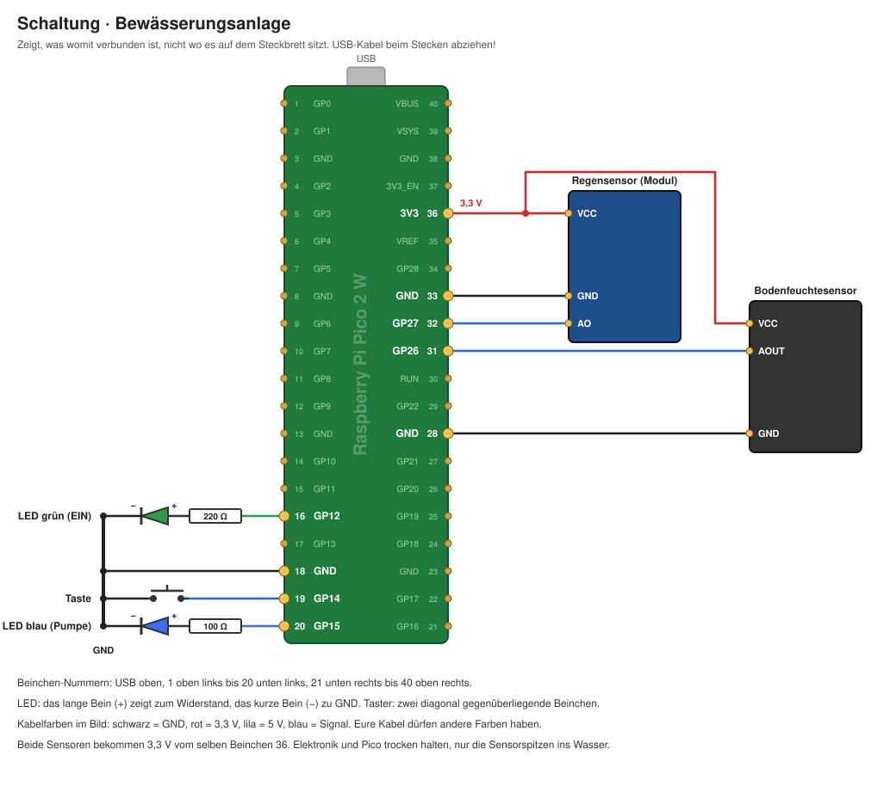
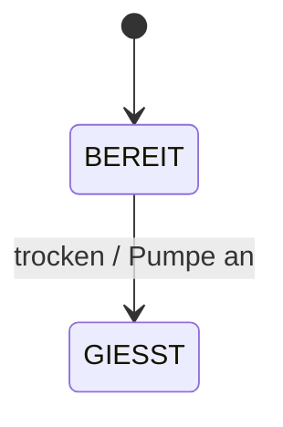
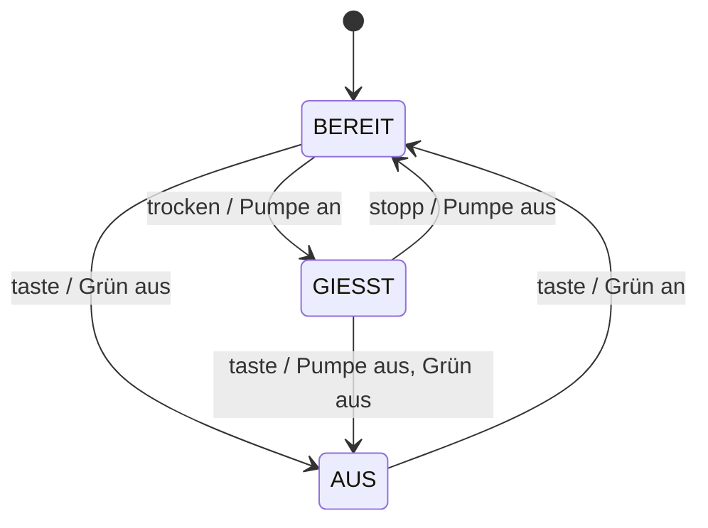

# Bauplan · Bewässerungsanlage

**Team:** 265b-team-05 · **Board:** Raspberry Pi Pico 2 W · **Ziel:** alle Karten bis Ende Woche 6 fertig, Vorführung in Woche 7

## So arbeitet ihr mit diesem Bauplan

1. **Teil 1** enthält eure User Stories in überarbeiteter Form. Fangt mit Karte **K0** an.
2. **Teil 2** sind die Karten für euer Kanban-Board. **Ihr entscheidet**, wer welche Karte nimmt und wann. Eine Karte darf erst starten, wenn alle Karten unter „braucht vorher" fertig sind. Höchstens eine Karte pro Person in „In Arbeit".
3. **Teil 3** erklärt jede Karte Schritt für Schritt. Wo im Code `# TODO` steht, schreibt ihr selbst. Wenn ihr hängt, öffnet die Hilfe **der Reihe nach**: zuerst Tipp 1, dann Tipp 2, die Lösung nur, wenn es gar nicht geht. Notiert im Lernjournal, welche Stufe ihr gebraucht habt.

> ⚠️ Bauteile nur stecken, wenn das USB-Kabel **abgezogen** ist. LEDs immer mit Vorwiderstand.

> 💧 **Wasser und Elektronik:** Nur die **Spitzen** der Sensoren kommen ins Wasser oder in die Erde. Pico, Steckbrett, Kabel und die kleinen Platinen der Module bleiben trocken. Arbeitet über einer Unterlage und habt ein Tuch bereit.

Eine echte Pumpe habt ihr nicht. Die **blaue LED** spielt die Pumpe: Leuchtet sie, wird gegossen. Die **grüne LED** zeigt, dass die Anlage eingeschaltet ist.

---

## Teil 1 · Unsere User Stories (überarbeitet)

### US1 · Gießen, wenn die Erde trocken ist (Muss)

Als Pflanzenbesitzer:in möchte ich, dass meine Pflanze automatisch gegossen wird, wenn die Erde zu trocken ist, damit sie nicht austrocknet.

- [ ] Ist die Anlage EIN und fällt die Bodenfeuchte unter 30 %, geht die Pumpe (blaue LED) innerhalb von 2 s an.
- [ ] Liegt die Bodenfeuchte bei 30 % oder darüber, startet die Pumpe nicht.
- [ ] Die Pumpe läuft, bis die Bodenfeuchte 40 % erreicht, dann geht sie innerhalb von 2 s aus.

### US2 · Nicht gießen bei Regen (Muss)

Als Hausbesitzer:in möchte ich, dass die Anlage bei Regen nicht gießt, damit kein Wasser verschwendet wird.

- [ ] Erkennt der Regensensor Regen, startet die Pumpe nicht, auch wenn die Erde trocken ist.
- [ ] Wird während des Gießens Regen erkannt, geht die Pumpe innerhalb von 2 s aus.

### US3 · Mit einem Knopf ein- und ausschalten (Muss)

Als ältere Gartenbesitzerin möchte ich die Anlage mit einem einzigen Knopfdruck ein- und ausschalten, damit ich sie leicht bedienen kann und meine Pflanzen nicht jeden Tag selbst gießen muss.

- [ ] Ein Tastendruck schaltet zwischen EIN und AUS um. Die grüne LED leuchtet, solange die Anlage EIN ist. Nach dem Einstecken ist sie EIN.
- [ ] Im Zustand AUS läuft die Pumpe nie. Wird während des Gießens ausgeschaltet, geht die Pumpe sofort aus.

> **Was wir geändert haben:** Bei US1 kommt eine **zweite Grenze** dazu: Die Pumpe startet unter 30 %, hört aber erst bei 40 % auf. Mit nur einer Grenze würde sie bei 30 % ständig an- und ausgehen, weil der Messwert immer ein bisschen zittert (Fachwort: **Hysterese**, siehe Woche 5). „Über 30 % bleibt aus" heißt jetzt „bei 30 % oder darüber startet sie nicht", damit klar ist, was bei genau 30 % passiert. US2 war schon gut und bleibt fast gleich. Bei US3 kann man „leicht erreichbare Stelle" am Steckbrett nicht prüfen. Stattdessen zeigt jetzt eine **grüne LED**, ob die Anlage eingeschaltet ist, das hilft beim einfachen Bedienen. Statt einer Pumpe leuchtet eine blaue LED, so wie es eure Lehrkraft festgelegt hat.

**Karte K0:** Kopiert Teil 1 in eure `ANFORDERUNGEN.md` (die alten Stories ersetzen) und committet mit der Nachricht `Stories überarbeitet`.

---

## Teil 2 · Karten für euer Kanban-Board

| Karte | Story | braucht vorher | fertig, wenn … |
|-------|-------|----------------|----------------|
| K0 Stories übernehmen | – | – | `ANFORDERUNGEN.md` enthält Teil 1, committet |
| K1 LEDs und Taste anschließen | US1, US3 | – | Testcode: beide LEDs leuchten, die Taste wird erkannt |
| K2 Sensoren anschließen | US1, US2 | K1 | Testcode zeigt zwei Rohwerte, die sich bei Wasser ändern |
| K3 Sensoren eichen | US1, US2 | K2 | `ROH_TROCKEN`, `ROH_NASS`, `REGEN_SCHWELLE` mit Messwerten in `hardware.py` |
| K4 Zustandsdiagramm zeichnen | US1, US2, US3 | K0 | Mermaid-Diagramm mit 3 Zuständen in `README.md` |
| K5 `naechster_zustand` und `ausgaben` schreiben | US1, US2, US3 | K4 | Tests zu `naechster_zustand` und `ausgaben` in K7 sind grün |
| K6 `ereignis_bestimmen` schreiben | US1, US2, US3 | K4 | Tests zu `ereignis_bestimmen` in K7 sind grün |
| K7 `test_logik.py` | US1, US2, US3 | K5, K6 | alle Tests grün am PC |
| K8 `main.py` am Board | US1, US2, US3 | K3, K7 | Pumpe startet bei trockener Erde, stoppt bei nasser Erde oder Regen |
| K9 Testprotokoll `TESTS.md` | US1, US2, US3 | K8 | jedes Akzeptanzkriterium hat eine Zeile mit ✅ oder ❌ |
| K10 `README.md` fertig | – | K8 | README nach der Vorlage aus Woche 6 |
| K11 Präsentation + Demo-Video | – | K9 | 3-Minuten-Ablauf geprobt, 30-s-Video im Repository |

K1 und K4 können **gleichzeitig** von zwei Personen erledigt werden, ebenso K5 und K6.

---

## Teil 3 · Anleitungen pro Karte

### K1 · LEDs und Taste anschließen

Ihr braucht: LED blau, LED grün, Widerstand **100 Ω** (für Blau), Widerstand 220 Ω, einen Taster, Kabel.

| Bauteil | Anschluss |
|---------|-----------|
| LED grün (Anlage EIN) | **GP12** (Beinchen 16) → 220 Ω → langes Bein, kurzes Bein → GND |
| LED blau (Pumpe) | **GP15** (Beinchen 20) → **100 Ω** → langes Bein, kurzes Bein → GND |
| Taste | **GP14** (Beinchen 19) ↔ GND (Beinchen 18) |



Das Bild zeigt, **was womit verbunden** ist, nicht wo es auf dem Steckbrett sitzt. Es zeigt schon die ganze Schaltung, auch die zwei Sensoren (K2).

Warum 100 Ω bei Blau? Blaue LEDs brauchen fast die ganze Spannung des Pico (ca. 3 V von 3,3 V). Mit 220 Ω leuchten sie nur sehr schwach.

Taster mit vier Beinchen: zwei **diagonal gegenüberliegende** Beinchen verwenden, Taster über die Mittelrille stecken.

Speichert `hardware.py` **auf dem Pico** (Datei → Speichern unter → MicroPython-Gerät). Die Sensor-Funktionen braucht ihr erst in K2 und K3, sie stehen aber schon drin:

```python
# hardware.py – Raspberry Pi Pico 2 W · Bewässerungsanlage
from machine import Pin, ADC

ROH_TROCKEN = 50000      # TODO in K3: Bodensensor in der Luft
ROH_NASS = 20000         # TODO in K3: Bodensensor im Wasserglas
REGEN_SCHWELLE = 40000   # TODO in K3: darunter heißt es "Regen"

_pumpe = Pin(15, Pin.OUT)
_gruen = Pin(12, Pin.OUT)
_taste = Pin(14, Pin.IN, Pin.PULL_UP)
_boden = ADC(26)
_regen = ADC(27)
_vorher = 1


def anzeigen(anlage_ein, pumpe_an):
    """Grüne LED = Anlage EIN, blaue LED = Pumpe läuft."""
    _gruen.value(1 if anlage_ein else 0)
    _pumpe.value(1 if pumpe_an else 0)


def gedrueckt():
    """True einmal pro Tastendruck."""
    global _vorher
    jetzt = _taste.value()
    neu = _vorher == 1 and jetzt == 0
    _vorher = jetzt
    return neu


def _mittelwert(sensor):
    summe = 0
    for i in range(20):
        summe = summe + sensor.read_u16()
    return summe // 20


def boden_roh():
    return _mittelwert(_boden)


def regen_roh():
    return _mittelwert(_regen)


def feuchte():
    """Bodenfeuchte in Prozent: 0 = Luft, 100 = Wasserglas."""
    prozent = (ROH_TROCKEN - boden_roh()) * 100 // (ROH_TROCKEN - ROH_NASS)
    return max(0, min(100, prozent))


def regen():
    """True, wenn auf der Regenplatte Wasser ist."""
    return regen_roh() < REGEN_SCHWELLE
```

Testet in der Thonny-Kommandozeile:

```python
from hardware import *
anzeigen(True, False)    # nur Grün
anzeigen(False, True)    # nur Blau
anzeigen(False, False)   # alles aus
```

Und die Taste (mit **Strg+C** beenden):

```python
import time
while True:
    if gedrueckt():
        print("Taste!")
    time.sleep_ms(50)
```

### K2 · Sensoren anschließen

Beide Sensoren liefern einen **analogen** Wert, wie der Lichtsensor in Woche 4. Beide brauchen 3,3 V vom **selben** Beinchen 36. Dafür steckt ihr ein Kabel von Beinchen 36 in eine freie Reihe des Steckbretts und nehmt von dort zwei Kabel weiter.

**Bodenfeuchtesensor** (Stab mit drei Anschlüssen):

| Sensor-Anschluss | Pico |
|------------------|------|
| VCC | **3V3** (Beinchen 36) |
| AOUT (oder AO, SIG) | **GP26** (Beinchen 31) |
| GND | GND (Beinchen 28) |

**Regensensor** (Platte mit Streifen + kleine Platine mit vier Anschlüssen). Die Platte wird mit zwei Kabeln an die Platine gesteckt, die Platine an den Pico:

| Platinen-Anschluss | Pico |
|--------------------|------|
| VCC | **3V3** (Beinchen 36) |
| GND | GND (Beinchen 33) |
| AO | **GP27** (Beinchen 32) |
| DO | bleibt frei |

Testet in der Thonny-Kommandozeile (`hardware.py` aus K1 ist schon auf dem Pico):

```python
from hardware import boden_roh, regen_roh
import time
while True:
    print("Boden:", boden_roh(), " Regen:", regen_roh())
    time.sleep(1)
```

Steckt den Bodensensor bis zur Markierung in ein Glas Wasser: Der Boden-Wert muss deutlich **kleiner** werden. Tropft mit dem Finger ein paar Tropfen Wasser auf die Regenplatte: Der Regen-Wert muss deutlich **kleiner** werden. Abtrocknen, die Werte gehen wieder hoch.

**Ändert sich nichts?** Prüft, ob AOUT bzw. AO wirklich an GP26 bzw. GP27 steckt, und ob beide Sensoren 3,3 V haben (bei vielen Modulen leuchtet dann ein kleines Lämpchen).

### K3 · Sensoren eichen

„30 % Bodenfeuchte" gibt es erst, wenn ihr dem Pico sagt, was 0 % und 100 % sind. Das heißt **eichen**.

1. **0 %:** Bodensensor trocken in die Luft halten, 5 s warten, `boden_roh()` ablesen. Das ist `ROH_TROCKEN`.
2. **100 %:** Bodensensor bis zur Markierung ins Wasserglas, 5 s warten, `boden_roh()` ablesen. Das ist `ROH_NASS`.
3. **Regen:** `regen_roh()` einmal mit trockener Platte, einmal mit ein paar Tropfen ablesen. `REGEN_SCHWELLE` liegt **in der Mitte** dazwischen.
4. Tragt alle drei Werte in `hardware.py` ein, mit den Messwerten als Kommentar. Beispiel (eure Werte sind anders!):

```python
ROH_TROCKEN = 52300      # gemessen: Sensor in der Luft
ROH_NASS = 24100         # gemessen: Sensor im Wasserglas
REGEN_SCHWELLE = 41000   # gemessen: trocken 58000, nass 24000
```

5. Prüft: `feuchte()` zeigt jetzt in der Luft ungefähr 0 und im Wasser ungefähr 100. Steckt den Sensor in einen Becher **trockene** Erde, dann gießt langsam etwas Wasser dazu: Die Prozent steigen.

### K4 · Zustandsdiagramm zeichnen

Eure Anlage hat **3 Zustände**: `AUS`, `BEREIT` (EIN, Pumpe aus) und `GIESST` (EIN, Pumpe an). Es gibt **3 Ereignisse**:

- `taste`: Jemand drückt den Knopf.
- `trocken`: Feuchte unter 30 % **und** kein Regen.
- `stopp`: Feuchte mindestens 40 % **oder** Regen.

Ergänzt die fehlenden Pfeile und schreibt das Diagramm in `README.md` ([Mermaid im Kursbuch](https://glandl.github.io/Coursebook-maker-reise-grade-9/werkzeuge/mermaid/)):

````markdown

````

<details>
<summary>Tipp 1</summary>

Die Taste führt aus **beiden** EIN-Zuständen nach `AUS`, und aus `AUS` zurück nach `BEREIT`. Von `GIESST` gibt es außerdem einen Pfeil zurück nach `BEREIT`: bei welchem Ereignis?

</details>

<details>
<summary>Lösung</summary>



</details>

**Denkfrage für die Präsentation:** Zwischen 30 % und 40 % gibt es kein Ereignis. Was macht die Anlage, wenn die Feuchte bei 35 % liegt und sie gerade gießt? Und wenn sie gerade nicht gießt?

### K5 · `naechster_zustand` und `ausgaben` schreiben

Nach dem **Automaten-Rezept** aus [Woche 5, Abschnitt 2a](https://glandl.github.io/Coursebook-maker-reise-grade-9/projekte/p1-code-gadget/woche-05-zustandsautomat/). Legt am PC eine Datei `logik.py` an (später auch auf den Pico kopieren):

```python
# logik.py – keine Imports von hardware!

TROCKEN = 30      # darunter: gießen
GENUG = 40        # ab hier: aufhören


def naechster_zustand(zustand, ereignis):
    """Die Pfeile des Zustandsdiagramms, sonst nichts."""
    if zustand == "AUS":
        if ereignis == "taste":
            return "BEREIT"
    elif zustand == "BEREIT":
        # TODO: zwei Pfeile
        pass
    elif zustand == "GIESST":
        # TODO: zwei Pfeile
        pass
    return zustand


def ausgaben(zustand):
    """Liefert (anlage_ein, pumpe_an) für die zwei LEDs."""
    if zustand == "BEREIT":
        return (True, False)
    # TODO: GIESST
    return (False, False)
```

<details>
<summary>Tipp 1</summary>

Jeder Pfeil in eurem Diagramm aus K4 wird zu einem `if ereignis == …: return …` im Block seines Startzustands. Das `pass` löscht ihr, sobald etwas im Block steht.

</details>

<details>
<summary>Tipp 2</summary>

```python
    elif zustand == "GIESST":
        if ereignis == "stopp":
            return ...
        if ereignis == ...:
            return "AUS"
```

Im Zustand `GIESST` ist die Anlage EIN **und** die Pumpe an.

</details>

<details>
<summary>Lösung</summary>

```python
def naechster_zustand(zustand, ereignis):
    """Die Pfeile des Zustandsdiagramms, sonst nichts."""
    if zustand == "AUS":
        if ereignis == "taste":
            return "BEREIT"
    elif zustand == "BEREIT":
        if ereignis == "trocken":
            return "GIESST"
        if ereignis == "taste":
            return "AUS"
    elif zustand == "GIESST":
        if ereignis == "stopp":
            return "BEREIT"
        if ereignis == "taste":
            return "AUS"
    return zustand


def ausgaben(zustand):
    """Liefert (anlage_ein, pumpe_an) für die zwei LEDs."""
    if zustand == "BEREIT":
        return (True, False)
    if zustand == "GIESST":
        return (True, True)
    return (False, False)
```

</details>

### K6 · `ereignis_bestimmen` schreiben

Diese Funktion macht aus Taste, Feuchte und Regen **ein** Ereignis. Sie bekommt alles als Parameter, deshalb könnt ihr sie am PC testen, ganz ohne Wasser. Ergänzt in `logik.py`:

```python
def ereignis_bestimmen(gedrueckt, feuchte, regen):
    """Macht aus Taste, Bodenfeuchte (%) und Regen (True/False) ein Ereignis."""
    # TODO 1: Taste gedrückt → "taste"
    # TODO 2: Regen ODER Feuchte mindestens GENUG → "stopp"
    # TODO 3: Feuchte unter TROCKEN → "trocken"
    return None          # dazwischen: kein Ereignis
```

<details>
<summary>Tipp 1</summary>

Die Reihenfolge ist wichtig: Taste zuerst, dann `stopp`, dann `trocken`. Weil `stopp` vor `trocken` geprüft wird, gibt es bei Regen **nie** `trocken`, auch bei staubtrockener Erde. Genau das will US2. Für „oder" verwendet ihr `or`.

</details>

<details>
<summary>Tipp 2</summary>

```python
    if gedrueckt:
        return "taste"
    if regen or feuchte >= ...:
        return ...
    if feuchte < ...:
        return "trocken"
    return None
```

</details>

<details>
<summary>Lösung</summary>

```python
def ereignis_bestimmen(gedrueckt, feuchte, regen):
    """Macht aus Taste, Bodenfeuchte (%) und Regen (True/False) ein Ereignis."""
    if gedrueckt:
        return "taste"
    if regen or feuchte >= GENUG:
        return "stopp"
    if feuchte < TROCKEN:
        return "trocken"
    return None
```

</details>

### K7 · `test_logik.py`

Legt `test_logik.py` **am PC** im selben Ordner wie `logik.py` an und startet ihn mit dem Interpreter **Lokales Python 3** ([Woche 6, Abschnitt 2b](https://glandl.github.io/Coursebook-maker-reise-grade-9/projekte/p1-code-gadget/woche-06-testen-doku/)).

```python
from logik import naechster_zustand, ausgaben, ereignis_bestimmen

TESTS = [
    ("BEREIT", "trocken", "GIESST"),
    ("GIESST", "stopp",   "BEREIT"),
    # TODO: die anderen drei Pfeile
    ("AUS",    "trocken", "AUS"),          # US3: im Zustand AUS nie gießen!
    ("GIESST", None,      "GIESST"),       # 35 %: weiter gießen
]
AUSGABE_TESTS = [
    ("BEREIT", (True, False)),
    # TODO: GIESST und AUS
]
EREIGNIS_TESTS = [
    # (Taste gedrückt, Feuchte %, Regen, erwartetes Ereignis)
    (False, 20, False, "trocken"),
    (False, 20, True,  "stopp"),           # US2: Regen, nicht gießen
    (False, 35, False, None),              # zwischen den Grenzen
    # TODO: genau 30 %, genau 40 %, Taste bei Regen
]

bestanden = 0
for zustand, ereignis, erwartet in TESTS:
    ergebnis = naechster_zustand(zustand, ereignis)
    if ergebnis == erwartet:
        bestanden = bestanden + 1
        print("ok     ", zustand, "+", ereignis, "→", ergebnis)
    else:
        print("FEHLER ", zustand, "+", ereignis, "→", ergebnis, "erwartet:", erwartet)
for zustand, erwartet in AUSGABE_TESTS:
    ergebnis = ausgaben(zustand)
    if ergebnis == erwartet:
        bestanden = bestanden + 1
        print("ok     ", zustand, "→", ergebnis)
    else:
        print("FEHLER ", zustand, "→", ergebnis, "erwartet:", erwartet)
for taste, prozent, nass, erwartet in EREIGNIS_TESTS:
    ergebnis = ereignis_bestimmen(taste, prozent, nass)
    if ergebnis == erwartet:
        bestanden = bestanden + 1
        print("ok     ", taste, prozent, nass, "→", ergebnis)
    else:
        print("FEHLER ", taste, prozent, nass, "→", ergebnis, "erwartet:", erwartet)

print(bestanden, "von", len(TESTS) + len(AUSGABE_TESTS) + len(EREIGNIS_TESTS), "Tests bestanden")
```

<details>
<summary>Tipp 1 (für die Grenzfälle)</summary>

Bei genau 30 % gilt „unter 30" **nicht**, also `None`. Bei genau 40 % gilt „mindestens 40", also `"stopp"`.

</details>

**Fertig, wenn** alle Tests grün sind. Dann vertauscht absichtlich die Reihenfolge von `stopp` und `trocken`: Welcher Test findet den Fehler?

### K8 · `main.py` am Board

1. Kopiert `logik.py` auf den Pico (Datei → Speichern unter → MicroPython-Gerät).
2. Speichert dort auch `main.py`:

```python
from hardware import anzeigen, gedrueckt, feuchte, regen
from logik import naechster_zustand, ausgaben, ereignis_bestimmen
import time

zustand = "BEREIT"
ein, pumpe = ausgaben(zustand)
anzeigen(ein, pumpe)
letzte_ausgabe = time.ticks_ms()

while True:
    prozent = feuchte()
    nass = regen()
    ereignis = ereignis_bestimmen(gedrueckt(), prozent, nass)
    neu = naechster_zustand(zustand, ereignis)
    if neu != zustand:
        print(zustand, "→", neu)
        zustand = neu
        # TODO: ausgaben(zustand) holen und an anzeigen() weitergeben
    if time.ticks_diff(time.ticks_ms(), letzte_ausgabe) >= 1000:
        print("Feuchte:", prozent, "%  Regen:", nass, " ", zustand)
        letzte_ausgabe = time.ticks_ms()
    time.sleep_ms(50)
```

<details>
<summary>Tipp 1</summary>

Schaut, wie es vor der Schleife gemacht wird: zwei Werte auspacken, dann `anzeigen` aufrufen.

</details>

<details>
<summary>Lösung</summary>

```python
        ein, pumpe = ausgaben(zustand)
        anzeigen(ein, pumpe)
```

</details>

**Fertig, wenn** die blaue LED angeht, sobald der Sensor in der Luft ist, ausgeht, sobald er im Wasser steckt, und auch ausgeht, wenn Tropfen auf die Regenplatte kommen.

### K9 · Testprotokoll `TESTS.md`

Vorlage: [Woche 6, Abschnitt 2c](https://glandl.github.io/Coursebook-maker-reise-grade-9/projekte/p1-code-gadget/woche-06-testen-doku/). Ihr braucht: einen Becher trockene Erde, ein Glas Wasser, ein Tuch. Eine Person bedient die Sensoren, eine beobachtet LEDs und Thonny, eine trägt ein. Eine Zeile pro Akzeptanzkriterium aus Teil 1, z. B.:

```markdown
| # | Ausgangszustand | Aktion | Erwartet | Beobachtet | ok? |
|---|-----------------|--------|----------|------------|-----|
| 1 | BEREIT, Sensor im Wasser | Sensor herausziehen | unter 30 %: Blau an innerhalb 2 s | | |
| 2 | GIESST | Sensor zurück ins Wasser | ab 40 %: Blau aus innerhalb 2 s | | |
| 3 | BEREIT, Sensor in der Luft, Tropfen auf Regenplatte | warten | Blau bleibt aus | | |
| 4 | GIESST | Tropfen auf Regenplatte | Blau aus innerhalb 2 s | | |
| … | | | | | |
```

Jedes ❌ wird eine neue Karte.

### K10 · `README.md` fertig

Nach der Vorlage aus [Woche 6, Abschnitt 4](https://glandl.github.io/Coursebook-maker-reise-grade-9/projekte/p1-code-gadget/woche-06-testen-doku/). Das Zustandsdiagramm aus K4 gehört hinein, die Hardware-Tabellen aus K1 und K2 auch, ebenso eure Eichwerte aus K3.

### K11 · Präsentation + Demo-Video

Ablauf aus [Woche 6, Abschnitt 5](https://glandl.github.io/Coursebook-maker-reise-grade-9/projekte/p1-code-gadget/woche-06-testen-doku/). Für die Demo: Zeigt Thonny mit den laufenden Werten auf dem Beamer. Bodensensor in trockene Erde: Blau geht an („die Pumpe gießt"). Mit einer Spritzflasche oder einem Becher langsam gießen, bis Blau ausgeht. Dann Sensor wieder heraus, Blau an, und jetzt „regnet" es auf die Platte: Blau geht aus. Zum Schluss Taste: Grün aus, nichts passiert mehr. 30-s-Video ins Repository.

---

## Wenn ihr schneller seid

- **Höchstens 10 s am Stück gießen:** Ist der Sensor kaputt oder steckt er nicht in der Erde, würde die Pumpe ewig laufen. Nach 10 s im Zustand `GIESST` hört sie trotzdem auf. Ein neues Ereignis `zu_lange` wie beim Reaktionsspiel in Woche 5.
- **Echte Pumpe:** Eine kleine 5-V-Wasserpumpe braucht viel mehr Strom, als ein Pin liefern kann. Dafür braucht man ein Relais oder einen Transistor. Fragt eure Lehrkraft, ob das geht.
- **Trockenwarnung:** Liegt die Feuchte unter 10 %, aber es regnet, blinkt die grüne LED. Die Pflanze braucht Hilfe, obwohl die Anlage nicht gießen darf.
