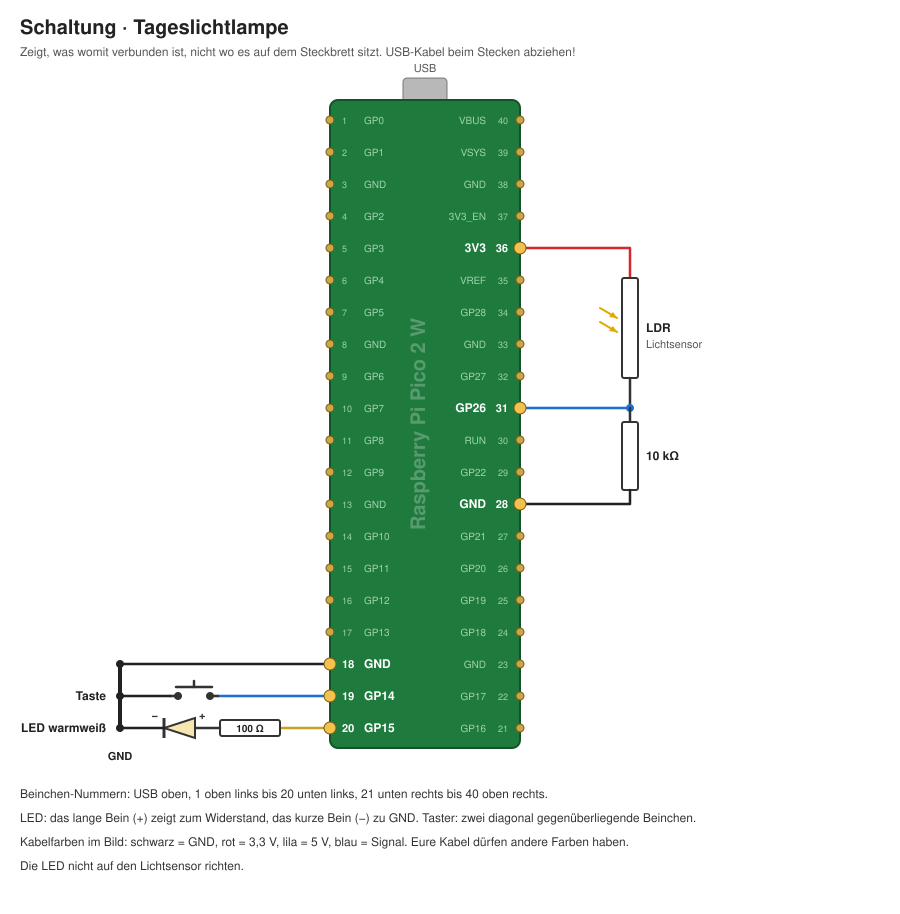
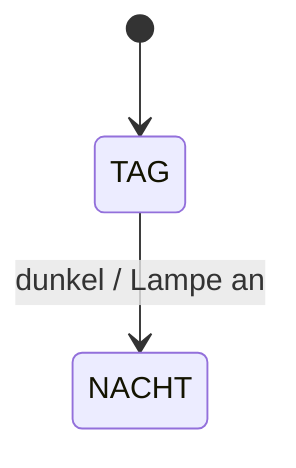
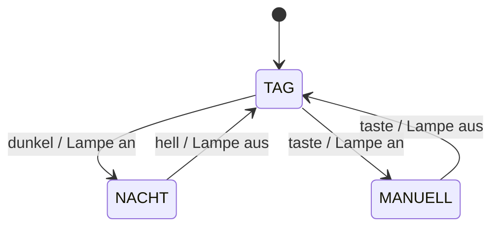

# Bauplan · Tageslichtlampe

**Team:** 265b-team-06 · **Board:** Raspberry Pi Pico 2 W · **Ziel:** alle Karten bis Ende Woche 6 fertig, Vorführung in Woche 7

## So arbeitet ihr mit diesem Bauplan

1. **Teil 1** enthält eure User Stories in überarbeiteter Form. Fangt mit Karte **K0** an.
2. **Teil 2** sind die Karten für euer Kanban-Board. **Ihr entscheidet**, wer welche Karte nimmt und wann. Eine Karte darf erst starten, wenn alle Karten unter „braucht vorher" fertig sind. Höchstens eine Karte pro Person in „In Arbeit".
3. **Teil 3** erklärt jede Karte Schritt für Schritt. Wo im Code `# TODO` steht, schreibt ihr selbst. Wenn ihr hängt, öffnet die Hilfe **der Reihe nach**: zuerst Tipp 1, dann Tipp 2, die Lösung nur, wenn es gar nicht geht. Notiert im Lernjournal, welche Stufe ihr gebraucht habt.

> ⚠️ Bauteile nur stecken, wenn das USB-Kabel **abgezogen** ist. LEDs immer mit Vorwiderstand.

---

## Teil 1 · Unsere User Stories (überarbeitet)

> ℹ️ **Ihr hattet drei verschiedene Gadget-Ideen:** eine Lampe, die bei Tageslicht aus bleibt, eine Erinnerung zum Ausstecken des Ladegeräts und ein Lämpchen, das bei zu hoher Raumtemperatur leuchtet. Ein Team baut **ein** Gadget. Eure Lehrkraft hat die **Tageslichtlampe** ausgewählt, weil ihre zwei Stories gut zusammenpassen und alle Bauteile da sind. Das Temperatur-Lämpchen findet ihr unter „Wenn ihr schneller seid".

### US1 · Licht sparen bei Tageslicht (Muss)

Als umweltbewusste Person möchte ich, dass meine Lampe bei Tageslicht von selbst ausgeht und bei Dunkelheit angeht, damit ich während des Tages Strom spare.

- [ ] Bei Tageslicht (Lichtsensor frei) bleibt die Lampe durchgehend aus.
- [ ] Wird es dunkel (Lichtsensor mit der Hand abgedeckt), geht die Lampe innerhalb von 1 s an. Wird es wieder hell, geht sie innerhalb von 1 s aus.

### US2 · Trotzdem einschalten (Muss)

Als Privatperson möchte ich die Lampe mit einer Taste auch bei Tageslicht einschalten können, damit ich sie benutzen kann, wann ich möchte.

- [ ] Ein Tastendruck bei Tageslicht schaltet die Lampe ein. Sie bleibt an, auch wenn es hell bleibt.
- [ ] Ein weiterer Tastendruck schaltet zurück auf Automatik: Bei Tageslicht geht die Lampe dann innerhalb von 1 s aus.

> **Was wir geändert haben:** Eure US1 sagte nur, wann die Lampe **aus** ist. Damit man prüfen kann, ob sie funktioniert, steht jetzt auch da, dass sie bei Dunkelheit angeht. „Tageslicht" und „dunkel" sind so beschrieben, dass man sie in der Klasse vorführen kann (Sensor abdecken). Eure US2 hieß „Ausschalten", es geht aber ums **Einschalten**, deshalb heißt sie jetzt „Trotzdem einschalten". „Individuell einschalten" ist jetzt genau beschrieben: mit einer Taste. Neu ist das zweite Kriterium, sonst bliebe die Lampe nach dem Einschalten für immer an.

**Karte K0:** Kopiert Teil 1 in eure `ANFORDERUNGEN.md` (ohne den ℹ️-Kasten, die alten Stories ersetzen) und committet mit der Nachricht `Stories überarbeitet`.

---

## Teil 2 · Karten für euer Kanban-Board

| Karte | Story | braucht vorher | fertig, wenn … |
|-------|-------|----------------|----------------|
| K0 Stories übernehmen | – | – | `ANFORDERUNGEN.md` enthält Teil 1, committet |
| K1 Lampe und Taste anschließen | US1, US2 | – | Testcode: LED leuchtet, die Taste wird erkannt |
| K2 Lichtsensor anschließen | US1 | K1 | `helligkeit()` ändert sich beim Abdecken deutlich |
| K3 Zwei Schwellwerte finden | US1 | K2 | `SCHWELLE_DUNKEL` und `SCHWELLE_HELL` stehen mit Messwerten in `logik.py` |
| K4 Zustandsdiagramm zeichnen | US1, US2 | K0 | Mermaid-Diagramm mit 3 Zuständen in `README.md` |
| K5 `naechster_zustand` schreiben | US1, US2 | K4 | Tests zu `naechster_zustand` in K7 sind grün |
| K6 `ereignis_bestimmen` schreiben | US1, US2 | K4 | Tests zu `ereignis_bestimmen` in K7 sind grün |
| K7 `test_logik.py` | US1, US2 | K5, K6 | alle Tests grün am PC |
| K8 `main.py` am Board | US1, US2 | K3, K7 | Lampe geht im Dunkeln an, bei Tag aus, Taste schaltet sie bei Tag ein |
| K9 Testprotokoll `TESTS.md` | US1, US2 | K8 | jedes Akzeptanzkriterium hat eine Zeile mit ✅ oder ❌ |
| K10 `README.md` fertig | – | K8 | README nach der Vorlage aus Woche 6 |
| K11 Präsentation + Demo-Video | – | K9 | 3-Minuten-Ablauf geprobt, 30-s-Video im Repository |

K1 und K4 können **gleichzeitig** von zwei Personen erledigt werden, ebenso K5 und K6.

---

## Teil 3 · Anleitungen pro Karte

### K1 · Lampe und Taste anschließen

Ihr braucht: LED warmweiß, Widerstand **100 Ω**, einen Taster, Kabel.

| Bauteil | Anschluss |
|---------|-----------|
| Taste | **GP14** (Beinchen 19) ↔ GND (Beinchen 18) |
| LED warmweiß (Lampe) | **GP15** (Beinchen 20) → **100 Ω** → langes Bein, kurzes Bein → GND (Beinchen 18) |



Das Bild zeigt, **was womit verbunden** ist, nicht wo es auf dem Steckbrett sitzt. Es zeigt schon die ganze Schaltung, auch den Lichtsensor (K2).

Warum 100 Ω statt 220 Ω? Weiße LEDs brauchen fast die ganze Spannung des Pico (ca. 3 V von 3,3 V). Mit 220 Ω leuchten sie nur sehr schwach.

Taster mit vier Beinchen: zwei **diagonal gegenüberliegende** Beinchen verwenden, Taster über die Mittelrille stecken.

Speichert `hardware.py` **auf dem Pico** (Datei → Speichern unter → MicroPython-Gerät). Die Funktion `helligkeit()` braucht ihr erst in K2, sie steht aber schon drin:

```python
# hardware.py – Raspberry Pi Pico 2 W · Tageslichtlampe
from machine import Pin, ADC

_lampe = Pin(15, Pin.OUT)
_taste = Pin(14, Pin.IN, Pin.PULL_UP)
_sensor = ADC(26)
_vorher = 1


def lampe(an):
    _lampe.value(1 if an else 0)


def gedrueckt():
    """True einmal pro Tastendruck."""
    global _vorher
    jetzt = _taste.value()
    neu = _vorher == 1 and jetzt == 0
    _vorher = jetzt
    return neu


def helligkeit():
    """Umgebungslicht in Prozent (0 = dunkel, 100 = hell)."""
    return _sensor.read_u16() * 100 // 65535
```

Testet in der Thonny-Kommandozeile:

```python
from hardware import *
lampe(True)
lampe(False)
```

Und die Taste (mit **Strg+C** beenden):

```python
import time
while True:
    if gedrueckt():
        print("Taste!")
    time.sleep_ms(50)
```

### K2 · Lichtsensor anschließen

Ihr braucht: Lichtsensor (LDR), Widerstand 10 kΩ, Kabel. Den kennt ihr aus Woche 4.

| Bauteil | Anschluss |
|---------|-----------|
| Lichtsensor (LDR) | **3V3** (Beinchen 36) → LDR → **GP26** (Beinchen 31) → 10 kΩ → GND (Beinchen 28) |

**Achtung, eigenes Licht:** Stellt die LED so, dass sie **nicht** auf den Lichtsensor leuchtet, z. B. auf die andere Seite des Steckbretts. Sonst „sieht" die Lampe ihr eigenes Licht und glaubt, es ist Tag.

Testet in der Thonny-Kommandozeile (`hardware.py` aus K1 ist schon auf dem Pico):

```python
from hardware import helligkeit
import time
while True:
    print(helligkeit())
    time.sleep(0.5)
```

Deckt den Sensor mit der Hand ab: Der Wert muss deutlich kleiner werden.

### K3 · Zwei Schwellwerte finden

Mit nur **einem** Schwellwert flackert die Lampe, wenn die Helligkeit genau an der Grenze liegt (das habt ihr in Woche 4 gesehen). Deshalb gibt es zwei: „dunkel" erst unter `SCHWELLE_DUNKEL`, „hell" erst über `SCHWELLE_HELL`. Dazwischen ändert sich nichts. Fachwort: **Hysterese** ([Woche 5](https://glandl.github.io/Coursebook-maker-reise-grade-9/projekte/p1-code-gadget/woche-05-zustandsautomat/)).

1. Messt mit `helligkeit()` dreimal: normales Klassenlicht, Sensor mit der Hand abgedeckt, Sensor mit der Hand **halb** abgedeckt.
2. Messt noch einmal mit abgedecktem Sensor, während die LED leuchtet (`lampe(True)`). Ist der Wert jetzt höher? Dann leuchtet die LED auf den Sensor, stellt sie weiter weg.
3. Wählt `SCHWELLE_DUNKEL` zwischen „abgedeckt" und „halb abgedeckt", `SCHWELLE_HELL` zwischen „halb abgedeckt" und „Klassenlicht".
4. Tragt beide Werte mit den Messwerten als Kommentar in `logik.py` ein (die Datei legt ihr in K5 an, oder jetzt schon).

Beispiel (eure Werte sind anders!):

```python
SCHWELLE_DUNKEL = 25      # gemessen: abgedeckt 12, abgedeckt mit LED an 14
SCHWELLE_HELL = 50        # gemessen: halb abgedeckt 38, Klasse 72
```

### K4 · Zustandsdiagramm zeichnen

Eure Lampe hat **3 Zustände**:

- `TAG`: Automatik, hell, Lampe aus.
- `NACHT`: Automatik, dunkel, Lampe an.
- `MANUELL`: mit der Taste eingeschaltet, Lampe an.

Es gibt **3 Ereignisse**: `taste`, `dunkel` und `hell`.

Ergänzt die fehlenden Pfeile und schreibt das Diagramm in `README.md` ([Mermaid im Kursbuch](https://glandl.github.io/Coursebook-maker-reise-grade-9/werkzeuge/mermaid/)):

````markdown

````

<details>
<summary>Tipp 1</summary>

Von `NACHT` geht es zurück, wenn es hell wird. Die Taste führt von `TAG` nach `MANUELL` und von `MANUELL` zurück nach `TAG`. Mehr Pfeile braucht ihr nicht.

</details>

<details>
<summary>Lösung</summary>



</details>

**Denkfragen für die Präsentation:** Im Zustand `MANUELL` gibt es keinen Pfeil mit `hell`. Welches Akzeptanzkriterium ist damit erfüllt? Und was passiert, wenn man in der Nacht im Zustand `NACHT` die Taste drückt? Ist das so in Ordnung?

### K5 · `naechster_zustand` schreiben

Nach dem **Automaten-Rezept** aus [Woche 5, Abschnitt 2a](https://glandl.github.io/Coursebook-maker-reise-grade-9/projekte/p1-code-gadget/woche-05-zustandsautomat/). Legt am PC eine Datei `logik.py` an (später auch auf den Pico kopieren):

```python
# logik.py – keine Imports von hardware!

SCHWELLE_DUNKEL = 25      # TODO: euer Wert aus K3, mit Messwerten als Kommentar
SCHWELLE_HELL = 50        # TODO: euer Wert aus K3, mit Messwerten als Kommentar


def naechster_zustand(zustand, ereignis):
    """Die Pfeile des Zustandsdiagramms, sonst nichts."""
    if zustand == "TAG":
        if ereignis == "dunkel":
            return "NACHT"
        # TODO: der Pfeil nach MANUELL
    elif zustand == "NACHT":
        # TODO: ein Pfeil
        pass
    elif zustand == "MANUELL":
        # TODO: ein Pfeil
        pass
    return zustand


def lampe_an(zustand):
    """Leuchtet die Lampe in diesem Zustand?"""
    return zustand == "NACHT" or zustand == "MANUELL"
```

<details>
<summary>Tipp 1</summary>

Jeder Pfeil in eurem Diagramm aus K4 wird zu einem `if ereignis == …: return …` im Block seines Startzustands. Das `pass` löscht ihr, sobald etwas im Block steht.

</details>

<details>
<summary>Lösung</summary>

```python
def naechster_zustand(zustand, ereignis):
    """Die Pfeile des Zustandsdiagramms, sonst nichts."""
    if zustand == "TAG":
        if ereignis == "dunkel":
            return "NACHT"
        if ereignis == "taste":
            return "MANUELL"
    elif zustand == "NACHT":
        if ereignis == "hell":
            return "TAG"
    elif zustand == "MANUELL":
        if ereignis == "taste":
            return "TAG"
    return zustand
```

</details>

### K6 · `ereignis_bestimmen` schreiben

Diese Funktion macht aus Taste und Helligkeit **ein** Ereignis. Sie bekommt beides als Parameter, deshalb könnt ihr sie am PC testen. Ergänzt in `logik.py`:

```python
def ereignis_bestimmen(gedrueckt, helligkeit):
    """Macht aus Taste und Helligkeit ein Ereignis (oder None)."""
    # TODO 1: Taste gedrückt → "taste"
    # TODO 2: unter SCHWELLE_DUNKEL → "dunkel"
    # TODO 3: über SCHWELLE_HELL → "hell"
    return None          # dazwischen: kein Ereignis
```

<details>
<summary>Tipp 1</summary>

Die Taste kommt **zuerst**, sonst könnte man die Lampe bei Tag nie einschalten. Für „unter" verwendet ihr `<`, für „über" `>`.

</details>

<details>
<summary>Lösung</summary>

```python
def ereignis_bestimmen(gedrueckt, helligkeit):
    """Macht aus Taste und Helligkeit ein Ereignis (oder None)."""
    if gedrueckt:
        return "taste"
    if helligkeit < SCHWELLE_DUNKEL:
        return "dunkel"
    if helligkeit > SCHWELLE_HELL:
        return "hell"
    return None
```

</details>

### K7 · `test_logik.py`

Legt `test_logik.py` **am PC** im selben Ordner wie `logik.py` an und startet ihn mit dem Interpreter **Lokales Python 3** ([Woche 6, Abschnitt 2b](https://glandl.github.io/Coursebook-maker-reise-grade-9/projekte/p1-code-gadget/woche-06-testen-doku/)). Die Tests verwenden `SCHWELLE_DUNKEL` und `SCHWELLE_HELL` statt fester Zahlen. So stimmen sie auch noch, wenn ihr die Schwellen ändert.

```python
from logik import naechster_zustand, ereignis_bestimmen, lampe_an
from logik import SCHWELLE_DUNKEL, SCHWELLE_HELL

MITTE = (SCHWELLE_DUNKEL + SCHWELLE_HELL) // 2

TESTS = [
    ("TAG",     "dunkel", "NACHT"),
    ("TAG",     "taste",  "MANUELL"),
    # TODO: die anderen zwei Pfeile
    ("MANUELL", "hell",   "MANUELL"),     # US2: bleibt an, auch bei Tag
    ("TAG",     "hell",   "TAG"),         # US1: bei Tag bleibt sie aus
]
LAMPEN_TESTS = [
    ("NACHT", True),
    # TODO: TAG und MANUELL
]
EREIGNIS_TESTS = [
    # (Taste gedrückt, Helligkeit, erwartetes Ereignis)
    (False, SCHWELLE_DUNKEL - 5, "dunkel"),
    (False, SCHWELLE_HELL + 5,   "hell"),
    (False, MITTE,               None),   # dazwischen: nichts
    # TODO: Taste gedrückt bei Tag
]

bestanden = 0
for zustand, ereignis, erwartet in TESTS:
    ergebnis = naechster_zustand(zustand, ereignis)
    if ergebnis == erwartet:
        bestanden = bestanden + 1
        print("ok     ", zustand, "+", ereignis, "→", ergebnis)
    else:
        print("FEHLER ", zustand, "+", ereignis, "→", ergebnis, "erwartet:", erwartet)
for zustand, erwartet in LAMPEN_TESTS:
    ergebnis = lampe_an(zustand)
    if ergebnis == erwartet:
        bestanden = bestanden + 1
        print("ok     ", zustand, "→", ergebnis)
    else:
        print("FEHLER ", zustand, "→", ergebnis, "erwartet:", erwartet)
for taste, hell, erwartet in EREIGNIS_TESTS:
    ergebnis = ereignis_bestimmen(taste, hell)
    if ergebnis == erwartet:
        bestanden = bestanden + 1
        print("ok     ", taste, hell, "→", ergebnis)
    else:
        print("FEHLER ", taste, hell, "→", ergebnis, "erwartet:", erwartet)

print(bestanden, "von", len(TESTS) + len(LAMPEN_TESTS) + len(EREIGNIS_TESTS), "Tests bestanden")
```

**Fertig, wenn** alle Tests grün sind. Dann baut absichtlich einen Fehler ein (z. B. einen Pfeil `MANUELL → TAG` bei `hell`): Findet ihn der Test?

### K8 · `main.py` am Board

1. Kopiert `logik.py` auf den Pico (Datei → Speichern unter → MicroPython-Gerät).
2. Speichert dort auch `main.py`:

```python
from hardware import lampe, gedrueckt, helligkeit
from logik import naechster_zustand, ereignis_bestimmen, lampe_an
import time

zustand = "TAG"
lampe(False)
print("Tageslichtlampe bereit")

while True:
    ereignis = ereignis_bestimmen(gedrueckt(), helligkeit())
    neu = naechster_zustand(zustand, ereignis)
    if neu != zustand:
        print(zustand, "→", neu)
        zustand = neu
        # TODO: Lampe passend zum neuen Zustand schalten
    time.sleep_ms(50)
```

<details>
<summary>Tipp 1</summary>

`lampe_an(zustand)` liefert `True` oder `False`. Genau das will `lampe()`.

</details>

<details>
<summary>Lösung</summary>

```python
        lampe(lampe_an(zustand))
```

</details>

Startet das Programm, wenn es **hell** ist. Ist es beim Start schon dunkel, geht es im ersten Durchlauf gleich nach `NACHT`.

**Fertig, wenn** die Lampe beim Abdecken angeht, beim Freigeben ausgeht, und die Taste sie bei Tageslicht ein- und wieder auf Automatik schaltet.

### K9 · Testprotokoll `TESTS.md`

Vorlage: [Woche 6, Abschnitt 2c](https://glandl.github.io/Coursebook-maker-reise-grade-9/projekte/p1-code-gadget/woche-06-testen-doku/). Eine Zeile pro Akzeptanzkriterium aus Teil 1, z. B.:

```markdown
| # | Ausgangszustand | Aktion | Erwartet | Beobachtet | ok? |
|---|-----------------|--------|----------|------------|-----|
| 1 | TAG, Sensor frei | 30 s warten | Lampe bleibt aus | | |
| 2 | TAG | Sensor abdecken | Lampe an innerhalb 1 s | | |
| 3 | NACHT | Hand weg | Lampe aus innerhalb 1 s | | |
| 4 | TAG | Taste | Lampe an, bleibt 30 s an | | |
| … | | | | | |
```

Jedes ❌ wird eine neue Karte.

### K10 · `README.md` fertig

Nach der Vorlage aus [Woche 6, Abschnitt 4](https://glandl.github.io/Coursebook-maker-reise-grade-9/projekte/p1-code-gadget/woche-06-testen-doku/). Das Zustandsdiagramm aus K4 gehört hinein, die Hardware-Tabellen aus K1 und K2 auch, ebenso eure Messwerte aus K3.

### K11 · Präsentation + Demo-Video

Ablauf aus [Woche 6, Abschnitt 5](https://glandl.github.io/Coursebook-maker-reise-grade-9/projekte/p1-code-gadget/woche-06-testen-doku/). Für die Demo: „Es ist Tag": Lampe aus, obwohl jemand vorbeigeht. Sensor abdecken („Nacht"): Lampe an. Hand weg: aus. Dann bei Tag die Taste: Lampe an und bleibt an. Nochmal Taste: wieder Automatik, Lampe aus. 30-s-Video ins Repository.

---

## Wenn ihr schneller seid

- **Taste auch in der Nacht:** Bisher passiert in `NACHT` nichts, wenn man die Taste drückt. Ein vierter Zustand `NACHT_AUS` würde die Lampe nachts ausschalten (z. B. zum Schlafen). Wann soll er wieder verlassen werden? Zeichnet zuerst das Diagramm!
- **Temperatur-Lämpchen (eure dritte Idee):** Mit einem Temperatursensor TMP36 leuchtet eine rote LED an GP13, wenn es im Zimmer wärmer als 24 °C ist. Fragt eure Lehrkraft nach dem Sensor und der Anleitung zum Anschließen. Achtung: Er braucht dann den zweiten Analog-Pin **GP27**, weil an GP26 schon der Lichtsensor hängt.
- **Zeitschaltuhr (eure Ladegerät-Idee, vereinfacht):** Im Zustand `MANUELL` geht die Lampe nach 10 Minuten von selbst aus, falls jemand vergessen hat, sie auszuschalten. Ein neues Ereignis `zeit_um` wie beim Reaktionsspiel in Woche 5.
