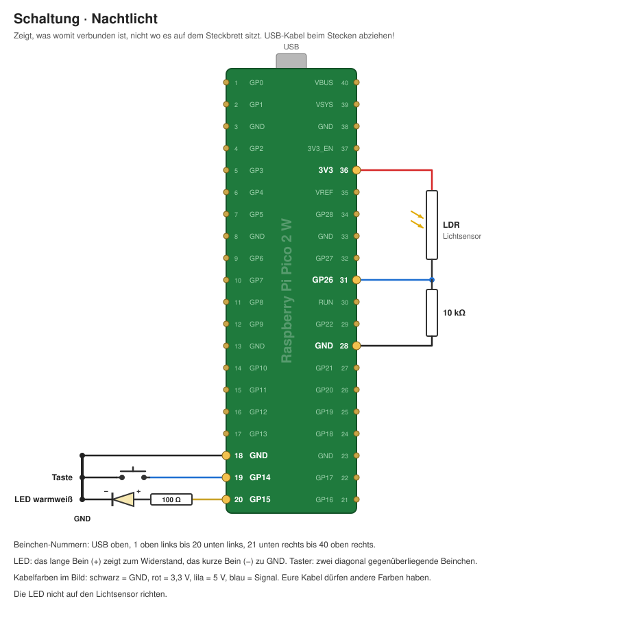
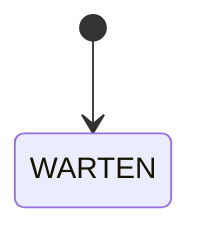
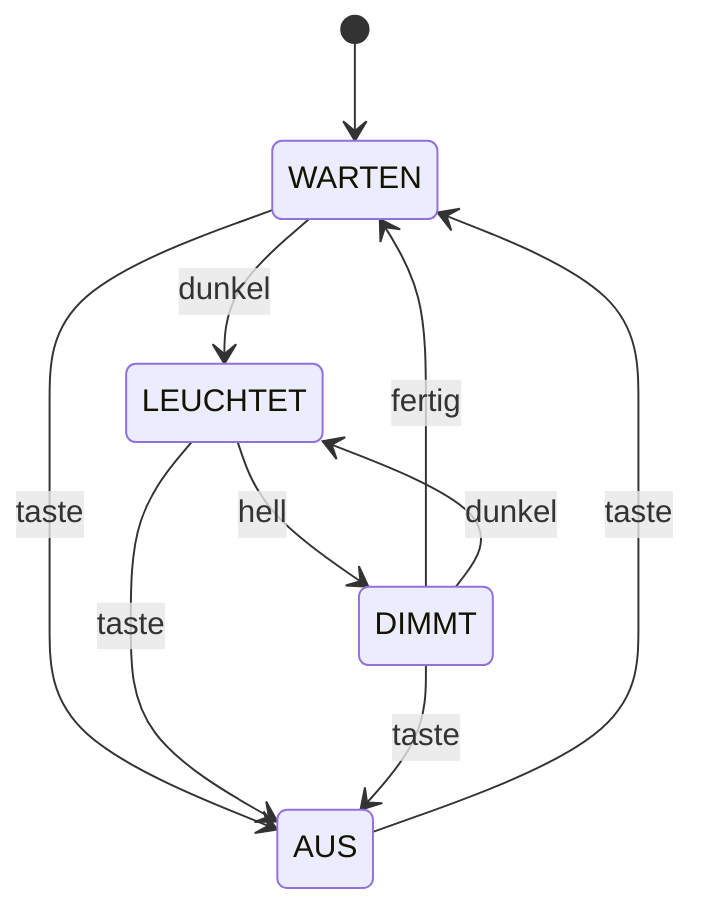

# Bauplan · Nachtlicht mit sanftem Ausgehen

**Team:** 265b-team-07 · **Board:** Raspberry Pi Pico 2 W · **Ziel:** alle Karten bis Ende Woche 6 fertig, Vorführung in Woche 7

## So arbeitet ihr mit diesem Bauplan

1. **Teil 1** enthält eure User Stories in überarbeiteter Form. Fangt mit Karte **K0** an.
2. **Teil 2** sind die Karten für euer Kanban-Board. **Ihr entscheidet**, wer welche Karte nimmt und wann. Eine Karte darf erst starten, wenn alle Karten unter „braucht vorher" fertig sind. Höchstens eine Karte pro Person in „In Arbeit".
3. **Teil 3** erklärt jede Karte Schritt für Schritt. Wo im Code `# TODO` steht, schreibt ihr selbst. Wenn ihr hängt, öffnet die Hilfe **der Reihe nach**: zuerst Tipp 1, dann Tipp 2, die Lösung nur, wenn es gar nicht geht. Notiert im Lernjournal, welche Stufe ihr gebraucht habt.

> ⚠️ Bauteile nur stecken, wenn das USB-Kabel **abgezogen** ist. LEDs immer mit Vorwiderstand.

---

## Teil 1 · Unsere User Stories (überarbeitet)

> ℹ️ **Eure US1 und US2 sind Wort für Wort das Nachtlicht-Beispiel aus Woche 2**, und den fertigen Code dazu gibt es in Woche 5. Damit ihr selbst etwas entwickelt, wird eure Kann-Story **US3 (Sanftes Ausgehen) zur Muss-Story**. US1 und US2 übernehmt ihr aus dem Kursbuch und baut sie in die Dateien `logik.py` und `test_logik.py` um. Bei US3 seid ihr auf euch gestellt, mit Tipps.

### US1 · Licht bei Dunkelheit (Muss)

Als Kind möchte ich, dass das Nachtlicht von selbst angeht, wenn es dunkel wird, damit ich nachts nicht im Finstern aufstehen muss.

- [ ] Bei abgedeckter Hand über dem Sensor geht die LED innerhalb von 1 s an.
- [ ] Bei Tageslicht bleibt die LED aus.
- [ ] Liegt die Helligkeit genau an der Grenze, flackert die LED nicht.

### US2 · Ausschalten (Muss)

Als Elternteil möchte ich das Nachtlicht mit einer Taste ganz ausschalten, damit es tagsüber keinen Strom braucht.

- [ ] Ein Tastendruck schaltet zwischen AUS und AUTOMATIK um. Nach dem Einstecken ist das Nachtlicht in AUTOMATIK.
- [ ] Im Zustand AUS leuchtet die LED nie, auch nicht bei Dunkelheit. Die Taste schaltet sofort aus, ohne langsames Dunklerwerden.

### US3 · Sanftes Ausgehen (Muss)

Als Kind möchte ich, dass das Licht langsam dunkler wird, statt schlagartig auszugehen, damit ich nicht erschrecke.

- [ ] Wird es hell (Hand weg vom Sensor), wird die LED in 3 s (±0,5 s) gleichmäßig dunkler, bis sie aus ist.
- [ ] Wird es während des Dunklerwerdens wieder dunkel, leuchtet die LED sofort wieder ganz hell.

> **Was wir geändert haben:** US1 und US2 bleiben fast gleich. Neu bei US1 ist das Kriterium „flackert nicht": Das braucht zwei Schwellwerte (**Hysterese**, Woche 5). Neu bei US2: Nach dem Einstecken ist das Licht gleich in AUTOMATIK, damit es nachts nach einem Stromausfall wieder funktioniert. US3 hatte keine Akzeptanzkriterien, jetzt stehen eine Zeit (3 s) und das Verhalten beim Wieder-dunkel-Werden da. US3 ist jetzt **Muss**, so wie es eure Lehrkraft festgelegt hat.

**Karte K0:** Kopiert Teil 1 in eure `ANFORDERUNGEN.md` (ohne den ℹ️-Kasten, die alten Stories ersetzen) und committet mit der Nachricht `Stories überarbeitet`.

---

## Teil 2 · Karten für euer Kanban-Board

| Karte | Story | braucht vorher | fertig, wenn … |
|-------|-------|----------------|----------------|
| K0 Stories übernehmen | – | – | `ANFORDERUNGEN.md` enthält Teil 1, committet |
| K1 Licht, Taste und Lichtsensor anschließen | US1, US2, US3 | – | Testcode: LED leuchtet halb und ganz hell, Taste wird erkannt, Helligkeit ändert sich beim Abdecken |
| K2 Zwei Schwellwerte finden | US1 | K1 | `SCHWELLE_DUNKEL` und `SCHWELLE_HELL` stehen mit Messwerten in `logik.py` |
| K3 Zustandsdiagramm zeichnen | US1, US2, US3 | K0 | Mermaid-Diagramm mit 4 Zuständen in `README.md` |
| K4 `naechster_zustand` und `ereignis_bestimmen` | US1, US2, US3 | K3 | Tests dazu in K6 sind grün |
| K5 `led_prozent` schreiben | US3 | K3 | Tests zu `led_prozent` in K6 sind grün |
| K6 `test_logik.py` | US1, US2, US3 | K4, K5 | alle Tests grün am PC |
| K7 `main.py` am Board | US1, US2, US3 | K2, K6 | Licht geht im Dunkeln an, wird bei Helligkeit langsam dunkler, Taste schaltet aus |
| K8 Testprotokoll `TESTS.md` | US1, US2, US3 | K7 | jedes Akzeptanzkriterium hat eine Zeile mit ✅ oder ❌ |
| K9 `README.md` fertig | – | K7 | README nach der Vorlage aus Woche 6 |
| K10 Präsentation + Demo-Video | – | K8 | 3-Minuten-Ablauf geprobt, 30-s-Video im Repository |

K1 und K3 können **gleichzeitig** von zwei Personen erledigt werden, ebenso K4 und K5.

---

## Teil 3 · Anleitungen pro Karte

### K1 · Licht, Taste und Lichtsensor anschließen

Ihr braucht: LED warmweiß, Widerstand **100 Ω**, einen Taster, Lichtsensor (LDR), Widerstand 10 kΩ, Kabel.

| Bauteil | Anschluss |
|---------|-----------|
| Taste | **GP14** (Beinchen 19) ↔ GND (Beinchen 18) |
| LED warmweiß | **GP15** (Beinchen 20) → **100 Ω** → langes Bein, kurzes Bein → GND (Beinchen 18) |
| Lichtsensor (LDR) | **3V3** (Beinchen 36) → LDR → **GP26** (Beinchen 31) → 10 kΩ → GND (Beinchen 28) |



Das Bild zeigt, **was womit verbunden** ist, nicht wo es auf dem Steckbrett sitzt.

Warum 100 Ω statt 220 Ω? Weiße LEDs brauchen fast die ganze Spannung des Pico (ca. 3 V von 3,3 V). Mit 220 Ω leuchten sie nur sehr schwach.

**Achtung, eigenes Licht:** Stellt die LED so, dass sie **nicht** auf den Lichtsensor leuchtet, z. B. auf die andere Seite des Steckbretts.

Neu gegenüber Woche 4: Die LED hängt an **PWM**, so wie der Summer. Damit kann sie nicht nur an und aus, sondern auch halb hell leuchten. PWM schaltet die LED sehr schnell an und aus (1000-mal pro Sekunde). Ist sie länger an als aus, sieht sie für das Auge heller aus.

Speichert `hardware.py` **auf dem Pico** (Datei → Speichern unter → MicroPython-Gerät):

```python
# hardware.py – Raspberry Pi Pico 2 W · Nachtlicht
from machine import Pin, PWM, ADC

_led = PWM(Pin(15))
_led.freq(1000)
_led.duty_u16(0)
_taste = Pin(14, Pin.IN, Pin.PULL_UP)
_sensor = ADC(26)
_vorher = 1


def led(prozent):
    """LED-Helligkeit: 0 = aus, 100 = ganz hell."""
    _led.duty_u16(prozent * 65535 // 100)


def gedrueckt():
    """True einmal pro Tastendruck."""
    global _vorher
    jetzt = _taste.value()
    neu = _vorher == 1 and jetzt == 0
    _vorher = jetzt
    return neu


def helligkeit():
    """Umgebungslicht in Prozent (0 = dunkel, 100 = hell)."""
    return _sensor.read_u16() * 100 // 65535
```

Testet in der Thonny-Kommandozeile:

```python
from hardware import *
led(100)
led(20)
led(0)
helligkeit()      # einmal normal, einmal mit der Hand abgedeckt
```

Und die Taste (mit **Strg+C** beenden):

```python
import time
while True:
    if gedrueckt():
        print("Taste!")
    time.sleep_ms(50)
```

### K2 · Zwei Schwellwerte finden

Mit nur **einem** Schwellwert flackert das Licht, wenn die Helligkeit genau an der Grenze liegt (Woche 4). Deshalb gibt es zwei: „dunkel" erst unter `SCHWELLE_DUNKEL`, „hell" erst über `SCHWELLE_HELL`. Dazwischen ändert sich nichts.

1. Messt mit `helligkeit()` dreimal: normales Klassenlicht, Sensor mit der Hand abgedeckt, Sensor mit der Hand **halb** abgedeckt.
2. Messt noch einmal abgedeckt, während die LED leuchtet (`led(100)`). Ist der Wert jetzt höher? Dann leuchtet die LED auf den Sensor, stellt sie weiter weg.
3. Wählt `SCHWELLE_DUNKEL` zwischen „abgedeckt" und „halb abgedeckt", `SCHWELLE_HELL` zwischen „halb abgedeckt" und „Klassenlicht".

Beispiel (eure Werte sind anders!):

```python
SCHWELLE_DUNKEL = 25      # gemessen: abgedeckt 12, abgedeckt mit LED an 14
SCHWELLE_HELL = 50        # gemessen: halb abgedeckt 38, Klasse 72
```

### K3 · Zustandsdiagramm zeichnen

Startet mit dem Diagramm aus [Woche 5](https://glandl.github.io/Coursebook-maker-reise-grade-9/projekte/p1-code-gadget/woche-05-zustandsautomat/) (`AUS`, `WARTEN`, `LEUCHTET`). Für US3 kommt ein vierter Zustand dazu: `DIMMT` (die LED wird gerade dunkler). Und ein viertes Ereignis: `fertig` (die 3 s Dunklerwerden sind vorbei).

Was sich ändert:

- Von `LEUCHTET` führt `hell` jetzt **nicht mehr** nach `WARTEN`, sondern nach `DIMMT`.
- Aus `DIMMT` gibt es drei Pfeile hinaus: Welche?
- Der Startzustand ist jetzt `WARTEN` (US2: nach dem Einstecken AUTOMATIK).

Schreibt das ganze Diagramm in `README.md` ([Mermaid im Kursbuch](https://glandl.github.io/Coursebook-maker-reise-grade-9/werkzeuge/mermaid/)):

````markdown

````

<details>
<summary>Tipp 1</summary>

Aus `DIMMT`: Die Zeit ist um. Es wird wieder dunkel. Jemand drückt die Taste. Wohin führt jeder dieser Pfeile?

</details>

<details>
<summary>Lösung</summary>



</details>

**Denkfrage für die Präsentation:** Im Zustand `DIMMT` ist es hell, es kommt also in jedem Durchlauf `hell`. Warum bleibt der Automat trotzdem in `DIMMT`?

### K4 · `naechster_zustand` und `ereignis_bestimmen`

Legt am PC eine Datei `logik.py` an (später auch auf den Pico kopieren). Übertragt `naechster_zustand` aus Woche 5 und ergänzt die neuen Pfeile aus K3.

`ereignis_bestimmen` bekommt einen neuen Parameter `dimmen_fertig`. Ihn berechnet die Hauptschleife (K7): Er ist `True`, wenn der Automat in `DIMMT` ist **und** die 3 s vorbei sind.

```python
# logik.py – keine Imports von hardware!

SCHWELLE_DUNKEL = 25      # TODO: euer Wert aus K2, mit Messwerten als Kommentar
SCHWELLE_HELL = 50        # TODO: euer Wert aus K2, mit Messwerten als Kommentar
DIMMZEIT_MS = 3000        # so lange dauert das sanfte Ausgehen


def naechster_zustand(zustand, ereignis):
    """Die Pfeile des Zustandsdiagramms, sonst nichts."""
    # TODO: ein Block pro Zustand, ein if pro Pfeil (8 Pfeile)
    return zustand


def ereignis_bestimmen(gedrueckt, helligkeit, dimmen_fertig):
    """Macht aus Taste, Helligkeit und Dimm-Zeit ein Ereignis (oder None)."""
    # TODO 1: Taste → "taste"
    # TODO 2: dimmen_fertig → "fertig"
    # TODO 3: unter SCHWELLE_DUNKEL → "dunkel"
    # TODO 4: über SCHWELLE_HELL → "hell"
    return None
```

<details>
<summary>Tipp 1</summary>

`naechster_zustand` ist wie in Woche 5, Abschnitt 2c, mit einem zusätzlichen `elif zustand == "DIMMT":` und drei `if` darin. Bei `ereignis_bestimmen` ist die Reihenfolge wichtig: `fertig` muss **vor** `hell` geprüft werden, denn während des Dimmens ist es ja hell.

</details>

<details>
<summary>Tipp 2</summary>

```python
    elif zustand == "LEUCHTET":
        if ereignis == "taste":
            return "AUS"
        if ereignis == "hell":
            return ...
    elif zustand == "DIMMT":
        if ereignis == ...:
            return "WARTEN"
        ...
```

</details>

<details>
<summary>Lösung</summary>

```python
def naechster_zustand(zustand, ereignis):
    """Die Pfeile des Zustandsdiagramms, sonst nichts."""
    if zustand == "AUS":
        if ereignis == "taste":
            return "WARTEN"
    elif zustand == "WARTEN":
        if ereignis == "taste":
            return "AUS"
        if ereignis == "dunkel":
            return "LEUCHTET"
    elif zustand == "LEUCHTET":
        if ereignis == "taste":
            return "AUS"
        if ereignis == "hell":
            return "DIMMT"
    elif zustand == "DIMMT":
        if ereignis == "taste":
            return "AUS"
        if ereignis == "fertig":
            return "WARTEN"
        if ereignis == "dunkel":
            return "LEUCHTET"
    return zustand


def ereignis_bestimmen(gedrueckt, helligkeit, dimmen_fertig):
    """Macht aus Taste, Helligkeit und Dimm-Zeit ein Ereignis (oder None)."""
    if gedrueckt:
        return "taste"
    if dimmen_fertig:
        return "fertig"
    if helligkeit < SCHWELLE_DUNKEL:
        return "dunkel"
    if helligkeit > SCHWELLE_HELL:
        return "hell"
    return None
```

</details>

### K5 · `led_prozent` schreiben

Das ist der Kern von US3. Die Funktion sagt, **wie hell** die LED gerade sein soll. Sie bekommt den Zustand und wie viele Millisekunden der Automat schon in diesem Zustand ist. Ergänzt in `logik.py`:

```python
def led_prozent(zustand, ms_im_zustand):
    """Helligkeit der LED in Prozent (0 bis 100)."""
    if zustand == "LEUCHTET":
        return 100
    if zustand == "DIMMT":
        # TODO: bei 0 ms → 100, nach DIMMZEIT_MS → 0, dazwischen gleichmäßig weniger
        pass
    return 0
```

Überlegt zuerst auf Papier: Wie hell soll die LED nach 0 ms, 1500 ms, 3000 ms und 4000 ms sein?

<details>
<summary>Tipp 1</summary>

Nach der Hälfte der Zeit (1500 ms) ist die Hälfte weg: 50 %. Der Anteil, der schon vorbei ist, ist `ms_im_zustand * 100 // DIMMZEIT_MS` Prozent. Was bleibt übrig?

</details>

<details>
<summary>Tipp 2</summary>

```python
        prozent = 100 - ms_im_zustand * 100 // DIMMZEIT_MS
        return max(0, ...)
```

`max(0, …)` sorgt dafür, dass es nach 3000 ms nicht negativ wird.

</details>

<details>
<summary>Lösung</summary>

```python
def led_prozent(zustand, ms_im_zustand):
    """Helligkeit der LED in Prozent (0 bis 100)."""
    if zustand == "LEUCHTET":
        return 100
    if zustand == "DIMMT":
        prozent = 100 - ms_im_zustand * 100 // DIMMZEIT_MS
        return max(0, prozent)
    return 0
```

</details>

### K6 · `test_logik.py`

Legt `test_logik.py` **am PC** im selben Ordner wie `logik.py` an und startet ihn mit dem Interpreter **Lokales Python 3** ([Woche 6, Abschnitt 2b](https://glandl.github.io/Coursebook-maker-reise-grade-9/projekte/p1-code-gadget/woche-06-testen-doku/)).

```python
from logik import naechster_zustand, ereignis_bestimmen, led_prozent
from logik import SCHWELLE_DUNKEL, SCHWELLE_HELL

TESTS = [
    ("WARTEN",   "dunkel", "LEUCHTET"),
    ("LEUCHTET", "hell",   "DIMMT"),
    ("DIMMT",    "dunkel", "LEUCHTET"),     # US3: sofort wieder hell
    # TODO: die anderen fünf Pfeile
    ("AUS",      "dunkel", "AUS"),          # US2: AUS heißt nie Licht
    ("DIMMT",    "hell",   "DIMMT"),        # weiter dimmen
]
EREIGNIS_TESTS = [
    # (Taste, Helligkeit, dimmen_fertig, erwartetes Ereignis)
    (False, SCHWELLE_DUNKEL - 5, False, "dunkel"),
    (False, SCHWELLE_HELL + 5,   True,  "fertig"),   # fertig vor hell!
    # TODO: hell ohne fertig, Mitte zwischen den Schwellen, Taste
]
LED_TESTS = [
    # (Zustand, ms im Zustand, erwartete Prozent)
    ("LEUCHTET", 5000, 100),
    ("DIMMT",    0,    100),
    ("DIMMT",    1500, 50),
    # TODO: DIMMT nach 3000 und 4000 ms, WARTEN, AUS
]

bestanden = 0
for zustand, ereignis, erwartet in TESTS:
    ergebnis = naechster_zustand(zustand, ereignis)
    if ergebnis == erwartet:
        bestanden = bestanden + 1
        print("ok     ", zustand, "+", ereignis, "→", ergebnis)
    else:
        print("FEHLER ", zustand, "+", ereignis, "→", ergebnis, "erwartet:", erwartet)
for taste, hell, fertig, erwartet in EREIGNIS_TESTS:
    ergebnis = ereignis_bestimmen(taste, hell, fertig)
    if ergebnis == erwartet:
        bestanden = bestanden + 1
        print("ok     ", taste, hell, fertig, "→", ergebnis)
    else:
        print("FEHLER ", taste, hell, fertig, "→", ergebnis, "erwartet:", erwartet)
for zustand, ms, erwartet in LED_TESTS:
    ergebnis = led_prozent(zustand, ms)
    if ergebnis == erwartet:
        bestanden = bestanden + 1
        print("ok     ", zustand, ms, "ms →", ergebnis, "%")
    else:
        print("FEHLER ", zustand, ms, "ms →", ergebnis, "% erwartet:", erwartet)

print(bestanden, "von", len(TESTS) + len(EREIGNIS_TESTS) + len(LED_TESTS), "Tests bestanden")
```

**Fertig, wenn** alle Tests grün sind. Dann löscht absichtlich das `max(0, …)`: Welcher Test findet den Fehler?

### K7 · `main.py` am Board

Die Hauptschleife merkt sich, **seit wann** der Automat im aktuellen Zustand ist. Daraus berechnet sie zwei Dinge: ob das Dimmen fertig ist, und wie hell die LED sein soll. Die LED wird in **jedem** Durchlauf neu gesetzt, nicht nur beim Zustandswechsel, sonst würde sie beim Dimmen nicht langsam dunkler.

1. Kopiert `logik.py` auf den Pico (Datei → Speichern unter → MicroPython-Gerät).
2. Speichert dort auch `main.py`:

```python
from hardware import led, gedrueckt, helligkeit
from logik import naechster_zustand, ereignis_bestimmen, led_prozent, DIMMZEIT_MS
import time

zustand = "WARTEN"
seit = time.ticks_ms()            # wann der aktuelle Zustand begonnen hat
led(0)
print("Nachtlicht bereit (AUTOMATIK)")

while True:
    ms_im_zustand = time.ticks_diff(time.ticks_ms(), seit)
    fertig = zustand == "DIMMT" and ms_im_zustand >= DIMMZEIT_MS
    ereignis = ereignis_bestimmen(gedrueckt(), helligkeit(), fertig)
    neu = naechster_zustand(zustand, ereignis)
    if neu != zustand:
        print(zustand, "→", neu)
        zustand = neu
        # TODO: der neue Zustand beginnt jetzt
        ms_im_zustand = 0
    # TODO: LED auf die richtige Helligkeit setzen
    time.sleep_ms(20)
```

<details>
<summary>Tipp 1</summary>

Beim Zustandswechsel merkt ihr euch die aktuelle Zeit in `seit`, so wie vor der Schleife. Für die LED ruft ihr `led_prozent` auf und gebt das Ergebnis an `led()` weiter.

</details>

<details>
<summary>Lösung</summary>

```python
    if neu != zustand:
        print(zustand, "→", neu)
        zustand = neu
        seit = time.ticks_ms()
        ms_im_zustand = 0
    led(led_prozent(zustand, ms_im_zustand))
    time.sleep_ms(20)
```

</details>

Warum hier 20 ms statt 50 ms Pause? Damit das Dunklerwerden in kleinen Schritten passiert und nicht ruckelt.

**Fertig, wenn** das Licht beim Abdecken angeht, beim Wegnehmen der Hand in etwa 3 s ausgeht, beim erneuten Abdecken während des Dimmens sofort wieder hell ist, und die Taste sofort ausschaltet.

### K8 · Testprotokoll `TESTS.md`

Vorlage: [Woche 6, Abschnitt 2c](https://glandl.github.io/Coursebook-maker-reise-grade-9/projekte/p1-code-gadget/woche-06-testen-doku/). Für die 3 s braucht ihr eine Stoppuhr (Handy). Am besten filmt ihr das Dunklerwerden und zählt die Zeit im Video nach. Eine Zeile pro Akzeptanzkriterium aus Teil 1, z. B.:

```markdown
| # | Ausgangszustand | Aktion | Erwartet | Beobachtet | ok? |
|---|-----------------|--------|----------|------------|-----|
| 1 | WARTEN | Sensor abdecken | LED an innerhalb 1 s | | |
| 2 | LEUCHTET | Hand weg, Stoppuhr | LED gleichmäßig dunkler, aus nach 3 s (±0,5 s) | | |
| 3 | DIMMT | nach 1 s wieder abdecken | LED sofort ganz hell | | |
| 4 | LEUCHTET | Taste | LED sofort aus | | |
| … | | | | | |
```

Jedes ❌ wird eine neue Karte.

### K9 · `README.md` fertig

Nach der Vorlage aus [Woche 6, Abschnitt 4](https://glandl.github.io/Coursebook-maker-reise-grade-9/projekte/p1-code-gadget/woche-06-testen-doku/). Das Zustandsdiagramm aus K3 gehört hinein, die Hardware-Tabelle aus K1 auch, ebenso eure Messwerte aus K2. Schreibt dazu, was ihr gegenüber dem Beispiel aus Woche 5 verändert habt.

### K10 · Präsentation + Demo-Video

Ablauf aus [Woche 6, Abschnitt 5](https://glandl.github.io/Coursebook-maker-reise-grade-9/projekte/p1-code-gadget/woche-06-testen-doku/). Für die Demo: Raum etwas abdunkeln, damit man das Dunklerwerden gut sieht. Sensor abdecken („Nacht"): Licht an. Hand weg („Morgen"): Das Licht wird langsam dunkler. Während des Dunklerwerdens wieder abdecken: sofort hell. Zum Schluss Taste: sofort aus. Vergleicht in der Präsentation euren Automaten mit dem aus Woche 5: Was ist dazugekommen? 30-s-Video ins Repository.

---

## Wenn ihr schneller seid

- **Natürlicheres Dimmen:** Das Auge sieht den Unterschied zwischen 10 % und 20 % viel stärker als zwischen 80 % und 90 %. Deshalb wirkt das Dimmen am Ende schneller als am Anfang. Probiert, in `led()` mit `prozent * prozent * 65535 // 10000` zu rechnen. Wie wirkt es jetzt?
- **Sanftes Angehen:** Auch beim Einschalten wird die LED in 1 s langsam hell. Ein neuer Zustand `WIRD_HELL`. Zeichnet zuerst das Diagramm!
- **Einschlaf-Timer:** Das Nachtlicht dimmt nach 10 Minuten im Zustand `LEUCHTET` auf 20 %, damit es beim Schlafen nicht stört.
