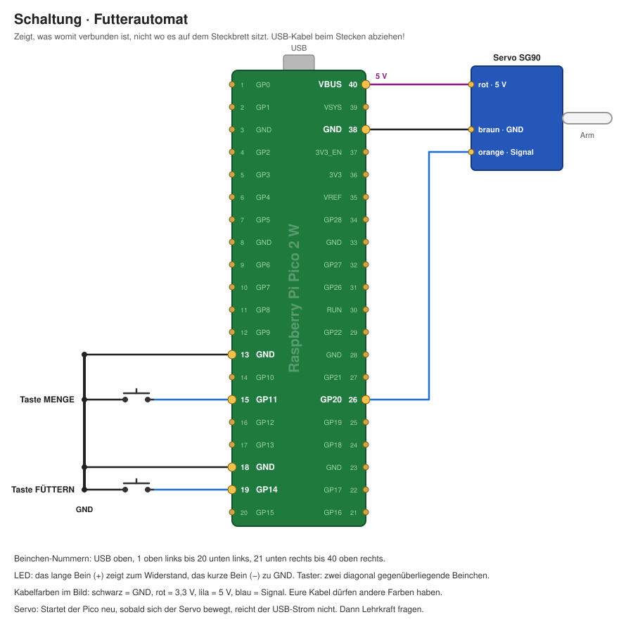
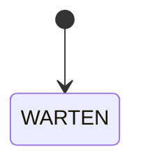
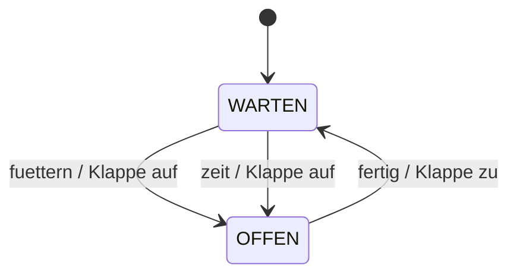

# Bauplan · Futterautomat

**Team:** 265b-team-08 · **Board:** Raspberry Pi Pico 2 W · **Ziel:** alle Karten bis Ende Woche 6 fertig, Vorführung in Woche 7

## So arbeitet ihr mit diesem Bauplan

1. **Teil 1** enthält eure User Stories in überarbeiteter Form. Fangt mit Karte **K0** an.
2. **Teil 2** sind die Karten für euer Kanban-Board. **Ihr entscheidet**, wer welche Karte nimmt und wann. Eine Karte darf erst starten, wenn alle Karten unter „braucht vorher" fertig sind. Höchstens eine Karte pro Person in „In Arbeit".
3. **Teil 3** erklärt jede Karte Schritt für Schritt. Wo im Code `# TODO` steht, schreibt ihr selbst. Wenn ihr hängt, öffnet die Hilfe **der Reihe nach**: zuerst Tipp 1, dann Tipp 2, die Lösung nur, wenn es gar nicht geht. Notiert im Lernjournal, welche Stufe ihr gebraucht habt.

> ⚠️ Bauteile nur stecken, wenn das USB-Kabel **abgezogen** ist.

**So funktioniert euer Automat:** Ein Servo-Motor hält mit seinem Arm eine Öffnung an einem Futterbehälter zu. Zum Füttern dreht er den Arm weg, das Futter rieselt heraus, nach einer bestimmten Zeit dreht er zurück. Eine Waage habt ihr nicht. Die **Menge** ergibt sich deshalb aus der **Zeit**, die die Klappe offen ist. Wie viel Gramm pro Sekunde herausfallen, messt ihr einmal mit einer Küchenwaage (K3). Statt echtem Tierfutter nehmt ihr in der Schule trockenen **Reis**.

---

## Teil 1 · Unsere User Stories (überarbeitet)

### US1 · Futter automatisch ausgeben (Muss)

Als Tierhalter:in möchte ich, dass mein Tier zur eingestellten Uhrzeit automatisch die eingestellte Futtermenge bekommt, damit es regelmäßig gefüttert wird, auch wenn ich nicht da bin.

- [ ] Zur Fütterungszeit (eingestellt: `FUETTER_STUNDE`:`FUETTER_MINUTE`) öffnet sich die Klappe innerhalb von 2 s.
- [ ] Die Klappe schließt sich von selbst, sobald die eingestellte Menge ausgegeben ist.
- [ ] Zu einer Fütterungszeit wird genau **einmal** gefüttert.

### US2 · Futtermenge einstellen (Muss)

Als Tierhalter:in möchte ich die Futtermenge einstellen können, damit mein Tier die richtige Portion bekommt.

- [ ] Jeder Druck auf die Taste MENGE erhöht die Menge um 10 g. Nach 100 g kommt wieder 10 g. Nach dem Einstecken sind 50 g eingestellt.
- [ ] Thonny zeigt nach jedem Druck die eingestellte Menge.
- [ ] Die ausgegebene Menge weicht höchstens 10 g von der eingestellten ab (dreimal 50 g ausgeben und mit einer Küchenwaage wiegen).

### US3 · Futter per Knopfdruck ausgeben (Muss)

Als Tierhalter:in möchte ich per Knopfdruck füttern können, damit mein Tier auch außerhalb der Fütterungszeit etwas bekommt.

- [ ] Ein Druck auf die Taste FÜTTERN öffnet die Klappe innerhalb von 1 s, die eingestellte Menge wird ausgegeben, dann schließt die Klappe von selbst.
- [ ] Während die Klappe offen ist, ändern die Tasten nichts.

> **Was wir geändert haben:** Ohne Waage kann der Automat nicht merken, wann 50 g draußen sind. Deshalb steuert die **Zeit** die Menge, und „stoppt bei 50 g" heißt jetzt „schließt, sobald die Menge ausgegeben ist". Statt ±5 g sind jetzt **±10 g** erlaubt: Futter fällt nie ganz gleichmäßig, und ihr sollt ehrlich messen können. Bei US1 ist neu, dass nur **einmal** gefüttert wird, sonst würde der Automat die ganze Minute lang immer wieder öffnen. Bei US2 gibt es jetzt eine Taste MENGE und eine Anzeige in Thonny, damit man sieht, was eingestellt ist. US1 und US3 hatten beide das Kriterium „stoppt automatisch", das steht jetzt bei jeder Story kurz drin. US4 (Futterstand) braucht einen Sensor im Behälter, sie steht unter „Wenn ihr schneller seid".

**Karte K0:** Kopiert Teil 1 in eure `ANFORDERUNGEN.md` (die alten Stories ersetzen) und committet mit der Nachricht `Stories überarbeitet`.

---

## Teil 2 · Karten für euer Kanban-Board

| Karte | Story | braucht vorher | fertig, wenn … |
|-------|-------|----------------|----------------|
| K0 Stories übernehmen | – | – | `ANFORDERUNGEN.md` enthält Teil 1, committet |
| K1 Tasten und Servo anschließen | US1, US2, US3 | – | Testcode: beide Tasten werden erkannt, Servo dreht auf 0° und 90° |
| K2 Futterbehälter bauen | US1, US3 | K1 | Klappe zu: kein Reis fällt heraus. Klappe offen: Reis rieselt |
| K3 Gramm pro Sekunde messen | US2 | K2 | `GRAMM_PRO_SEKUNDE` steht mit drei Messwerten in `logik.py` |
| K4 Uhr im Pico prüfen | US1 | – | `uhrzeit()` zeigt die richtige Uhrzeit (±1 min) |
| K5 Zustandsdiagramm zeichnen | US1, US3 | K0 | Mermaid-Diagramm in `README.md` |
| K6 `naechster_zustand` und `ereignis_bestimmen` | US1, US3 | K5 | Tests dazu in K8 sind grün |
| K7 `naechste_menge` und `offen_ms` | US2 | K0 | Tests dazu in K8 sind grün |
| K8 `test_logik.py` | US1, US2, US3 | K6, K7 | alle Tests grün am PC |
| K9 `main.py` am Board | US1, US2, US3 | K3, K4, K8 | FÜTTERN gibt die eingestellte Menge aus, zur Fütterungszeit öffnet die Klappe einmal |
| K10 Testprotokoll `TESTS.md` | US1, US2, US3 | K9 | jedes Akzeptanzkriterium hat eine Zeile mit ✅ oder ❌ |
| K11 `README.md` fertig | – | K9 | README nach der Vorlage aus Woche 6 |
| K12 Präsentation + Demo-Video | – | K10 | 3-Minuten-Ablauf geprobt, 30-s-Video im Repository |

K1, K4 und K5 können **gleichzeitig** von drei Personen erledigt werden, ebenso K6 und K7. Für K2 sammelt schon vorher Material (siehe dort).

---

## Teil 3 · Anleitungen pro Karte

### K1 · Tasten und Servo anschließen

Ihr braucht: zwei Taster, einen Servo SG90, Kabel.

| Bauteil | Anschluss |
|---------|-----------|
| Taste MENGE | **GP11** (Beinchen 15) ↔ GND (Beinchen 13) |
| Taste FÜTTERN | **GP14** (Beinchen 19) ↔ GND (Beinchen 18) |
| Servo, Kabel **rot** | **VBUS** (Beinchen 40), 5 V vom USB-Kabel |
| Servo, Kabel **braun** | GND (Beinchen 38) |
| Servo, Kabel **orange** | **GP20** (Beinchen 26) |



Das Bild zeigt, **was womit verbunden** ist, nicht wo es auf dem Steckbrett sitzt.

Taster mit vier Beinchen: zwei **diagonal gegenüberliegende** Beinchen verwenden, Taster über die Mittelrille stecken.

**Startet der Pico neu, sobald sich der Servo bewegt?** Dann reicht der Strom vom USB-Kabel nicht. Probiert ein anderes USB-Kabel oder einen anderen USB-Anschluss am Laptop, sonst fragt eure Lehrkraft.

Speichert `hardware.py` **auf dem Pico** (Datei → Speichern unter → MicroPython-Gerät). Die Funktion `uhrzeit()` braucht ihr erst in K4, sie steht aber schon drin:

```python
# hardware.py – Raspberry Pi Pico 2 W · Futterautomat
from machine import Pin, PWM
import time

WINKEL_ZU = 0           # TODO in K2: bei diesem Winkel ist die Öffnung zu
WINKEL_OFFEN = 90       # TODO in K2: bei diesem Winkel rieselt der Reis

_fuettern = Pin(14, Pin.IN, Pin.PULL_UP)
_menge = Pin(11, Pin.IN, Pin.PULL_UP)
_servo = PWM(Pin(20))
_servo.freq(50)
_vorher_fuettern = 1
_vorher_menge = 1


def servo(winkel):
    """Dreht den Servo auf 0–180 Grad."""
    # 0,5 ms (0°) bis 2,5 ms (180°) von 20 ms
    _servo.duty_u16(1638 + winkel * (8192 - 1638) // 180)


def klappe(offen):
    servo(WINKEL_OFFEN if offen else WINKEL_ZU)


def fuettern_gedrueckt():
    """True einmal pro Druck auf FÜTTERN."""
    global _vorher_fuettern
    jetzt = _fuettern.value()
    neu = _vorher_fuettern == 1 and jetzt == 0
    _vorher_fuettern = jetzt
    return neu


def menge_gedrueckt():
    """True einmal pro Druck auf MENGE."""
    global _vorher_menge
    jetzt = _menge.value()
    neu = _vorher_menge == 1 and jetzt == 0
    _vorher_menge = jetzt
    return neu


def uhrzeit():
    """Liefert (stunde, minute, sekunde) der Uhr im Pico."""
    t = time.localtime()
    return t[3], t[4], t[5]
```

Testet in der Thonny-Kommandozeile:

```python
from hardware import *
servo(0)
servo(90)
servo(180)
klappe(False)
```

Und die Tasten (mit **Strg+C** beenden):

```python
import time
while True:
    if fuettern_gedrueckt():
        print("FÜTTERN")
    if menge_gedrueckt():
        print("MENGE")
    time.sleep_ms(50)
```

### K2 · Futterbehälter bauen

Ihr braucht: eine leere, trockene Plastikflasche (0,5 l), Karton, Klebeband oder Heißkleber (fragt eure Lehrkraft), Schere, einen Becher, trockenen Reis. Den Servo-Arm (das weiße Plastikteil) steckt ihr oben auf den Servo.

1. Schneidet den Boden der Flasche ab. Die Flasche steht **kopfüber**, der Deckel ist unten. Das ist euer Trichter.
2. Schraubt den Deckel ab. Die Öffnung ist zu groß? Klebt ein Stück Karton mit einem kleineren Loch (ca. 1 cm) darüber.
3. Befestigt die Flasche an einem Karton-Ständer so, dass unten ein Becher Platz hat.
4. Klebt den Servo so neben die Öffnung, dass sein Arm die Öffnung **zudeckt**. Ein Stück Karton am Arm macht ihn breiter.
5. Probiert in der Kommandozeile mit `servo(…)` aus, bei welchem Winkel die Öffnung genau zu ist und bei welchem sie ganz frei ist. Tragt die zwei Winkel in `hardware.py` ein (`WINKEL_ZU`, `WINKEL_OFFEN`).
6. Füllt Reis ein. Mit `klappe(False)` darf nichts herausfallen, mit `klappe(True)` muss es rieseln.

> ⚠️ Der Servo ist schwach. Drückt den Arm nicht mit der Hand gegen seine Richtung, und klemmt ihn nicht ein, sonst gehen die kleinen Zahnräder kaputt.

Macht ein Foto vom Aufbau für die README.

### K3 · Gramm pro Sekunde messen

Der Automat weiß nicht, wie viel Reis herausfällt. Das müsst ihr ihm sagen.

1. Stellt einen leeren Becher auf die Küchenwaage und drückt auf „Tara" (0 g).
2. Füllt die Flasche **halb voll** mit Reis.
3. Öffnet die Klappe für genau 2 s:

```python
from hardware import klappe
import time
klappe(True)
time.sleep(2)
klappe(False)
```

4. Wiegt den Reis im Becher. Wiederholt das dreimal und notiert alle drei Werte.
5. Rechnet: `GRAMM_PRO_SEKUNDE = Mittelwert ÷ 2`. Beispiel: 18 g, 22 g und 20 g ergeben im Mittel 20 g, also 10 g pro Sekunde.
6. Tragt den Wert mit den Messwerten als Kommentar in `logik.py` ein (die Datei legt ihr in K6 an, oder jetzt schon):

```python
GRAMM_PRO_SEKUNDE = 10.0   # gemessen in 2 s: 18 g, 22 g, 20 g
```

**Fällt sehr viel oder sehr wenig?** Macht das Loch kleiner oder größer. Gut sind 5 bis 20 g pro Sekunde.

**Denkfrage für die Präsentation:** Fällt aus einer fast leeren Flasche gleich viel Reis pro Sekunde wie aus einer vollen? Probiert es aus!

### K4 · Uhr im Pico prüfen

Der Pico 2 W hat eine eingebaute Uhr. Sie kennt die richtige Zeit aber nur, wenn **Thonny sie beim Verbinden stellt**. Ein extra Uhren-Modul braucht ihr nicht.

1. In Thonny: **Extras → Optionen → Interpreter**. Prüft, dass das Häkchen bei **„Echtzeituhr synchronisieren"** (englisch *Synchronize device's real time clock*) und **„Lokale Zeit verwenden"** (*Use local time in real time clock*) gesetzt ist.
2. Pico neu verbinden (Stopp-Taste in Thonny).
3. In der Kommandozeile: `from hardware import uhrzeit` und `uhrzeit()`. Stimmt die Uhrzeit mit eurem Handy überein?

**Wichtig:** Wird der Pico vom Strom getrennt, vergisst er die Uhrzeit und beginnt bei 0:00. Für die Vorführung den Pico also über Thonny am Laptop lassen.

### K5 · Zustandsdiagramm zeichnen

Euer Automat hat **2 Zustände**: `WARTEN` (Klappe zu) und `OFFEN` (Klappe offen, Futter rieselt). Es gibt **3 Ereignisse**:

- `fuettern`: Jemand drückt FÜTTERN.
- `zeit`: Es ist Fütterungszeit (und es wurde zu dieser Zeit noch nicht gefüttert).
- `fertig`: Die Klappe war lange genug offen für die eingestellte Menge.

Die Taste MENGE ist **kein** Ereignis des Automaten. Sie ändert nur eine Zahl (die Menge), nicht den Zustand.

Ergänzt die Pfeile und schreibt das Diagramm in `README.md` ([Mermaid im Kursbuch](https://glandl.github.io/Coursebook-maker-reise-grade-9/werkzeuge/mermaid/)):

````markdown

````

<details>
<summary>Tipp 1</summary>

Zwei Pfeile führen von `WARTEN` nach `OFFEN`, einer zurück.

</details>

<details>
<summary>Lösung</summary>



</details>

**Denkfrage für die Präsentation:** In `OFFEN` gibt es keinen Pfeil mit `fuettern`. Welches Akzeptanzkriterium ist damit erfüllt?

### K6 · `naechster_zustand` und `ereignis_bestimmen`

Nach dem **Automaten-Rezept** aus [Woche 5, Abschnitt 2a](https://glandl.github.io/Coursebook-maker-reise-grade-9/projekte/p1-code-gadget/woche-05-zustandsautomat/). Legt am PC eine Datei `logik.py` an (später auch auf den Pico kopieren):

```python
# logik.py – keine Imports von hardware!

FUETTER_STUNDE = 7
FUETTER_MINUTE = 30
GRAMM_PRO_SEKUNDE = 10.0   # TODO: euer Wert aus K3, mit Messwerten als Kommentar


def naechster_zustand(zustand, ereignis):
    """Die Pfeile des Zustandsdiagramms, sonst nichts."""
    # TODO: drei Pfeile
    return zustand


def ist_fuetterzeit(stunde, minute):
    """True während der ganzen Fütterungsminute."""
    return stunde == FUETTER_STUNDE and minute == FUETTER_MINUTE


def ereignis_bestimmen(gedrueckt, fuetterzeit, ms_offen, menge):
    """Macht aus Taste, Uhrzeit und Öffnungszeit ein Ereignis (oder None).

    fuetterzeit: True, wenn jetzt gefüttert werden soll (und noch nicht wurde).
    ms_offen: wie lange die Klappe schon offen ist.
    """
    # TODO 1: Taste → "fuettern"
    # TODO 2: Fütterungszeit → "zeit"
    # TODO 3: ms_offen mindestens offen_ms(menge) → "fertig"
    return None
```

`offen_ms(menge)` schreibt ihr in K7. Bis dahin funktioniert `ereignis_bestimmen` noch nicht ganz.

<details>
<summary>Tipp 1</summary>

`naechster_zustand`: Im Block `WARTEN` zwei `if`, im Block `OFFEN` eines. `ereignis_bestimmen`: drei `if` in der Reihenfolge der TODOs, für „mindestens" `>=`.

</details>

<details>
<summary>Lösung</summary>

```python
def naechster_zustand(zustand, ereignis):
    """Die Pfeile des Zustandsdiagramms, sonst nichts."""
    if zustand == "WARTEN":
        if ereignis == "fuettern":
            return "OFFEN"
        if ereignis == "zeit":
            return "OFFEN"
    elif zustand == "OFFEN":
        if ereignis == "fertig":
            return "WARTEN"
    return zustand


def ereignis_bestimmen(gedrueckt, fuetterzeit, ms_offen, menge):
    if gedrueckt:
        return "fuettern"
    if fuetterzeit:
        return "zeit"
    if ms_offen >= offen_ms(menge):
        return "fertig"
    return None
```

</details>

### K7 · `naechste_menge` und `offen_ms`

Zwei kleine Rechen-Funktionen für US2. Ergänzt in `logik.py`:

```python
def naechste_menge(menge):
    """Menge nach einem Druck auf MENGE: +10 g, nach 100 g wieder 10 g."""
    # TODO
    return menge


def offen_ms(menge):
    """So viele Millisekunden muss die Klappe für diese Menge (g) offen sein."""
    # TODO: Menge ÷ Gramm pro Sekunde ergibt Sekunden, mal 1000 ergibt ms
    return 0
```

<details>
<summary>Tipp 1</summary>

`naechste_menge`: Ist die Menge schon 100 (oder mehr), kommt 10 zurück, sonst `menge + 10`.
`offen_ms`: Bei 10 g pro Sekunde braucht ihr für 50 g genau 5 s, also 5000 ms. `int(…)` macht daraus eine ganze Zahl.

</details>

<details>
<summary>Lösung</summary>

```python
def naechste_menge(menge):
    """Menge nach einem Druck auf MENGE: +10 g, nach 100 g wieder 10 g."""
    if menge >= 100:
        return 10
    return menge + 10


def offen_ms(menge):
    """So viele Millisekunden muss die Klappe für diese Menge (g) offen sein."""
    return int(menge / GRAMM_PRO_SEKUNDE * 1000)
```

</details>

### K8 · `test_logik.py`

Legt `test_logik.py` **am PC** im selben Ordner wie `logik.py` an und startet ihn mit dem Interpreter **Lokales Python 3** ([Woche 6, Abschnitt 2b](https://glandl.github.io/Coursebook-maker-reise-grade-9/projekte/p1-code-gadget/woche-06-testen-doku/)). Die Tests rechnen mit `offen_ms(50)` statt mit festen Zahlen, damit sie auch nach K3 noch stimmen.

```python
from logik import naechster_zustand, ereignis_bestimmen, ist_fuetterzeit
from logik import naechste_menge, offen_ms, FUETTER_STUNDE, FUETTER_MINUTE

TESTS = [
    ("WARTEN", "fuettern", "OFFEN"),
    # TODO: die anderen zwei Pfeile
    ("OFFEN",  "fuettern", "OFFEN"),       # US3: Taste ändert nichts, solange offen
    ("WARTEN", "fertig",   "WARTEN"),      # kein Pfeil: bleibt
]
EREIGNIS_TESTS = [
    # (Taste, Fütterungszeit, ms offen, Menge, erwartetes Ereignis)
    (True,  False, 0,                  50, "fuettern"),
    (False, True,  0,                  50, "zeit"),
    (False, False, offen_ms(50) - 100, 50, None),       # noch nicht genug
    # TODO: genau offen_ms(50) → "fertig"
]
ZEIT_TESTS = [
    (FUETTER_STUNDE, FUETTER_MINUTE,     True),
    (FUETTER_STUNDE, FUETTER_MINUTE + 1, False),
    # TODO: eine ganz andere Uhrzeit
]
MENGEN_TESTS = [
    (50,  60),
    (100, 10),                            # nach 100 g wieder 10 g
    # TODO: 10 → ?  und 90 → ?
]

bestanden = 0
anzahl = 0
for zustand, ereignis, erwartet in TESTS:
    anzahl = anzahl + 1
    ergebnis = naechster_zustand(zustand, ereignis)
    if ergebnis == erwartet:
        bestanden = bestanden + 1
        print("ok     ", zustand, "+", ereignis, "→", ergebnis)
    else:
        print("FEHLER ", zustand, "+", ereignis, "→", ergebnis, "erwartet:", erwartet)
for taste, zeit, ms, menge, erwartet in EREIGNIS_TESTS:
    anzahl = anzahl + 1
    ergebnis = ereignis_bestimmen(taste, zeit, ms, menge)
    if ergebnis == erwartet:
        bestanden = bestanden + 1
        print("ok     ", taste, zeit, ms, menge, "→", ergebnis)
    else:
        print("FEHLER ", taste, zeit, ms, menge, "→", ergebnis, "erwartet:", erwartet)
for stunde, minute, erwartet in ZEIT_TESTS:
    anzahl = anzahl + 1
    ergebnis = ist_fuetterzeit(stunde, minute)
    if ergebnis == erwartet:
        bestanden = bestanden + 1
        print("ok     ", stunde, ":", minute, "→", ergebnis)
    else:
        print("FEHLER ", stunde, ":", minute, "→", ergebnis, "erwartet:", erwartet)
for menge, erwartet in MENGEN_TESTS:
    anzahl = anzahl + 1
    ergebnis = naechste_menge(menge)
    if ergebnis == erwartet:
        bestanden = bestanden + 1
        print("ok     ", menge, "g →", ergebnis, "g")
    else:
        print("FEHLER ", menge, "g →", ergebnis, "g erwartet:", erwartet)

print(bestanden, "von", anzahl, "Tests bestanden")
```

**Fertig, wenn** alle Tests grün sind. Dann baut absichtlich einen Fehler ein (z. B. `> 100` statt `>= 100` in `naechste_menge`): Findet ihn der Test?

### K9 · `main.py` am Board

Die Hauptschleife merkt sich drei Dinge:

- `menge`: die eingestellte Menge (US2).
- `geoeffnet_um`: wann die Klappe aufgegangen ist. Daraus wird `ms_offen`.
- `gefuettert_um`: zu welcher Uhrzeit zuletzt automatisch gefüttert wurde. So wird in der Fütterungsminute nur **einmal** gefüttert (US1).

1. Kopiert `logik.py` auf den Pico (Datei → Speichern unter → MicroPython-Gerät).
2. Speichert dort auch `main.py`:

```python
from hardware import klappe, fuettern_gedrueckt, menge_gedrueckt, uhrzeit
from logik import naechster_zustand, ereignis_bestimmen, ist_fuetterzeit
from logik import naechste_menge, FUETTER_STUNDE, FUETTER_MINUTE
import time

zustand = "WARTEN"
menge = 50
geoeffnet_um = time.ticks_ms()
gefuettert_um = None
klappe(False)
print("Uhrzeit im Pico:", uhrzeit())
print("Fütterungszeit:", FUETTER_STUNDE, ":", FUETTER_MINUTE, " Menge:", menge, "g")

while True:
    if zustand == "WARTEN" and menge_gedrueckt():
        # TODO: Menge erhöhen und in Thonny anzeigen
        pass

    stunde, minute, sekunde = uhrzeit()
    jetzt_fuettern = ist_fuetterzeit(stunde, minute) and gefuettert_um != (stunde, minute)
    ms_offen = time.ticks_diff(time.ticks_ms(), geoeffnet_um)

    ereignis = ereignis_bestimmen(fuettern_gedrueckt(), jetzt_fuettern, ms_offen, menge)
    neu = naechster_zustand(zustand, ereignis)
    if neu != zustand:
        print(stunde, ":", minute, zustand, "→", neu, "(", ereignis, ")")
        zustand = neu
        if zustand == "OFFEN":
            geoeffnet_um = time.ticks_ms()
            if ereignis == "zeit":
                gefuettert_um = (stunde, minute)
            # TODO: Klappe auf
        else:
            # TODO: Klappe zu, ausgegebene Menge in Thonny zeigen
            pass
    time.sleep_ms(50)
```

`stunde, minute, sekunde = uhrzeit()` packt die drei Werte, die `uhrzeit()` liefert, in drei Variablen aus.

<details>
<summary>Tipp 1</summary>

Für die Menge: `menge = naechste_menge(menge)`, dann `print`. Für die Klappe: `klappe(True)` bzw. `klappe(False)`.

</details>

<details>
<summary>Lösung</summary>

```python
    if zustand == "WARTEN" and menge_gedrueckt():
        menge = naechste_menge(menge)
        print("Menge:", menge, "g")
```

```python
        if zustand == "OFFEN":
            geoeffnet_um = time.ticks_ms()
            if ereignis == "zeit":
                gefuettert_um = (stunde, minute)
            klappe(True)
        else:
            klappe(False)
            print(menge, "g ausgegeben")
```

</details>

**Zum Ausprobieren** stellt `FUETTER_STUNDE` und `FUETTER_MINUTE` in `logik.py` auf die Uhrzeit in **zwei Minuten** und schaut, ob die Klappe dann aufgeht, und zwar nur einmal.

**Fertig, wenn** FÜTTERN die eingestellte Menge ausgibt, MENGE die Menge in 10-g-Schritten ändert und die Klappe zur Fütterungszeit genau einmal aufgeht.

### K10 · Testprotokoll `TESTS.md`

Vorlage: [Woche 6, Abschnitt 2c](https://glandl.github.io/Coursebook-maker-reise-grade-9/projekte/p1-code-gadget/woche-06-testen-doku/). Ihr braucht Reis, einen Becher und die Küchenwaage. Eine Zeile pro Akzeptanzkriterium aus Teil 1, z. B.:

```markdown
| # | Ausgangszustand | Aktion | Erwartet | Beobachtet | ok? |
|---|-----------------|--------|----------|------------|-----|
| 1 | WARTEN, Fütterungszeit in 2 min | warten | Klappe öffnet zur Fütterungszeit innerhalb 2 s | | |
| 2 | nach Test 1 | bis Minutenende warten | Klappe öffnet kein zweites Mal | | |
| 3 | WARTEN, 50 g | MENGE drücken | Thonny zeigt 60 g | | |
| 4 | WARTEN, 50 g | 3× FÜTTERN, jedes Mal wiegen | jedes Mal 40–60 g | | |
| … | | | | | |
```

Jedes ❌ wird eine neue Karte.

### K11 · `README.md` fertig

Nach der Vorlage aus [Woche 6, Abschnitt 4](https://glandl.github.io/Coursebook-maker-reise-grade-9/projekte/p1-code-gadget/woche-06-testen-doku/). Das Zustandsdiagramm aus K5 gehört hinein, die Hardware-Tabelle aus K1, das Foto aus K2 und eure Messwerte aus K3.

### K12 · Präsentation + Demo-Video

Ablauf aus [Woche 6, Abschnitt 5](https://glandl.github.io/Coursebook-maker-reise-grade-9/projekte/p1-code-gadget/woche-06-testen-doku/). Für die Demo: Zeigt Thonny auf dem Beamer. Stellt vorher die Fütterungszeit auf eine Minute während eurer Präsentation. Zuerst Menge auf 30 g stellen und FÜTTERN drücken: Reis in den Becher, Becher auf die Waage. Dann wartet ihr gemeinsam auf die Fütterungszeit: Die Klappe geht von selbst auf. 30-s-Video ins Repository.

---

## Wenn ihr schneller seid

- **Futterstand anzeigen (eure US4):** Ein Lichtsensor (LDR + 10 kΩ an GP26) unten seitlich in der Flasche, eine LED gegenüber: Ist die Flasche leer, fällt Licht auf den Sensor. Dann leuchtet eine Warn-LED an GP15, und es wird nicht mehr gefüttert. Fragt eure Lehrkraft nach den Bauteilen.
- **Zwei Fütterungszeiten:** Morgens und abends. Statt zwei Variablen braucht ihr eine Liste `FUETTERZEITEN = [(7, 30), (18, 0)]`, und `ist_fuetterzeit` prüft, ob `(stunde, minute)` in der Liste ist.
- **Rütteln gegen Verstopfen:** Bleibt der Reis hängen, öffnet und schließt der Servo die Klappe während `OFFEN` ein paarmal schnell.
